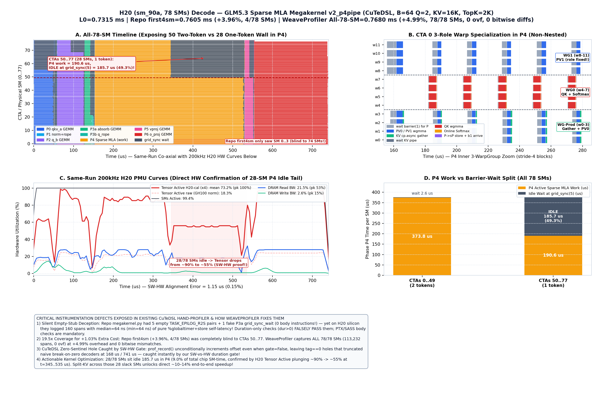

# WeaveProfiler (wp)
简体中文 | [English](README_EN.md)

WeaveProfiler 是一套面向 GPU 核内（intra-kernel）低开销插桩、软硬件时间线对齐、以及配合 AI Coding Agent 完成算子优化闭环的工具集。它在不修改生产源码、不改动 kernel 调用栈的前提下，对核内各阶段打点，验证插桩保真度，并把结果与硬件采样指标合并到同一条时间线上，供 Agent 或人工据此判断优化是否有效。

适用对象包括 Sparse Attention、GDN、MoE 等复杂持久 kernel，以及常见的 CUDA / HIP / CuTeDSL / Triton 算子。

---

## 一、定位与快速上手

### 支持范围

| 维度 | 支持内容 |
| --- | --- |
| 硬件 | NVIDIA H20（`sm_90a`）、NVIDIA B300（`sm_100a` / `sm_103a`）、AMD Instinct MI308X（`gfx942`） |
| 前端语言 | CUDA C++、HIP C++、CuTeDSL、Triton（NVIDIA 与 AMD） |
| Agent | 原生支持 Claude Code 与 OpenAI Codex CLI；其他命令行 Agent 可通过 `guard-exec` 包装 |

### 两步接入

```bash
git clone https://github.com/ziyuhuang123/WeaveProfiler.git
python3 -B WeaveProfiler/run.py install-agent \
  --workspace /path/to/your_kernel_repo \
  --protect kernel.cu \
  --card h20
```

`install-agent` 会一次性写入 MCP 配置、Hook 配置与 Skill 说明。随后进入算子目录直接运行 `claude` 或 `codex` 即可，无需额外配置。

若使用无交互方式，可用包装命令：

```bash
python3 -B WeaveProfiler/run.py guard-exec \
  --workspace /path/to/your_kernel_repo \
  -- codex exec "对基线 kernel 采样并分析跨 SM 负载不均"
```

---

## 二、从 0 到插桩完成的实测耗时

测试环境：NVIDIA H20（`sm_90a`），GPU 4 实测。

输入为完全未插桩的原始源码，从 0 开始依次完成：定位插桩点 → 规则注入生成影子代码 → 编译 → 实卡 ABBA 测速与逐字节输出核对 → 四道保真门禁 → 必要时自动循环外提重测 → 通过并签发 `seal.json`。

### 1. Triton 3.6 Sparse / Flash Attention（外部调用方 0 行修改）

**纯确定性规则路径（0 次 LLM 调用）**

| 阶段 | 耗时 | 结果 |
| --- | --- | --- |
| 首轮定位 | 2 ms | — |
| 规则注入 | 25.6 ms | — |
| JIT / 运行 / 解码 | 1.93 s | 首轮合计 1.96 s；探针位于内层循环，开销 +19.9%，未过门禁 |
| 自动循环外提 | 42.4 ms | — |
| JIT / 运行 / 解码 | 1.28 s | — |
| **总计** | **3.29 s** | **PASS**：开销 +4.95%，0 字节差异，0 溢出，3,072 spans |

**LLM 语义定位路径**（`deepseek-v4.1-flash-1017`，`effort=low`）

| 阶段 | 耗时 |
| --- | --- |
| 首轮定位 | 5.09 s |
| 注入 | 40.0 ms |
| 运行 | 2.00 s |
| 第 2 轮自动外提 | 1.33 s |
| **总计** | **约 8.5 s** |

### 2. CUDA C++ 多文件 `.so` Sparse TopK MQA（0 `__global__` 签名改动，0 Host 改动）

配置：`deepseek-v4.1-flash-1017`（`effort=low`）+ 确定性展开 + 自动循环外提。

| 阶段 | 耗时 | 结果 |
| --- | --- | --- |
| 首轮定位 | 10.01 s | — |
| 确定性展开 | 21.8 ms | — |
| 并行 `L0` / `L_inst` 编译与实卡运行 | 8.71 s | 首轮合计 18.75 s；探针在内层循环，触发 +20.1% 开销与溢出门禁 |
| 第 2 轮自动外提（0 次 LLM 调用） | 30.4 ms | — |
| `L0` 缓存命中的增量编译 / 运行 / 封签 | 7.75 s | — |
| **总计** | **26.53 s** | **PASS 封签**：开销 +5.70%，0 spill，0 字节差异，0 溢出，`seal_verified=true` |

关于定位深度的说明：若把首轮定位设为慢思考深度（例如 `qwen4-max` + `reasoning_effort=max`），仅单次定位就耗时 189 s。因此 `identify_source` 默认首轮使用 `low`（5–12 s），仅在失败修复回合自动提升为 `max`。

### 3. `ziyuhuang123/weave` 的 348 行 `sm90_fp8_mqa_logits.cuh`（`CUTLASS_GLOBAL __launch_bounds__`）

从 0 定位 + 确定性规则展开：

| 环节 | 耗时 / 结果 |
| --- | --- |
| `offline` 启发式定位 | 25 ms |
| `deepseek-v4.1-flash-1017`（`low`）定位 | 11.72 s；识别 `load/compute/wait/mma/store` 5 个阶段，`zero_sig_change=true` |
| `.cubin` `cudaLibrary_t` 编译 / 加载 / 运行 / 解码 | 2.83 s，`STO_ENTRY == 1` |

### 4. 后续优化迭代（第 2 轮及以后，命中 `L0` 编译缓存）

| 前端 | 单轮耗时 |
| --- | --- |
| Triton | 约 1.3–2.0 s |
| CUDA C++ `.so` | 约 7.0–7.8 s |

---

## 三、核心工程设计

### 3.1 寄存器压缩与低扰动核内录制

- **`WP_CTX_1R`**：把槽位号（`slot`，高 16 bit）、写入游标（`cur`，低 15 bit）与溢出停用标志（符号位）压缩进单个 32-bit 寄存器。录制缓冲区元数据放在 `__constant__ wp_fi_c` 中，走常量缓存，占用 0 B SMEM，也不占用每线程通用寄存器。附加开关 `-DWP_CTX_1R_NOINLINE` 把冷路径抽离为 `__noinline__` 辅助函数，降低主循环的寄存器压力。
- **`WP_SMEM_ZREG`**：面向使用 `setmaxnreg` 或寄存器极度紧张的核函数，把上下文放入 16 B static `__shared__`，并配 `__noinline__` 写入函数，使循环体内常驻 0 个额外寄存器。
- **访存与计时**：使用 16 字节流式写指令 `st.global.cs.v4.u32`，避免污染 L2 中的业务数据；计时支持 `%globaltimer`（`-DWP_TIMER=0`）与 `%clock64` 局部时钟 + OPEN/CLOSE 双锚点校准（`-DWP_TIMER=1`）；支持无控制流分裂的 PTX 谓词记录与相邻阶段时间戳合并（`WP_TRANS_PRED`）。

### 3.2 四语言支持与零调用栈改动

**CUDA C++（`recorders/cuda_cpp/wp_lite.cuh`）与 HIP C++（`recorders/hip_cpp/wp_lite_hip.h`）**

- `__global__` 入口不新增任何参数，通过 `__constant__ wp_fi_c` / `__device__ wp_g` 与主机侧 `wp_attach` 绑定。
- `__device__` 子函数调用链不改签名：通过 `WP_KERNEL_SCOPE` + `WP_DEVICE_SCOPE` + `WP_SYNC_CURSOR_OUT/IN`，经由 `wp_g.cur[slot]` 同步游标，无需把上下文参数层层透传。
- 多文件 `.so` 支持 `-DWP_DEFINE_HOST_API` 导出 `extern "C" wp_init/wp_reset/wp_dump/wp_free`，Python 侧用 `weaveprof.WpSoController` 直接控制。
- 运行时 `.cubin` JIT（如 DeepGEMM / `weave` 的 `cudaLibrary_t`）通过 `wp_attach_library(lib, &buf)` 绑定，保持 `STO_ENTRY == 1`，不新增 `__global__` 符号。

**Triton（NVIDIA / AMD，`recorders/triton/wp_triton.py`、`wp_triton_amd.py`）与 CuTeDSL（`recorders/cutedsl/wp_cute.py`）**

- 规则引擎把原核函数名替换为同名透明代理（`_FiTritonProxy` / `_FiCuteProxy` / `_FiCuteDescriptor`，同时支持模块函数与类方法），外部 Python 调用代码 `kernel[grid](...)` 或 `obj.method(...)` 0 行改动。
- 运行时自动从 `wp_attach(buf)` 注入录制缓冲区；Triton 代理保留未插桩 L0 的 `@triton.autotune`，并直接复用其胜出配置。

### 3.3 影子副本与沙箱隔离

- **独立影子副本**：所有插桩、编译、运行都在工作区之外的独立 `L0`（未插桩）与 `L_inst`（插桩）副本中完成，不触碰生产源码；封签前再次校验生产源码的 SHA-256。
- **内容寻址 `L0` 缓存与并行构建**：`L0` 构建产物按源码树哈希缓存，与 `L_inst` 并行编译，复测时跳过重复的基线构建。
- **Linux `bwrap` 只读挂载 + 100 ms 守护线程**：`guard-exec` 在 Linux 下自动用 `bubblewrap` 把 `WeaveProfiler` 目录、`.claude/`、`.codex/`、`.agents/skills/weaveprofiler/`、`.mcp.json` 与 `.supervisor.key` 挂为只读，并运行 100 ms 周期的后台守护线程，监控并自动回滚未封签的篡改。

### 3.4 四道保真门禁与 HMAC 防伪封签

| 门禁 | 检查内容 |
| --- | --- |
| 编译器资源与 spill | 除寄存器数外，解析 `nvcc` / `cuobjdump` 的 `spill_stores`、`spill_loads`、`stack_bytes` 以及 SASS `STL` / `LDL` 增量，拦截“寄存器数未变但暗中 spill 到 local memory”的情况 |
| 输出一致性 | 逐字节（或按指定容差）比对 `L0` 与 `L_inst` 的输出张量 |
| 探针完整性与空壳拦截 | 要求 0 overflow、0 配对错误，并拦截耗时接近录制器自身延迟（如 64 ns）的空壳探针 |
| 对称 ABBA 热态开销 | 要求热态交替计时（ABBA），且 `|overhead| <= 10%`；同时拦截正向减速，以及插桩破坏编译器循环展开 / 调度造成的负向失真（`NEGATIVE_OVERHEAD_PERTURBATION`） |

通过后签发 HMAC 封签：密钥位于工作区之外的 `~/.cache/weaveprof/sessions/<id>/.supervisor.key`，据此生成 `seal.json`，绑定源码、配置、验证结果与 trace 摘要。

### 3.5 时间线可视化与优化对比

- **远端自动渲染三面板总览图（`overview.png`）**：`run_megakernel_audit` 与 `weaveprof_megakernel_audit` 默认在 GPU 宿主机上直接用 `weaveprof/viz.py` 渲染单次运行的三面板软硬同轴总览 PNG（约 1.4 s、250–350 KB），默认不再产出体积庞大的 `.perfetto.json.gz`（仅在显式传 `write_perfetto_gz=True` 时导出）：
  - **Panel (A)**：同一次运行的 `nsys` 200 kHz 硬件利用率曲线（`Tensor Active`、`DRAM BW`、`SM Issue`、`Active SMs`）与峰值/均值指标框；
  - **Panel (B)**：全部物理 SM（`SM0..SM{N-1}`）的逐 tile 多阶段执行瀑布图，一眼看清跨 SM 尾部负载不均；
  - **Panel (C)**：代表 SM（如 `SM 0`）按 warp 角色（或并发 CTA 槽位）展开的同轴时间线。
- **查跨 SM 负载不均与文本报告**：除 `overview.png` 外，返回 `<2 KB` 结构化 JSON（含 `stage_summary`、四分位硬件轨迹 `hw_quartiles`、`megakernel_skew` 与按收益排序的 `causal_opportunities`），支持纯文本与多模态 Agent 直接诊断。
- **优化前后对比**：结合当前卡型（H20 / B300 / MI308X）的实测算力与带宽上限，对比修改前后的总耗时与各阶段占比变化，判断改动是否有效，或是否需要回退。

---

## 四、MCP Server 工具说明

实现位于 `weaveprof/mcp_server.py`：零外部依赖的标准 stdio JSON-RPC 2.0 服务端，兼容换行分隔与 `Content-Length` 两种帧格式；启动时把 fd 1 重定向到 stderr，避免杂散输出破坏协议；服务端内部对输出目录与构建 / 测速命令做独立的路径与命令合法性检查。

共暴露 7 个工具：

| 工具 | 说明 |
| --- | --- |
| `weaveprof_status` | 查看当前工作区受保护文件列表、基线 SHA-256、实时 SHA-256、已记录的有效 PASS 封签数、Edit 与 Stop 门禁是否已解锁、当前最优耗时。 |
| `weaveprof_megakernel_audit` | 在独立影子副本中执行（或基于已采集 dump 执行）单 / 多文件 kernel 审计：并行编译 `L0` / `L_inst`（支持 `L0` 缓存）、运行 ABBA 测速、通过四道保真门禁、输出跨 SM 负载分析与瓶颈提示、生成 Perfetto trace 与 HMAC `seal.json`，并自动把有效封签注册到当前会话。 |
| `weaveprof_profile` | 运行从 0 自动定位与闭环插桩剖析：生成 `probe.json` → 规则注入影子副本 → ABBA 测速与门禁验证 → 失败时自动循环外提 → 签发并注册 `seal.json`。 |
| `weaveprof_plan_context` | 根据核函数源码、架构与寄存器 / 共享内存余量，规划低开销上下文模式（`WP_CTX_1R` 与 `WP_SMEM_ZREG` 的取舍）与编译参数建议。 |
| `weaveprof_analyze` | 对已对齐的软硬 trace JSON 做瓶颈归因，输出算力 / 带宽利用摘要、跨 SM 偏斜统计，以及按收益排序的优化建议。 |
| `weaveprof_compare_rounds` | 对比上一轮与当前轮的分析报告，识别已消除 / 残留 / 新增的瓶颈，给出继续优化或回退的建议。 |
| `weaveprof_verify_seal` | 使用工作区外的会话密钥对指定 `seal.json` 做防伪验证（HMAC + 绑定产物摘要 + 开销上限检查），通过后注册到会话。 |

---

## 五、Hook 三阶段完整规则

实现位于 `weaveprof/guard_hook.py`。`install-agent` 会自动同时写入 Claude Code（`.claude/settings.json`）与 OpenAI Codex CLI（`.codex/hooks.json`，并在 `.codex/config.toml` 中开启 `hooks = true`）。两端遵循统一协议：从 stdin 读取 JSON，放行时退出码 `0`，拦截时把明确原因输出到 stderr 并退出码 `2`。

所有会话状态与密钥存放在工作区之外的 `~/.cache/weaveprof/sessions/<workspace_hash>/`，包含 `.supervisor.key`、`session.json` 与 `backups/`（基线字节备份）。

### 阶段 1：`PreToolUse`（工具调用前拦截）

- 禁止读取或访问 `.supervisor.key`、会话存储目录、`guard_hook.py`、`mcp_server.py` 及相关环境变量。
- 禁止在任何命令或参数中设置 `WP_SAMPLE` / `FI_SAMPLE > 1`；禁止重跑 `install-agent` / `guard-exec` 重置基线；禁止修改或删除 `seal.json` / `verify.json` / `episode_ledger.json`，以及 `.claude/` / `.codex/` / `.mcp.json` / `~/.claude/` / `~/.codex/`。上述规则同样覆盖 MCP 工具传入的 `bench_cmd`、`build_cmd`、`out_dir` 等字段。
- 在尚无 HMAC 验证通过的基线 `PASS` 封签之前，禁止通过 `Edit` / `Write` / `apply_patch` / `Bash` 修改任何受保护的算子文件。
- 即使编辑已解锁，也禁止向生产算子源码插入 `wp_lite.cuh`、`WP_OPEN`、`WP_B(`、`FI_OPEN` 等探针代码；插桩只能在影子副本中进行。

### 阶段 2：`PostToolUse`（工具调用后兜底）

- 校验受保护文件的实时 SHA-256：若在获得有效 `PASS` 封签之前被 `Bash` 或脚本静默改动，立即从工作区外的 `backups/` 按原始字节还原，并报错阻断。
- 扫描受保护文件是否混入新增探针宏，发现即阻断。

### 阶段 3：`Stop` / `SubagentStop`（结束回合前验签）

- 要求会话中至少存在一个 HMAC 验真通过的 `PASS` 封签，且受保护文件的当前字节必须与某个已封签的 `PASS` 版本一致：改动代码后必须重新通过审计封签，或回退到已封签版本；同时文件中不得含探针宏。
- 带单轮防死循环计数：同一停止序列连续阻断 3 次后，第 4 次放行并立即清零计数器，下一轮重新生效，不会永久关闭门禁。

---

## 六、目录结构

```text
WeaveProfiler/
├── README.md              # 简体中文文档
├── README_EN.md           # English documentation
├── SKILL.md               # Agent Skill 入口说明（Claude Code / Codex CLI / Antigravity）
├── pyproject.toml         # Python 包配置与 weaveprof CLI 入口
├── plugin.json            # Agent 插件与工具清单
├── run.py                 # 统一命令行入口
├── recorders/             # 核内录制器前端（cuda_cpp / hip_cpp / cutedsl / triton）
├── weaveprof/             # 核心 Python 包（mcp_server / guard_hook / agent_installer / megakernel / causal / harness / api / cli + pipeline/{core,scan,instrument,capture,validate}/）
├── configs/               # 硬件卡档（H20/B300/MI308X）、硬件指标、语言匹配模式、算子语义、配方与 Schema
├── docs/                  # 设计说明与各平台硬件采样指南
├── examples/              # 各语言最小插桩参考示例
└── tests/                 # 离线单元、结构契约与对抗安全测试套件
```

---

## 七、真实案例与 H20 实卡验证结果

### 7.1 论文核心案例：8×H20 生产级 DeepGEMM MegaMoE 端到端优化（1.47× 加速）

在 $8\times$NVIDIA H20（`sm_90a`，78 SM，NVLink 全互联）生产级 **Qwen3.5-397B DeepGEMM MegaMoE**（`EP=8`，`S=1024`）上，WeaveProfiler 软硬同轴时间线直接定位出两类主瓶颈，并指导重构取得 **`1.47×` 端到端加速**（完整分析见 [docs/case_studies/h20_megamoe_optimization.md](docs/case_studies/h20_megamoe_optimization.md)）：


| 版本 | 端到端耗时 | FP8 Tensor Core（均值 / 峰值） | HBM 带宽（均值 / 峰值） | 关键诊断与改动 |
| --- | ---: | ---: | ---: | --- |
| 原始分核 DeepGEMM（图 a） | `613.2 µs` | `27.9%` / `37.1%` | `36.4%` / `47.6%` | ① GEMM1/GEMM2 分核间约 65 µs 屏障空泡；② GEMM2 同步 `Scatter` 阻塞计算组 |
| **优化后融合 Megakernel（图 b）** | **`416.4 µs`（`1.47×`）** | **`41.8%` / `62.6%`** | **`55.7%` / `81.5%`** | ① 单核持久化融合 + 动态队列（94.0% 活跃 SM）；② 异步 `Scatter` 卸载至空闲 `Disp` 线程束 |

### 7.2 主流开源算子库零签名修改三联图直出（FlashInfer Hopper FA3）

在不改动 FlashInfer 0.6.8 任何上层调用签名与模板接口的前提下，跨三头文件（`prefill_sm90.cuh` + `mainloop.cuh` + `mainloop_mma.cuh`）自动覆盖全 12 个物理 Warp 并直出同次 200.3 kHz `nsys` 软硬对齐三联 PNG 图：


### 7.3 GLM-5.3 SparseMLA Decode 与 Qwen3.8-Next GDN Prefill（H20 全 78 SM）



| 指标 | GLM-5.3 SparseMLA Decode（CuTeDSL，78 SM × 12 Warp） | Qwen3.8-Next GDN Prefill（CUDA C++，78 SM × 16 Warp） |
| --- | --- | --- |
| 热态开销 | **`+4.99%`**（`768.0 µs`，清除 6 处 64 ns 空桩） | **`+0.026%`**（`223.29 → 223.35 ms`，128-reg / 232 KB SMEM） |
| 输出一致性 | 14,303,232 B 输出，0 字节差异 | 全张量 0 字节差异 |
| 软硬对齐偏差 | `1.15 µs`（200 kHz `nsys`） | `2.57 µs`（`0.001%`，200 kHz `nsys`） |
| 暴露的核心瓶颈 | `CTA 50..77`（28 SM）在栅栏空等 `185.7 µs`（49.3%），Tensor 从 ~90% 跌至 ~55% | `P5 GDN` 阶段 `28 SM` 提前完工并在栅栏空等约 `4.0 ms` |

### 7.4 CUDA `.so` Sparse TopK MQA 优化闭环

| 版本 | 耗时 | 开销 | 寄存器 / spill | 跨 SM 负载 spread |
| --- | --- | --- | --- | --- |
| V0 | 689.0 us | +1.55% | 32 → 32 寄存器，0 spill | 518.8 us（50 vs 28 SM 负载不均） |
| V1（改为动态 Tile 队列） | 495.0 us | +0.064% | — | 83.3 us |

V1 相对 V0 为 1.392x 加速。Hook 对未封签编辑、Bash 篡改回滚、手工插桩、未重封结束四类行为均拦截成功。

### 运行时 `.cubin` `cudaLibrary_t` JIT（`weave` 风格）

| 指标 | 结果 |
| --- | --- |
| 入口数 | `STO_ENTRY == 1`，零 `__global__` 签名改动 |
| 编译 + 加载 + 运行 + 解码 | 2.83 s |
| 数值误差 | `max_ref_abs_err = 8e-6` |
| 记录质量 | 15,840 记录 / 0 overflow / 0 解码错误 |

---

## 八、常用命令与离线验证

### 常用命令

```bash
# 安装 Agent 配置（MCP / Hook / Skill 一次写入）
python3 -B WeaveProfiler/run.py install-agent \
  --workspace /path/to/your_kernel_repo \
  --protect kernel.cu \
  --card h20

# 包装任意命令行 Agent 运行
python3 -B WeaveProfiler/run.py guard-exec \
  --workspace /path/to/your_kernel_repo \
  -- codex exec "对基线 kernel 采样并分析跨 SM 负载不均"
```

安装完成后，在算子目录中直接运行 `claude` 或 `codex`，通过 MCP 工具执行审计、剖析、分析与轮次对比。

### 离线验证

以下命令不需要 GPU，可用于检查包结构、MCP / Hook / 安装器行为与对抗安全用例：

```bash
python3 -B tests/package_structure.py
python3 -B -m unittest tests/test_mcp_hook_installer.py tests/test_wp_megakernel.py
bash tests/run_all.sh
```
