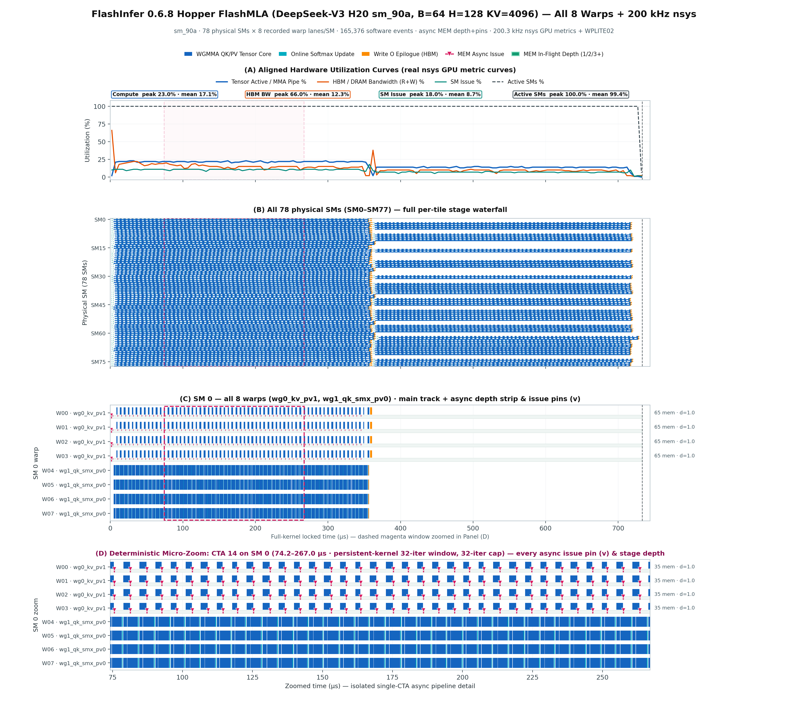

# WeaveProfiler

简体中文 | [English](README_EN.md)

> **让 AI 看清 GPU 核内每一微秒在跑什么——面向 RSI（Recursive Self-Improvement）与 Megakernel 开发的自动核内 Profiler。**

WeaveProfiler 把**自动低开销核内插桩**和**同次 200 kHz 硬件利用率曲线**对齐到同一张**四联 PNG 图**里，以 **`Skill + MCP + Hook`** 原生形态接入 Claude Code、Qwen Code、OpenAI Codex CLI、Antigravity 等 AI 编程代理。支持 CUDA C++、HIP C++、CuTeDSL 和 Triton，不改生产源码、不改函数签名，全自动完成插桩、验证与出图。

---

## 1. 为什么 RSI 需要 WeaveProfiler

在 **RSI（Recursive Self-Improvement，递归自我改进）** 流程里，AI 代理需要持续“写 kernel → 定位瓶颈 → 改写微架构 → 复测验证”，自主演化高性能 **Megakernel**（MegaMoE、FlashAttention、Persistent GEMM 等）。光看一个端到端耗时数字，AI 只能盲猜；要让 RSI 真正有效，必须配一套既细到核内代码语义、又能全自动运行的 profiler。

以往的方案总在两边二选一：

- **全自动厂商工具（`nsys` / `rocprof-sys` 等）**：自动好用，但只能看到全卡累加的硬件利用率曲线（Compute / HBM / NVLink / xGMI），不理解 kernel 内部代码语义，不知道掉谷那一微秒到底卡在哪个 SM、哪个 Warp、哪一段异步搬运或同步。（`ncu` 虽能进核内，但靠多次重放算整核平均，没有时间轴，持久核与多卡通信核基本跑不动。）
- **传统手动核内插桩**：能对应到具体代码阶段，但写起来极其复杂，寄存器/SMEM 稍微吃紧就触发 spill 或打乱调度把耗时测歪，异步流水线（`cp.async` / TMA / `wgmma` / `tcgen05`）更难配对，无法放进全自动 RSI 循环。

**WeaveProfiler 把两者的优点合二为一：**

1. **自动核内插桩 + 同次硬件利用率对齐**：自动识别算法阶段并在隔离临时副本里注入低开销探针（热路径零原子、免改函数签名；对 Triton 额外提供 PTX 级自动插桩，把编译器藏起来的 `cp.async` / `wgmma` 等待与在途深度直接剥出来），与同一次运行的 200 kHz 硬件利用率曲线刚性对齐，直出一张**四联 PNG 图**（全卡硬件曲线 + 全卡 SM/CU 瀑布 + 单个 SM 的全 Warp 时间线［含异步在途深度副轨与发射针 `▼`］+ 自动单 CTA 微距放大）。
2. **四道确定性硬检查保证数据真实**：每次插桩必须过反汇编/零 spill、输出逐字节一致、事件完整、稳态开销 `≤ 10%` 四项检查；超标自动外提粗化重测，避免拿测歪的数据误导下一轮优化。
3. **`Skill + MCP + Hook` 天然融入 RSI 框架**：`Skill` 告诉 Agent 怎么读四联图定位瓶颈，`MCP` 提供标准化的隔离剖析与跨轮对比工具，`Hook` 自动守住“不污染原码、先测后改、必交 PNG”的规则——方便接入主流 RSI 框架，是未来开发复杂 Megakernel 的利器。

---

## 2. 系统架构与关键定义

### 2.1 GPU 执行层级与跨平台术语对照

为保证全文表述一致，表 1 定义本文使用的 GPU 硬件与执行层级术语，并给出 NVIDIA 与 AMD 平台的对应名称。

| 概念 | 本文统一称呼 | NVIDIA 对应 | AMD 对应 | 简要定义 |
| --- | --- | --- | --- | --- |
| 设备端核函数 | 核函数（kernel） | CUDA `__global__` / Triton / CuTeDSL kernel | HIP `__global__` / AMD Triton kernel | 在 GPU 上并发启动的一次设备端计算程序。 |
| 物理计算核心 | SM / CU | 流多处理器（SM） | 计算单元（CU） | GPU 上独立调度线程块与执行算术/访存指令的硬件核心。 |
| 线程块 | 线程块（CTA） | Cooperative Thread Array（CTA / Block） | Workgroup | 驻留在单个 SM/CU 上、共享同一片共享内存（SMEM / LDS）的线程集合。 |
| 硬件调度线程束 | Warp / Wave | Warp（32 线程） | Wavefront（CDNA3 为 64 线程） | 硬件锁步执行指令的最小调度单元；核内记录器默认按物理 Warp/Wave 粒度记录。 |
| 束内单线程 | 通道（lane） | `lane 0..31` | `lane 0..63` | 单个 Warp/Wave 内的一条执行通道；默认仅由 `lane 0` 写入事件记录。 |
| 厂商硬件采样器 | 硬件剖析器 | Nsight Systems（`nsys`） | `rocprof-sys` / `rocprofv3` | 在真实运行中采集核函数窗口与硬件利用率计数器的厂商工具。 |

### 2.2 系统核心术语

正文统一使用以下概念名称，避免直接堆砌代码变量名（概念与代码标识符的完整对照见附录 F）：

- **阶段（stage）**：核函数内部具有明确算法或通信语义的一段执行区间，例如分块加载、矩阵乘累加、在线 Softmax 归一化或尾声写回。
- **探针（probe）**：标记某个阶段开始与结束的一对核内计时调用。
- **探针方案（probe plan）**：由阶段识别器输出的只读结构化声明文件，记录 CTA 内各 Warp 角色的判定条件，以及每个阶段的语义标签与起止源码行号。
- **核内记录器（in-kernel recorder）**：插入设备端核函数副本的轻量级计时与缓冲写入库，按 16 字节定长结构记录时间戳、事件标志与辅助字段。
- **隔离临时副本（isolated temporary copy）**：验证器在独立临时目录中复制生成的算子副本；所有探针注入、编译和计时运行均在此副本上进行，不改动受保护的原始文件。
- **软件时间线（software timeline）**：由核内记录器采集的每个 SM/CU、每个物理 Warp/Wave 的微秒级阶段区间序列。
- **硬件时间线（hardware timeline）**：由同一次运行中的厂商硬件剖析器采集的整卡利用率曲线（计算单元、HBM 显存带宽、机内/跨机互联带宽与活跃核心占比）。
- **三栏对齐图（three-panel aligned view）**：将同一微秒时间轴上的硬件时间线、全卡 SM/CU 瀑布图与单 SM/CU 物理 Warp/Wave 时间线纵向对齐渲染出的静态 PNG 诊断图。
- **阶段识别器（stage identifier）**：只读分析目标源码并生成探针方案的组件。
- **验证器（verifier）**：负责执行确定性插桩、基线与插桩双版本编译、实卡测速、四项检查、时间线对齐、出图与签发封签的独立确定性组件。
- **四项检查（four checks）**：验证器在交付结果前强制执行的四项阻塞验收——反汇编与资源检查、计算输出检查、事件完整性与语义覆盖检查、稳态开销检查。
- **封签（seal）**：当四项检查全部通过时，验证器使用存放在工作区外的会话密钥，对源码哈希、产物哈希与检查结果计算的加密签名记录（HMAC-SHA256）。
- **受保护文件（protected file）**：在建立工作区会话时登记的核心算子源文件，受生命周期状态机保护。
- **监督层（supervisor）**：由工作区外会话密钥、原始源码备份与生命周期钩子脚本组成的规则执行层，用于防止编码代理绕过剖析流程或污染生产源码。

### 2.3 系统组件与数据流

WeaveProfiler 由**阶段识别器**、**确定性插桩引擎**、**验证器**、**时间线对齐与渲染器**以及**监督层**五个部分协同构成：

```text
受保护源码 (只读) ──► 阶段识别器 (调用外部 LLM API，输出探针方案 JSON)
                            │
                            ▼
                 确定性插桩引擎 (在隔离临时副本中按方案注入探针)
                            │
                            ▼
                 验证器 (编译基线/插桩双版本 → 实卡运行 → 四项检查)
                   ├── 任一项失败 ──► 返回失败诊断与热点摘要给阶段识别器，粗化重试
                   └── 四项全通过 ──► 硬件时间线对齐 → 渲染三栏对齐图 → 签发封签
```

- **外部大语言模型调用说明**：自动阶段识别默认通过 HTTPS 向兼容 OpenAI 协议的大模型推理端点（默认模型为 `qwen4-max`，可通过环境变量覆盖端点与模型）发送目标算子源码片段及对应平台的模式参考，仅接收结构化的探针方案 JSON。调用前需在运行环境中配置相应 API 密钥（详见第 6 节）。若用户已有人工编写或预先生成的探针方案，则可直接调用验证器完成纯本地插桩、编译、实测与出图，无需联网。
- **确定性插桩与验收**：探针注入、编译器调用、反汇编比对、输出比对、事件解码、开销判定与封签计算全部由固定 Python 程序完成，大语言模型无法直接写入生产源码或改写验收结论。

### 2.4 核内记录器设计

核内记录器面向高寄存器压力的张量核心/矩阵核心算子设计，核心目标是把测量扰动压到最低：

1. **每物理 Warp/Wave 私有缓冲与流式写**：按 `CTA 数 × 每 CTA 物理 Warp/Wave 数` 预先切分互不重叠的显存切片。每个 Warp/Wave 仅由 `lane 0` 顺序追加 16 字节事件记录（8 字节时间戳 + 4 字节事件与标志位 + 4 字节辅助字段），**热路径无原子操作**（仅在缓冲区写满触发溢出标记的冷路径使用原子置位）。NVIDIA 端使用带流式缓存提示的 128 位全局存储指令（`st.global.cs.v4.u32`，提示硬件优先淘汰记录缓冲缓存行以降低对数据缓存的干扰），AMD CDNA3 端使用带非临时提示（`nt`）的 128 位向量存储指令（`global_store_dwordx4 ... nt`）。
2. **上下文状态存放策略与寄存器溢出规避**：每个记录线程需要维护槽号、当前写位置与溢出标记等记录器状态（下文称“上下文”）。
   - **CUDA C++ 单寄存器模式（默认）**：将缓冲区基址与容量存放在设备端只读常量内存，在热循环中仅用 **1 个 32 位寄存器**打包保存槽号、15 位写位置与溢出标记，占用 **0 字节共享内存**。由于写位置位宽为 15 位，单寄存器模式下每条泳道最多记录 **32,767 条**事件。
   - **CUDA C++ 共享内存与非内联回退模式**：当目标核函数寄存器已接近硬件上限、增加 1 个寄存器即引发本地栈溢出时，编译器反馈选择器自动回退至共享内存上下文模式（在默认 Warp 粒度下每线程块分配 `32 × 16 = 512` 字节静态共享内存；在每 CTA 单泳道粒度下为 16 字节）或非内联辅助函数模式，以保持热循环零新增活跃寄存器。
   - **HIP C++**：使用多字段结构体寄存器上下文，并通过每泳道游标槽支持跨设备端辅助函数续写。
3. **两类硬件时钟与相邻边界合并**：支持直接读取全卡同步墙钟（NVIDIA `%globaltimer`、AMD `s_memrealtime`）；也支持双锚点模式——仅在 Warp/Wave 入口与出口读取全卡同步墙钟并配对读取本地周期计数器（NVIDIA `%clock64`、AMD `s_memtime`），循环体内仅读周期计数器，解码时线性换算回全卡纳秒轴。在 NVIDIA CUDA C++ 与单角色 Triton 中，若上一阶段结束紧邻下一阶段开始，引擎可将其合并为单次读时钟、连续写入前后两条记录的过渡调用。
4. **不改函数签名接入**：CUDA C++ 与 HIP C++ 在隔离临时副本中声明编译单元内部全局符号，主机侧通过符号拷贝或动态 `.cubin` 符号查找绑定缓冲区地址，核函数参数列表与上层 C++/Python 调用链零改动；Triton 与 CuTeDSL 通过同名透明包装代理在最终启动核函数时隐式注入缓冲区参数（插桩副本自动移除 `@triton.autotune` 并直接复用基线选出的最优配置，保留 `@triton.heuristics`），外部调用代码无需改动。

### 2.5 硬件利用率采集与总线物理规则

硬件时间线与软件时间线来自**同一次真实运行**，通过核函数启动窗口与全卡同步时间戳做刚性对齐，不拼接不同次运行的数据，并严格遵守各硬件总线的物理架构约束：

- **计算利用率**：NVIDIA 端读取 Tensor Core / MMA 流水线活跃占比；AMD MI308X（`gfx942`，4 XCC × 20 CU × 4 SIMD）在 `rocprof-sys` 同次采集下按 `100 × SQ_VALU_MFMA_BUSY_CYCLES / (GRBM_GUI_ACTIVE × 80)` 计算矩阵核心利用率，并与通用向量单元利用率（`SIMD_UTILIZATION`）严格区分。
- **HBM 显存带宽利用率（读写共享总线，可累加）**：HBM 读与写共用同一套显存数据总线，因此同一采样时刻将读带宽占比与写带宽占比相加（上限截断至 `100%`），同时保留单向读写原始序列。
- **NVLink 互联利用率（出向与入向独立全双工通路，绝不合并）**：NVLink 的发送端（TX，出向）与接收端（RX，入向）是**两套相互独立的物理通路**。因此仅在**同一方向内部**将请求与响应用户数据累加（`NVLink TX = TX Requests + TX Responses`；`NVLink RX = RX Requests + RX Responses`），**绝不将 TX 与 RX 相加或合并为一条曲线**；在三栏对齐图上栏中，两者始终以独立曲线分别展示。
- **机内互联与跨机通信严格分离**：机内 NVLink / xGMI 计数器只反映单节点内 GPU 间通信，绝不用于声称跨机 RDMA/InfiniBand 利用率。跨机通信需要独立的网卡硬件计数器曲线；若网卡计数器因硬件旁路而不可读，图中明确标注不可用脚注，绝不补零伪造曲线。

---

## 3. 端到端工作流与读图规范

### 3.1 闭环工作流

1. **建立受保护会话**：运行安装命令，指定算子工作区、目标 GPU 型号与受保护算子文件。安装器向代理写入工具注册、生命周期钩子与操作说明，并在工作区外生成原始源码备份与会话密钥。此时受保护文件进入**锁定**状态。
2. **基线剖析与首次封签**：代理调用剖析工具，阶段识别器读取源码生成探针方案，验证器在隔离临时副本中注入探针、编译基线与插桩双版本、在实卡上测速并执行四项检查。若某项失败（如热点内循环开销超限），验证器将结构化失败报告与热点摘要返回给阶段识别器，自动将探针外提或合并后重测。四项全通过后，验证器对齐同次硬件曲线、渲染三栏对齐图并签发基线封签。
3. **解锁优化**：基线封签通过后，受保护文件解锁，代理依据三栏对齐图与瓶颈归因摘要修改算子源码。
4. **复测与跨轮对比**：修改完成后再次运行剖析工具获取新一轮封签，并调用跨轮对比工具确认耗时是否下降、目标瓶颈是否缓解以及是否需要回退。
5. **结束前校验**：代理准备结束任务时，监督层核对当前受保护文件字节是否与某个已通过验证的封签一致，且不含任何残留核内计时语句。

### 3.2 受保护文件状态机

```text
[安装并登记 --protect]
          │
          ▼
   (1) 锁定状态 ──► 禁止代理编辑受保护源码；若被 shell 命令改动，钩子按外部备份还原
          │
          │  完成首次全通过基线剖析，验证器签发有效封签
          ▼
   (2) 解锁优化 ──► 允许代理修改受保护源码；仍禁止直接往生产源码写入任何探针宏或记录器头文件
          │
          │  每轮修改后重新通过验证器并签发新封签
          ▼
   (3) 结束校验 ──► 任务结束前核验：当前源码哈希 == 某份有效封签哈希 且 无探针代码残留
```

### 3.3 四联对齐图读法

WeaveProfiler 默认直接交付静态 PNG 诊断图（`overview.png`），不再输出 `.perfetto.json.gz` 等大体积压缩轨迹。前 3 栏共享完全对齐的微秒（`µs`）横轴，右侧虚线标示核函数结束边界；当全核事件过密（相邻事件间距 `< 12 px`）时自动追加第 4 栏单 CTA 微距展开：

- **(A) 硬件利用率曲线**：同次运行采集的整卡硬件指标（0–100%，NVIDIA 为 200 kHz `nsys`，AMD 为 `rocprof-sys`），包括计算流水线（Tensor / Matrix Core）、HBM 读+写总带宽、独立绘制的机内互联（NVIDIA 为独立的 `NVLink TX` 与 `NVLink RX` 两条曲线，AMD 为 `xGMI`）、可选跨机 RDMA 曲线以及活跃 SM/CU 占比。
- **(B) 全卡物理 SM / CU 执行瀑布**：纵轴列出全卡全部物理核心，展示跨核心波次台阶、尾波拖尾与暴露等待聚集区。
- **(C) 代表性 SM / CU 全物理 Warp / Wave 时间线**：每个 Warp 采用「**上层主执行轨（MMA / 亮黄斜纹 Exposed Wait / Store）+ 下层按需 0/1/2 条极薄异步引擎副轨（Mem 绿带 + 洋红发射针 `▼`；MMA 蓝带 + 深紫发射针 `▼`）**」，把任意 `num_stages` 并发深度压缩成一条浅/中/深三档热力带，绝不按 stage 拆成多条子泳道。
- **(D) 确定性单 CTA 微距展开（Zoom-In）**：全核视角过密时自动触发，按确定性规则（优先选 `Exposed Wait` 占比最高的完整 CTA，无等待时选耗时中位数的稳态 CTA；单 CTA 超过 48 拍时固定截取最重气泡周围 32 拍，并支持 `--zoom-cta` / `--zoom-window` 手动指定）隔离展示单个 CTA 的逐拍发射针 `▼`、在途深度爬坡/排空与等待气泡；(A)(B)(C) 三栏同步用洋红虚线框标出放大区间。

---

## 4. 确定性校验与防误操作约束

### 4.1 为什么要把验证与编码代理隔开

让编码代理自动做 kernel 剖析和优化时，常见事故并不是恶意攻击，而是工程上的偷懒与失误：没测基线就直接改代码、把计时代码写进生产源文件忘记清理、探针放进自旋循环把开销拉爆、或者绕过实测拿旧数据凑报告。因此 WeaveProfiler 把验证逻辑放在独立进程里，把受保护源码的备份、校验密钥和会话状态放在工作区外的 `~/.cache/weaveprof/sessions/` 中，并由代理生命周期钩子（`PreToolUse` / `PostToolUse` / `Stop`）在关键节点做确定性拦截——既保护原始源码干净，也保证每轮交付一定有实测通过的 PNG 图。

### 4.2 四项阻塞检查

验证器对每一次隔离副本运行执行以下四项检查，任一项不通过即拒绝签发通过封签：

| 序号 | 检查项 | 验证性质 | 代码中的精确判据 | 失败后果 |
| --- | --- | --- | --- | --- |
| 1 | 反汇编与资源检查 | 确认插桩未破坏编译器对核心计算/访存指令的生成，且未引入寄存器溢出或额外共享内存 | 对比基线与插桩版本的 SASS/ISA：核心指令保序比 `core_ratio >= 0.95`，或（核心指令多重集保真比 `core_multiset_ratio >= 0.98` 且 `core_ratio >= 0.85`），同时整体指令序列相似度 `lcs_ratio >= 0.60`；新增寄存器溢出字节 `<= 0`；新增共享内存 `<= 0`；无本地栈存取指令（`STL`/`LDL` 或 `scratch_*`）异常激增。 | 拒绝交付；若因寄存器压力触发，建议切换共享内存或非内联上下文模式。 |
| 2 | 计算输出检查 | 确认插桩未改变算子数值行为 | 在相同输入张量下，插桩版本与未插桩基线的完整输出缓冲区**逐字节完全一致**，且非空、指向独立文件。 | 拒绝交付；报告输出不匹配或缺失。 |
| 3 | 事件完整性与语义覆盖检查 | 确认记录数据无损坏、无遗漏、语义有效 | 拆分为 5 条独立要求：① 每个阶段起止成对闭合（`t_end >= t_begin`，无孤立起止或交叉嵌套）；② 记录缓冲区溢出标志为 0（无事件丢失）；③ 声明的每个探针触发次数均大于 0；④ 默认要求覆盖 CTA 内全部物理 Warp/Wave；⑤ 拒绝外层嵌套大框吞并内部阶段、拒绝粗块折叠，并对注意力等算子核验核心阶段（如加载、矩阵乘、Softmax、写回）是否齐全。 | 拒绝交付；返回具体缺失阶段、空壳或嵌套告警。 |
| 4 | 稳态运行开销检查 | 确认测量本身未显著改变核函数耗时 | 至少 1 次热身启动之后采集不少于 3 组配对稳态耗时，要求中位数相对变化 `|t_inst / t_base - 1| <= 10%`（默认阈值 `0.10`，禁止通过工具参数放宽）。正值超限表示计时开销过大；**负值超过 `-10%` 同样视为编译器调度扰动而拒绝**。交替测量顺序（ABBA：基线、插桩、插桩、基线）用于回放验证以抵消时钟频率漂移。 | 拒绝交付；反馈热点探针触发次数与包围循环行号以供外提粗化。 |

*(注：第 3 项的全物理 Warp 覆盖检查与粗粒度折叠检查在底层 Python 策略对象中提供可选开关，默认开启；MCP 公开入口拒绝调用方覆写策略对象。)*

### 4.3 失败反馈与带历史先验的并行候选搜索

当任一项检查未通过时，验证器生成结构化失败诊断（包含失败检查项、各探针触发次数、最耗时的内部循环行区间、失败轮时间线热点摘要与语义告警），交回阶段识别器进行自动外提或边界合并。针对编译较慢的大型 C++ 头文件算子，后端提供带历史先验的并行候选搜索流程：仅将修改过的少量头文件放入最小 `-I` 覆盖目录避免全量拷贝，先在多核 CPU 上并行编译并做反汇编/溢出预筛，筛掉会触发溢出的方案后再占用 GPU 测速，并将各方案的成败记录持久化为本地先验以加速后续迭代。

### 4.4 封签绑定与拒绝自报输入

验证器只接受测量指令，不接受调用方拼凑的测量结果。以公开 MCP 审计工具（`weaveprof_megakernel_audit`）为例，代理只能提交待测源码位置与构建/运行命令；插桩、编译、实卡运行与四项检查全部由验证器进程亲自完成。该入口显式拒绝 5 类可由调用方伪造的参数：

- **预先录制的事件转储文件路径（`dump_path`）**：即并非由验证器本次运行生成的核内原始事件文件；
- **调用方自报的运行指标（`runtime_metrics`）**：即由外部直接传入的耗时数组、输出一致标志或资源统计，而非验证器实测所得；
- **自定义事件名表（`names`）**、**外部覆盖的采样命令（`nsys_cmd`）**以及**覆盖验收阈值的策略对象（`policy`）**。

当且仅当四项检查全部通过时，验证器使用工作区外的会话密钥，对受保护源码哈希、插桩产物哈希与检查结果联合计算 HMAC-SHA256 签名并写入封签文件；会话策略中的不可变字段同样受独立策略签名保护，且构建与测速子进程的环境变量中会剔除密钥。底层 Python 接口出于离线重绘和回归测试需要仍保留预采集模式，但生命周期钩子会拒绝用预采集模式生成的封签解锁受保护文件。

### 4.5 生命周期钩子防护与各代理保证矩阵

在支持生命周期钩子的代理平台上，监督层在工具调用的不同阶段执行自动检查（表 2 解释每个钩子时机的含义；表 3 给出 4 种代理的实际接入情况）：

| 触发时机 | 中文含义 | 监督层执行的具体动作 |
| --- | --- | --- |
| 调用工具前 | 在代理执行读/写文件或运行命令之前拦截检查 | 禁止读取会话密钥及钩子/MCP 守护脚本；在获得首个有效基线封签前禁止编辑受保护源码；解锁后仍禁止往生产源码直接写入核内记录器头文件或探针宏；禁止修改或删除封签与钩子配置文件。 |
| 调用工具后 | 在一次文件编辑或命令执行成功返回之后立即复核 | 重新计算受保护源码与钩子/MCP 配置的哈希；若发现在锁定期间被 shell 命令绕过修改或配置文件被篡改，立即从工作区外备份按字节还原并报错；若源码中混入探针代码立即拦截。 |
| 工具调用失败后 | 在某次文件或命令调用报错退出后仍执行一致性检查 | 防止失败的 shell 命令留下半截改动或篡改配置，复核哈希并在违规时自动还原。 |
| 结束任务前 | 在主代理准备结束对话并向用户交付最终结果前核验 | 要求当前受保护源码字节与某份有效通过封签严格一致，且源码中无残留核内探针语句。 |
| 子代理结束前 | 在代理派生的子代理完成自身任务返回前核验 | 检查子代理是否留下越权改动、配置篡改或探针代码残留。 |

| 代理平台 | 接入机制 | 已注册的钩子时机（见附录 C 事件名对照） | 额外隔离 |
| --- | --- | --- | --- |
| **Claude Code** | MCP + 钩子 + Skill | 调用前、调用后、调用失败后、任务结束前、子代理结束前（5 类） | Linux 下可选 `guard-exec`（`bubblewrap` 只读挂载） |
| **Qwen Code（`qwen`）** | MCP + 原生 JSON 协议钩子 + Skill | 调用前、调用后、调用失败后、任务结束前、子代理结束前（5 类） | 首次启动需批准项目钩子或信任工作区 |
| **Antigravity（`agy`）** | 原生工作区插件（MCP + 钩子 + 规则 + Skill） | 调用前、调用后、调用周期后、任务结束前（4 类） | 同上 |
| **OpenAI Codex CLI** | MCP + 钩子 + 说明文件 | 调用前、调用后、任务结束前（3 类；无失败后与子代理结束钩子） | Linux 下推荐配合 `guard-exec` |

---

## 5. 实测评估与案例研究

### 5.1 实验设置与指标定义

- **硬件与软件**：以下实测运行在 NVIDIA H20 GPU 上（Hopper 架构，78 个物理 SM；卡片配置编译目标为 `sm_90`，支持 `sm_90a` WGMMA 指令集；多卡案例采用 8×H20 NVLink 全互联节点）。硬件计数器采用 `nsys` 采集，配置采样频率 `200,000 Hz`（实测有效采样率约 `200.3 kHz`，即每 ~5 µs 一个硬件样本）。
- **核心指标公式**：
  - **稳态相对开销**：`(t_inst - t_base) / t_base`，其中 `t_inst` 与 `t_base` 分别为插桩版本与未插桩基线在热身后的稳态中位数耗时；验收门槛为 `|开销| <= 10%`。
  - **软硬边界差**：`|T_hw - T_sw| / T_hw`，衡量厂商硬件剖析器测得的核函数窗口 `T_hw` 与核内记录器观测到的跨核心最外层软件窗口 `T_sw` 之间的相对偏差。
  - **寄存器溢出增量（register spill delta）**：`spill_bytes_inst - spill_bytes_base`，衡量插桩是否导致编译器将寄存器变量溢出到本地栈内存（验收要求 `<= 0 B`）。
- **工作负载符号**：`B` 批大小（batch size），`H` 注意力头数（heads），`S` / `T` 序列长度（sequence length），`D` 单头维度（head dimension），`KV` KV 缓存长度，`EP` 专家并行路数（expert parallelism），`E` 专家总数（experts）。
- **数据透明度说明**：本仓库作为轻量代码包仅收录下述实卡运行的代表性测量值与直出 PNG 图像，不含原始二进制转储与多次重复的方差日志文件；数值均代表对应配置下的单次实卡验证结果。

### 5.2 开源算子库零签名修改剖析

在不改动原始开源算子库函数签名、模板参数与上层调用代码的前提下，WeaveProfiler 对三个代表性开源核函数完成了全自动闭环剖析（表 4）。全部三张图均为 H20 本地直出的三栏对齐图（图 1–图 3，读图规则见第 3.3 节）。

| 开源算子库与核函数 | 前端语言与测试规模（H20） | 物理 Warp 覆盖 | 实测闭环结果与稳态开销 |
| --- | --- | :---: | --- |
| **FlashInfer 0.6.8 Hopper FA3**（`prefill_sm90.cuh` 及 2 个主循环头文件） | CUDA C++，`B=5, H=16, S=512, D=128`（另测长序 `S=4096`） | 12 / 12（`W00..W11`） | 零签名修改通过；长序稳态相对开销 `-1.62%`（见下述讨论），软硬边界差 `0.33%` |
| **FlashInfer 0.6.8 Hopper FlashMLA**（`mla_hopper.cuh`，DeepSeek-V3 分页 MLA） | CUDA C++，`B=64, H=128, KV=512`（另测长序 `KV=4096`） | 8 / 8（`W00..W07`） | 第 1 轮细粒度打点开销 `+14.55%` 被验证器拦截，第 2 轮自动外提粗化后通过：`+8.25%`（`KV=512`）/ `+6.11%`（`KV=4096`），0 B 寄存器溢出 |
| **vLLM FLA FlashKDA**（`chunk_delta_h.py`，线性注意力分块递推） | Triton 3.6，`B=1, T=512, H=64, D=128`（另测长序 `T=8192`） | 4 / 4（`W00..W03`） | 代理固定基线最优调优配置；经自动外提与边界合并后通过：`+6.74%`（`T=512`）/ `+8.14%`（`T=8192`），0 B 寄存器溢出 |

**关于负开销（`-1.62%`）的说明**：FA3 在长序上测得 `-1.62%` 的相对变化，绝对值位于 `±10%` 容差内且反汇编与输出检查通过。但负开销并不意味着“插桩加快了算子”，而是表明加入少量记录指令轻微改变了编译器的指令排布或发射节奏；当此类负向扰动超过 `-10%` 时，验证器会将其判定为编译器调度失真并拒绝交付。

- **图 1：FlashInfer 0.6.8 Hopper FA3 Prefill**（CUDA C++ 跨 3 个头文件，`B=5, H=16, S=512, D=128`，覆盖全部 12 个物理 Warp：`W00` 负责 TMA 异步预取、`W01..W03` 早退空闲、`W04..W11` 组成两个计算 WarpGroup 执行矩阵乘与在线 Softmax）：


- **图 2：FlashInfer 0.6.8 Hopper FlashMLA**（CUDA C++ `mla_hopper.cuh`，`B=64, H=128, KV=512`，覆盖全部 8 个物理 Warp；该配置共启动 128 个线程块，在 78 个 SM 上形成 `128 = 78 + 50` 的两波次调度台阶，中栏瀑布与上栏 Tensor 利用率台阶逐微秒对应）：



- **图 3：vLLM FLA FlashKDA**（Triton 3.6 `chunk_delta_h.py`，`B=1, T=512, H=64, D=128`，覆盖全部 4 个物理 Warp，分解初始状态加载、8 轮分块矩阵乘与状态衰减更新，以及最终状态写回）：


### 5.3 案例研究：8×H20 生产级 DeepGEMM MegaMoE 优化（1.47× 加速）

在 8×NVIDIA H20 NVLink 全互联节点上剖析生产级 **Qwen3.5-397B DeepGEMM MegaMoE** 工作负载（`EP=8, S=1024, E=512`；单层 MoE 包含第一阶段门控/上投影矩阵乘 `GEMM1`、第二阶段下投影矩阵乘 `GEMM2` 及跨卡结果汇聚 `Scatter`；CTA 内部分配通信线程束 `Disp`、数据预取线程束 `TMA` 与计算线程束组 `WG0–1` / `WG2–3`）。完整诊断与重构过程见 [docs/case_studies/h20_megamoe_optimization.md](docs/case_studies/h20_megamoe_optimization.md)。


| 版本 | 端到端耗时 | FP8 Tensor Core 利用率（均值 / 峰值） | HBM 带宽利用率（均值 / 峰值） | 诊断瓶颈与对应优化 |
| --- | ---: | ---: | ---: | --- |
| 原始分核版本（图 a） | `613.2 µs` | `27.9%` / `37.1%` | `36.4%` / `47.6%` | ① `GEMM1` 与 `GEMM2` 拆核启动且静态分配专家，核间产生约 `65 µs` 空等；② `GEMM2` 中同步 `Scatter` 阻塞计算组，`Disp` 线程束闲置 |
| 优化后融合持久化版本（图 b） | `416.4 µs`（`1.47×`） | `41.8%` / `62.6%` | `55.7%` / `81.5%` | ① 融合为单核持久化算子并以动态队列领取专家任务（活跃 SM 均值 `94.0%`）；② 将 `Scatter` 异步卸载至空闲 `Disp` 线程束与矩阵计算重叠 |

*(注：图 a 到图 b 报告的是两项优化联合生效后的单次对比结果，不含仅应用优化 ① 的独立消融测量；Tensor Core 与 HBM 均值 × 耗时在优化前后基本守恒，分别变化 `+1.7%` 与 `+3.9%`。)*

### 5.4 局限性与已知边界

为避免过度承诺，以下列出当前版本的已知边界：

1. **外部模型调用与隐私边界**：自动阶段识别（`weaveprof_profile` / `wp.identify`）会将目标核函数源码片段发送至配置的大模型 HTTP 端点。对源码出域有严格限制的环境应使用私有部署的 OpenAI 兼容端点（通过 `OPENAI_BASE_URL` 配置），或人工提供探针方案仅运行本地验证器。
2. **原地编辑子命令与锁定语义**：默认剖析路径仅编辑隔离临时副本；但低层命令行子命令 `run.py instrument --apply` 设计为按方案原地修改目标文件，且优化阶段本身需要代理在基线封签解锁后编辑受保护源码。
3. **钩子防线的已知约束**：任务结束拦截钩子在连续触发 3 次拦截后会熔断放行并打印警告，以避免代理陷入死循环；只读文件读取拦截覆盖会话密钥、钩子脚本与 MCP 服务脚本，底层验证器模块（`backend.py`、`harness.py`）的只读保护在 Linux 下依赖 `guard-exec` 的 `bubblewrap` 挂载；Windows 环境不支持 `bubblewrap` 且 POSIX `0600` 权限位作用有限。
4. **单寄存器模式记录容量上限**：CUDA C++ 单寄存器上下文模式的写位置为 15 位，每条物理 Warp 泳道上限为 `32,767` 条记录；若超长循环需要更多记录，应先外提探针或切换标准寄存器/共享内存模式。
5. **AMD 硬件计数器时间粒度**：`rocprof-sys` 原始 PM 计数器按核函数 dispatch 聚合（单次启动为一个聚合值），呈现为覆盖整次启动的水平带而非核内微秒级波动曲线；如需 AMD 核内细粒度硬件采样，需结合 `rocprofiler-sdk` 设备连续采样（DCS）。

---

## 6. 快速上手与仓库地图

### 6.1 支持范围与前置条件

| 维度 | 支持内容 |
| --- | --- |
| 硬件与编译目标 | NVIDIA H20（`sm_90` / `sm_90a`）、NVIDIA B300（`sm_100a` / `sm_103a`）、AMD Instinct MI308X（`gfx942`） |
| 算子语言 | CUDA C++、HIP C++、CuTeDSL（仅 NVIDIA）、Triton（NVIDIA PTX 与 AMD CDNA3） |
| 编码代理 | 原生集成 Claude Code、OpenAI Codex CLI、Qwen Code（`qwen`）、Antigravity（`agy`）；其他 CLI 代理可通过 `guard-exec` 包装 |
| 运行依赖 | Python 3.10+、对应 GPU 工具链（`nvcc`/`nsys` 或 `hipcc`/`rocprof-sys`）、`matplotlib`（用于本地渲染三栏对齐图）；启用自动阶段识别时需配置 `OPENAI_API_KEY`、`DASHSCOPE_API_KEY` 或 `BAILIAN_API_KEY`（可选 `OPENAI_BASE_URL`） |

### 6.2 安装与入口说明

仓库提供三个相互等价的上层入口，均指向同一套后端逻辑：
- **`run.py`**：克隆仓库即可直接执行的命令行脚本（含 `install-agent`、`guard-exec` 与分阶段 `scan/instrument/capture/validate/deliver` 等 18 个子命令）；
- **`weaveprof` CLI**：通过 `pip install -e .` 安装后注册的命令行别名；
- **Python 接口（`import weaveprof as wp`）**：供脚本与测试直接调用的编程接口（`wp.identify`、`wp.verify`、`wp.profile` 等）。

两步接入你的算子仓库：

```bash
git clone https://github.com/ziyuhuang123/WeaveProfiler.git
python3 -B WeaveProfiler/run.py install-agent \
  --workspace /path/to/your_kernel_repo \
  --protect kernel.cu \
  --card h20
```

参数说明：
- `--workspace`：待剖析算子所在的项目根目录。
- `--protect`：登记受保护的算子源文件（可多次指定）。**注意**：安装完成后该文件即进入锁定状态，代理在取得首个全通过基线封签之前无法修改该文件。
- `--card`：指定目标 GPU 硬件配置（`h20`、`b300` 或 `mi308x`）。
- `--agent`（可选）：默认同时为 4 种代理写入集成文件，也可指定单个代理（`claude`、`codex`、`qwen`、`agy`）；详细写入文件清单见附录 A。

安装后进入工作区启动对应代理即可。如需无交互批处理并在 Linux 下启用 `bubblewrap` 只读隔离挂载，使用监督包装命令：

```bash
python3 -B WeaveProfiler/run.py guard-exec \
  --workspace /path/to/your_kernel_repo \
  -- codex exec "剖析该核函数的瓶颈与跨 SM 负载不均"
```

### 6.3 目录结构与离线验证

```text
WeaveProfiler/
├── README.md              # 简体中文文档
├── README_EN.md           # English documentation
├── SKILL.md               # 面向编码代理的完整操作规程（Agent Skill）
├── pyproject.toml         # Python 包配置与 weaveprof CLI 入口
├── plugin.json            # 代理插件与工具声明清单（6 项工具）
├── run.py                 # 统一命令行入口
├── recorders/             # 各语言核内记录器（CUDA C++ / HIP C++ / CuTeDSL / Triton NV & AMD）
├── weaveprof/             # 核心后端、阶段识别、确定性插桩、验证器、MCP 服务、钩子防护与绘图模块
├── configs/               # 卡片配置、硬件指标规则、算子模式与跨语言示例库
├── docs/                  # 真实优化案例、设计说明与平台采集文档
├── examples/              # 各语言最小示例、主机端封装与已验证参考实现
└── tests/                 # 离线单元、结构契约与安全对抗测试
```

无需 GPU 即可在本地运行离线验证：

```bash
python3 -B tests/package_structure.py
python3 -B -m unittest tests/test_mcp_hook_installer.py tests/test_wp_megakernel.py tests/test_hardware_utilization.py
bash tests/run_all.sh
```

---

## 附录：工程参考表

### 附录 A：各代理自动写入的配置文件

| 代理 | 自动写入工作区的文件 |
| --- | --- |
| Claude Code | `.mcp.json`、`.claude/settings.json`、`.claude/settings.local.json`、`.claude/skills/weaveprofiler/SKILL.md`、`CLAUDE.md` |
| OpenAI Codex CLI | `.codex/config.toml`、`.codex/hooks.json`、`.agents/skills/weaveprofiler/SKILL.md`、`AGENTS.md` |
| Qwen Code（`qwen`） | `.qwen/settings.json`（含 `mcpServers` 与原生 JSON 协议钩子）、`.qwen/skills/weaveprofiler/SKILL.md`、`QWEN.md`（首次启动需在终端执行 `/trust` 或批准项目钩子，可在 `/hooks` 确认处于 `active` 状态） |
| Antigravity（`agy`） | `.agents/plugins/weaveprofiler/`（`plugin.json`、`mcp_config.json`、`hooks.json`、`rules/AGENTS.md`、`skills/weaveprofiler/SKILL.md`）与 `GEMINI.md` |

### 附录 B：MCP 工具清单（`weaveprof/mcp_server.py`）

| 工具名 | 主要输入 | 是否调 LLM | 适用场景 |
| --- | --- | :---: | --- |
| `weaveprof_status` | 工作区路径 | 否 | 查看受保护文件、基线与实时 SHA-256、有效封签数及当前最优耗时。 |
| `weaveprof_profile` | 源码路径、运行命令、目标卡型 | 是 | 从零自动完成“阶段识别 → 隔离副本插桩与四项检查 → 失败自动粗化重测 → 对齐出图 → 签发封签”。 |
| `weaveprof_megakernel_audit` | 源码与基准配置（拒绝自报指标与外部转储） | 否 | 对已知插桩结构的复杂 Megakernel 执行隔离副本编译、实测、四项检查、跨 SM 倾斜分析、出图并签发封签。 |
| `weaveprof_plan_context` | 源码路径与寄存器/共享内存余量 | 否 | 根据资源余量推荐记录器上下文存放模式与编译开关。 |
| `weaveprof_analyze` | 已对齐的时间线产物 | 否 | 输出计算/显存/互联利用率摘要、跨核心负载偏斜与按收益排序的优化建议。 |
| `weaveprof_compare_rounds` | 上一轮与当前轮剖析结果 | 否 | 对比两轮优化前后的耗时与瓶颈变化，判断是否保留或回退改动。 |
| `weaveprof_verify_seal` | 封签路径 | 否 | 使用工作区外会话密钥核验封签 HMAC 签名及绑定产物哈希。 |

### 附录 C：钩子事件名与代理映射（`weaveprof/guard_hook.py`）

| 触发时机 | 原始钩子事件名 | 支持该事件的代理 |
| --- | --- | --- |
| 调用工具前 | `PreToolUse` | Claude Code、Codex CLI、Qwen Code、Antigravity |
| 调用工具后 | `PostToolUse` | Claude Code、Codex CLI、Qwen Code、Antigravity |
| 工具调用失败后 | `PostToolUseFailure` | Claude Code、Qwen Code |
| 工具调用周期后 | `PostInvocation` | Antigravity |
| 主任务结束前 | `Stop` | Claude Code、Codex CLI、Qwen Code、Antigravity |
| 子代理结束前 | `SubagentStop` | Claude Code、Qwen Code |

### 附录 D：核内记录器前端与编译开关

| 前端语言 | 记录器文件 | 关键开关与机制 |
| --- | --- | --- |
| CUDA C++ | `recorders/cuda_cpp/wp_lite.cuh` | `-DWP_LEVEL=0\|1\|2`、`-DWP_GRAN=0\|1`、`-DWP_TIMER=0\|1`；上下文开关：`-DWP_CTX_REG`（单 32 位寄存器、0 B SMEM、32,767 条/泳道上限）、`-DWP_CTX_SMEM`（512 B SMEM @ Warp 粒度 / 16 B @ CTA 粒度）、`-DWP_CTX_REG_NOINLINE`；符号绑定：`cudaMemcpyToSymbol` / `cudaLibraryGetGlobal`（内部符号 `wp_fi_c`，宏别名 `wp_g`）。 |
| HIP C++ | `recorders/hip_cpp/wp_lite_hip.h` | `-DWP_LEVEL=0\|1\|2`、`-DWP_GRAN=0\|1`、`-DWP_TIMER=0\|1`（默认 1：周期计数 + `s_memrealtime` 双锚点）；非临时写 `global_store_dwordx4 ... nt`；`hipMemcpyToSymbol` 绑定。 |
| Triton（NVIDIA） | `recorders/triton/wp_triton.py` | 透明包装代理自动去除插桩副本上的 `@triton.autotune` 并复用基线最优配置；PTX `st.global.cs.v4.u32`；支持单次过渡融合 `WP_TRANS`。 |
| Triton（AMD） | `recorders/triton/wp_triton_amd.py` | 面向 `gfx942` wave64，16 字节打包向量写（`fi_open_16b` 等），读取 `HW_ID`/`XCC_ID` 映射物理 CU。 |
| CuTeDSL（NVIDIA） | `recorders/cutedsl/wp_cute.py` | SSA 值语义上下文与透明代理/类方法描述符包装，通过 `@cute.jit` 启动器透传缓冲张量至 `@cute.kernel`。 |

### 附录 E：常见输出产物与概念–标识符对照

| 正文概念 | 典型文件名或代码标识符 | 说明 |
| --- | --- | --- |
| 探针方案 | `probe.json` | 阶段识别器输出的结构化探针定义 |
| 核内原始转储 | `capture.fi02.bin`（魔数 `FILITE02`） | 记录器写出的紧凑 16 字节事件二进制文件 |
| 失败诊断报告 | `feedback.json` | 校验未通过时返回给阶段识别器的诊断与热点摘要 |
| 验收汇总与封签 | `verify.json`、`seal.json` | 四项检查数值明细及工作区外密钥签发的 HMAC 封签 |
| 会话状态与策略 | `session.json`（含 `policy_hmac`） | 受保护文件哈希、基线封签与策略完整性签名 |
| 三栏对齐图 | `overview.png` | `weaveprof/viz.py` 本地渲染的三栏软硬时间线图 |
| Perfetto 轨迹（按需） | `*.perfetto-trace` / `*.perfetto.json.gz` | 可选导出的交互式 Perfetto 轨迹文件 |
