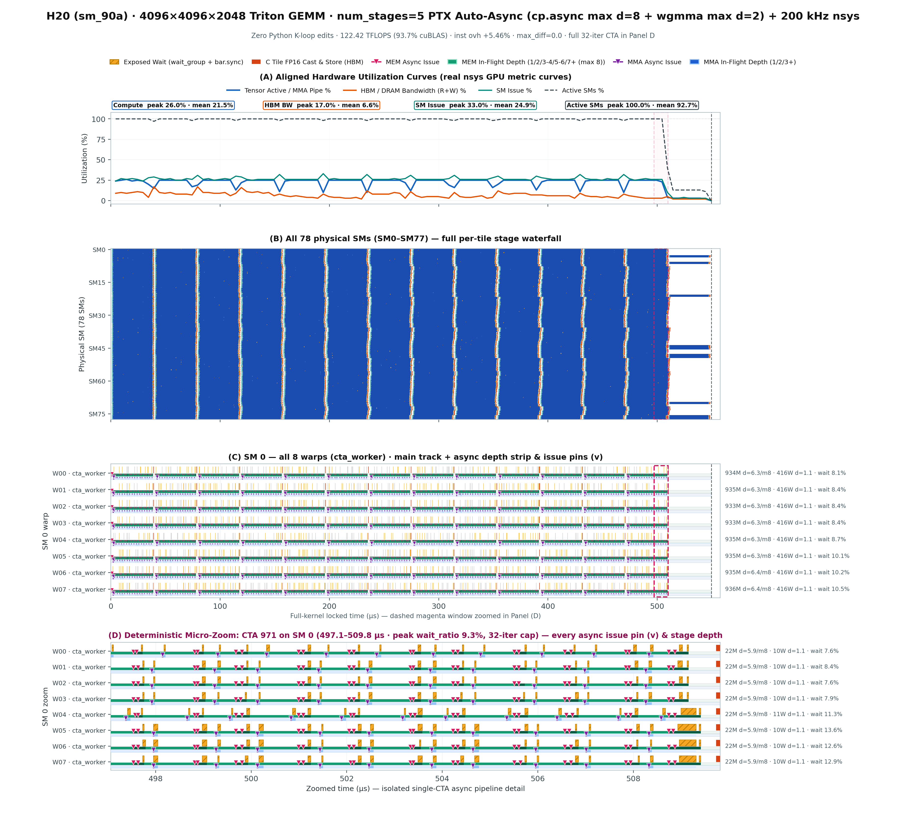
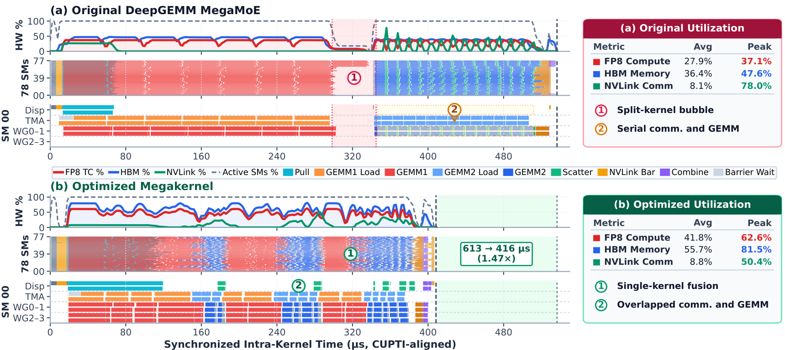
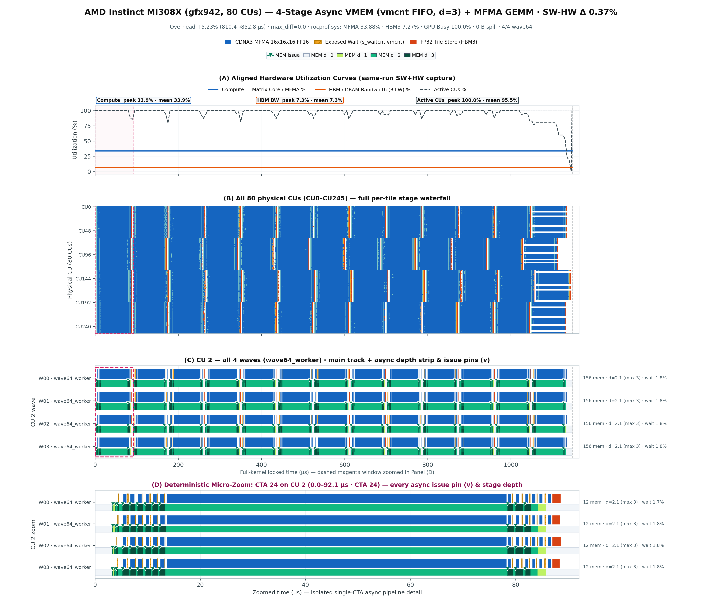
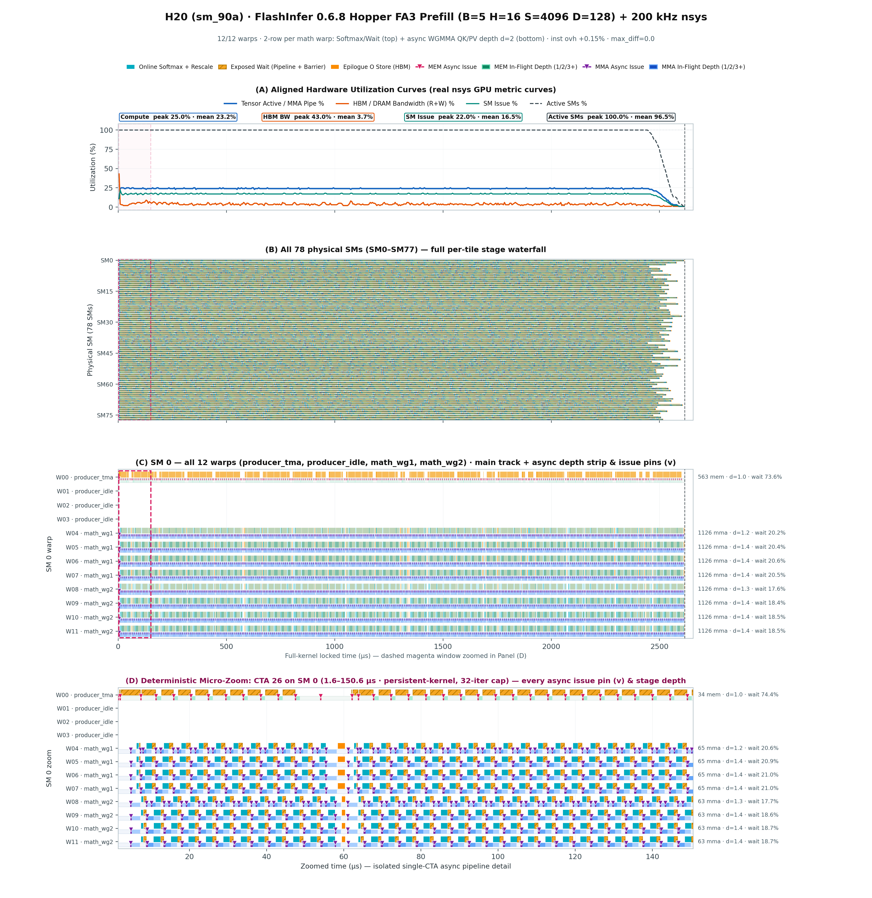
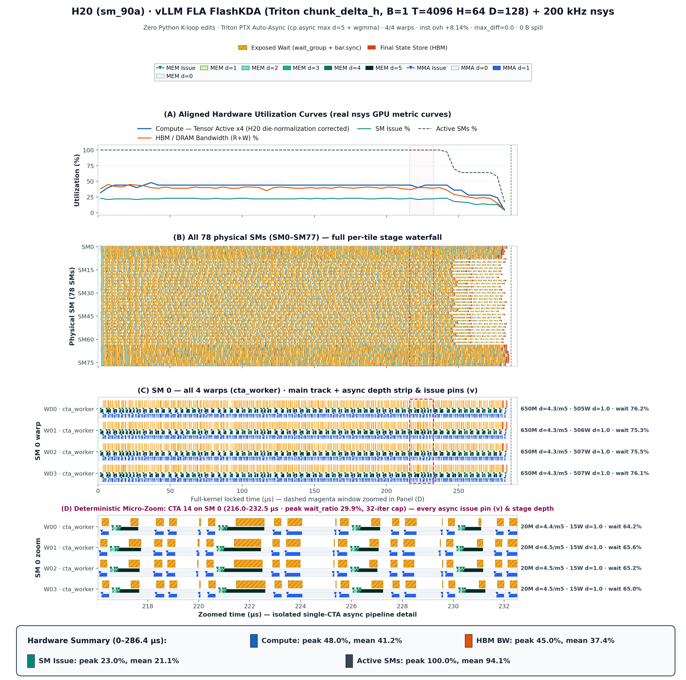
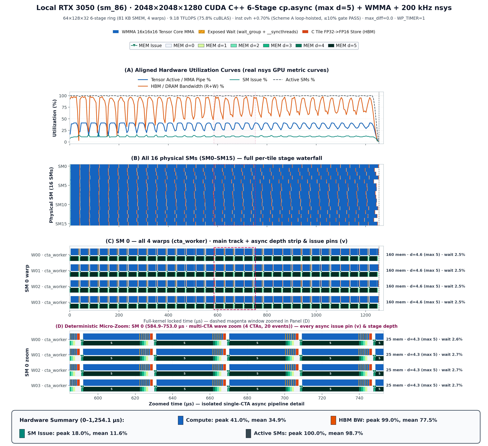
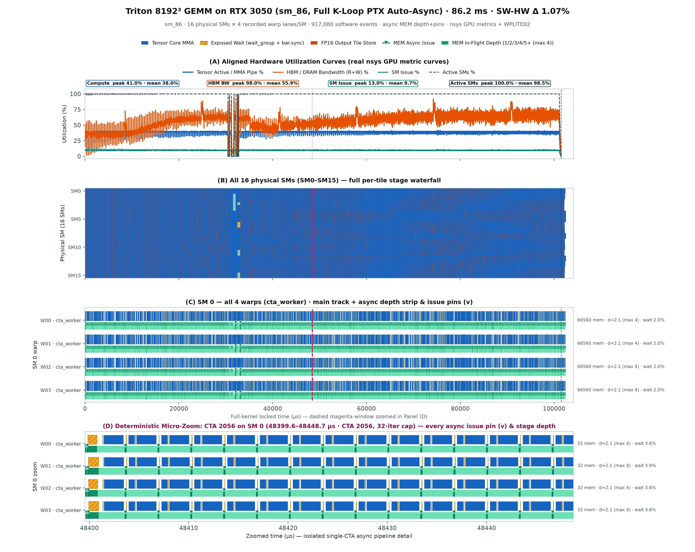
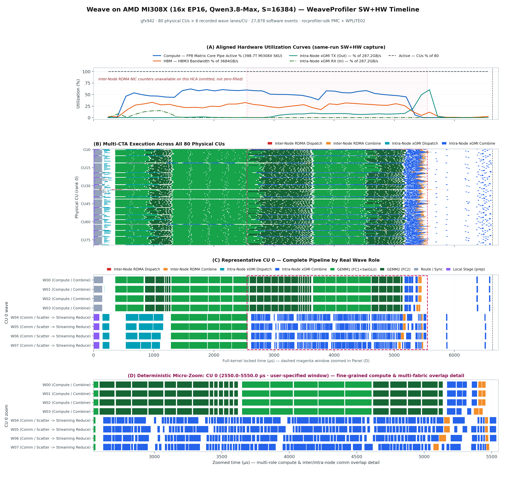

# WeaveProfiler

简体中文 | [English](README_EN.md)

> **让智能体与工程师看清 GPU 核内每一微秒——面向现代异步流水算子与智能体递归自我改进（RSI）的自动化核内剖析框架。**

**WeaveProfiler** 将**闭环自动核内软件插桩**与**同次硬件利用率采样**刚性对齐到同一张静态四联时间线图（`overview.png`）中。框架同时支持两种接入形态：① 以 **`Skill + MCP + Hook`** 直接嵌入 Claude Code、Qwen Code、OpenAI Codex CLI、Antigravity 等 AI 编程代理（免配额外密钥）；② 直接传入 **阿里云百炼（DashScope / Coding Plan / MaaS）** 或任意 OpenAI 兼容 API Key 通过 CLI / Python SDK 独立调用。跨 **CUDA C++、HIP C++、Triton（NVIDIA PTX 与 AMD AMDGCN）及 CuTeDSL**，所有探针注入与校验均在隔离副本内自动完成，零生产源码修改、零函数签名入侵。

---

## 1. 背景与三大挑战：为什么现代 GPU 算子与 RSI 需要 WeaveProfiler

大模型训练与推理的核心算子正普遍转向**持久化融合 Megakernel**（如 MegaMoE、FlashAttention-3、FlashMLA、门控线性注意力 GDN）：同一 CTA 内的不同 Warp 被赋予独立**角色**（生产者搬运、矩阵计算、跨卡通信），并通过多级**异步硬件流水线**（NVIDIA `cp.async` / TMA / `wgmma` / `tcgen05`、AMD CDNA3 `buffer_load` + `s_waitcnt vmcnt` + `MFMA`）掩盖访存与通信延迟。算子性能直接取决于各角色之间的重叠效率：**在途异步操作深度（In-Flight Depth $d$）**决定了延迟是否被有效掩盖，而**暴露等待（Exposed Wait）**则直接标定了关键路径上的停顿根因。随着算子优化迈向无人类介入的**智能体驱动递归自我改进（Agent-Driven RSI）**，这一细粒度剖析过程必须实现全自动与防失真闭环。

然而，现有工具与朴素大模型改码面临三大核心挑战：

1. **自由改码易引入隐蔽轨迹缺陷且缺乏真伪校验**：厂商硬件剖析器（`nsys`、`rocprofv3`）将核函数视为黑盒，无法定位到具体角色与软件阶段；而直接让大模型改写核函数插桩，即便通过编译与数值输出检查，仍会频繁出现跨分支起止漏配、角色 Warp 漏采、缓冲区截断或热循环过度打点引发严重降速；若将校验脚本暴露在可写工作区内，智能体甚至可能篡改核函数展开配置或放宽门限以“刷过”检查。
2. **编译器与硬件异步流水被误测为同步发射桩**：源码级或高层 IR 级同步探针在非阻塞异步指令发射后立即闭合，看不到编译器在底层生成的提交与等待边界（如 Triton 自动插入的 `commit_group` / `wait_group` 或 AMDGCN `s_waitcnt vmcnt(N)`），导致真实在途驻留时长被低估数十至上百倍、在途深度虚报为 $d=0$，并将真实的等待停顿混入后续矩阵计算阶段。
3. **重状态记录器触发寄存器溢出或共享内存驻留断崖**：生产级融合核长期运行在寄存器文件与共享内存上限边缘；多寄存器上下文（4–10 个活跃寄存器）极易诱发本地内存 `STL/LDL` 溢出，而千字节级共享内存环形缓冲（0.5–4 KB/CTA）则会导致每 SM 并发驻留 CTA 数断崖下跌（如 `2 → 1 CTA/SM`）或在环形回绕时静默丢失事件。

---

## 2. 核心观察与三大设计机制

> **核心观察**：在核内剖析全流程中，**只有阶段语义识别需要大模型的语义理解**，而探针注入、异步配对与真伪验证均可由确定性规则完成；同时，由于所有异步硬件引擎均遵循“发射提交 → 按序等待退役”的固定因果律，探针只需极小运行时可变状态即可精确还原在途并发深度与暴露等待。

```text
受保护源码 (只读) ──► 只读阶段识别 (AI 编程代理 或 百炼/OpenAI API) ──► 结构化 probe.json
                                                                           │
                                                                           ▼
             工作区外确定性 Harness (CUDA/HIP/CuTe 源码注入 · NVIDIA Triton PTX / AMD AMDGCN 自动异步 Pass)
                                                                           │
                                                                           ▼
                     同次硬件采样 (200 kHz nsys / rocprof-sys) + 四项双向 Fail-Closed 门禁校验
                       ├── 任一项未过 ──► 返回违规探针与失败轨迹 feedback.json，自动外提/粗化迭代
                       └── 全部通过   ──► 生成软硬同轴四联图 overview.png + 签发 HMAC-SHA256 封签
```

围绕这一观察，WeaveProfiler 构建了三大核心机制与系统级护栏：

### 2.1 闭环自动插桩与系统级防篡改护栏
- **只读语义识别 + 确定性注入**：大模型仅以只读方式分析核函数源码并输出角色谓词与阶段边界规范 `probe.json`，绝不直接编辑核函数算术逻辑。确定性 Harness 在隔离副本中完成探针注入；针对编译器自动软流水的 Triton 算子，提供 **NVIDIA PTX 级自动双异步 Pass**（`triton_ptx_async.py`）与 **AMD CDNA3 AMDGCN 级自动异步 Pass**（`triton_amdgcn_async.py`，自动保存/恢复标量 `SCC` 条件码并使用独立 `vscnt` 向量写通道，零干扰 `vmcnt` 计数），无需改动 Python K-loop 一行代码。
- **四项双向 Fail-Closed 阻塞门禁**：① **反汇编与资源门禁**（核心计算/访存指令保序保真，新增寄存器溢出 $\Delta_{\text{spill}} \le 0\text{ B}$，新增共享内存 $\Delta_{\text{smem}} \le 0\text{ B}$）；② **数值输出门禁**（与未插桩基线逐位一致或在严格容差内吻合）；③ **事件完整性与全物理单元覆盖门禁**（起止严格闭合、零溢出丢包、100% 物理 Warp/Wave64 覆盖）；④ **双向稳态开销门禁**（热身后稳态中位耗时满足 $|t_{\text{inst}}/t_{\text{base}} - 1| \le 10\%$，无论超标变慢还是打乱调度的异常“变快”均拒绝放行并触发自动粗化重测）。
- **三层系统护栏**：工作区外独立 MCP 进程与代理不可见密钥的 `HMAC-SHA256` 封签（`~/.cache/weaveprof/sessions/`）、`PreToolUse` / `PostToolUse` / `Stop` 生命周期钩子，以及可选 Linux `bubblewrap` OS 只读沙箱，从系统机制上杜绝绕过校验、残留探针或篡改门限。

### 2.2 跨 Warp 与单 Warp 异步流水线配对追踪
- **跨 Warp 生产者–消费者配对（1-to-$N$ 最早到达去重）**：在 Hopper FA3、FlashMLA 等由单生产者 Warp 向多计算 Warp 广播数据的 `mbarrier` 环形流水线中，基于全卡统一纳秒时钟按 `(CTA, event, slot)` 匹配同代发射与等待退出，以最早消费者到达时刻 $\min_w t_{\text{exit}}(w)$ 作为保守完成上界，经全 CTA 扫描线精确计算真实的跨 Warp TMA 在途深度（杜绝 1-to-$N$ 扇出重复计数与慢消费者虚高）。
- **单 Warp 多引擎 FIFO 深度还原**：在每条物理 Warp/Wave 主轨上显式框定 `wait_group` / `mbarrier` / `s_waitcnt vmcnt(N)` 的 **Exposed Wait**，并在独立的 `MEM` 与 `MMA` 副轨上维护双序号计数器（每次提交开区间 `seq_in++`，每次等待 `N` 按序闭合 `seq_out < seq_in - N`），在 NVIDIA（`cp.async` / `wgmma` / `tcgen05`）与 AMD CDNA3（`WP_VMEM_COMMIT` / `WP_VMEM_WAIT` / `v_mfma`）上统一还原逐拍在途深度 $dd = seq_in - seq_out。

### 2.3 极小状态低扰动流式记录与免改签名接入
- **无锁分片流式写 + 单寄存器状态压缩**：每个 `(CTA, 物理 Warp/Wave)` 独占连续缓冲切片，仅由 `lane 0` 以绕过缓存的 16 字节向量写指令（NVIDIA `st.global.cs.v4.u32`、AMD `buffer_store_dwordx4` / `global_store_dwordx4 ... nt`）顺序追加，热路径**零原子操作、零跨 Warp 同步**。默认模式 `WP_CTX_REG` 将可变状态（禁用/溢出位 + 16 位槽号 + 15 位游标）压缩进**单个 32-bit 寄存器（`0 B` 共享内存）**，在 `setmaxnreg` 核上自动前移至配额缩减前初始化，并为零寄存器余量核提供 `16 B` 静态共享内存回退（`WP_CTX_SMEM`）。
- **双锚点周期计时 + 相邻探针合并 + 旁路绑定**：热循环内读取低延迟本地周期计数器（`%clock64` / `s_memtime`）并由首尾全卡墙钟锚点（`%globaltimer` / `s_memrealtime`）离线线性校准；相邻阶段交界自动合并为单次读表双记录写出；CUDA/HIP 通过模块内设备符号旁路绑定并经每槽进度游标跨 `__device__` 头文件免改签名接力，Triton/CuTeDSL 通过透明代理固定最优配置注入。

---

## 3. 四联软硬同轴对齐图（`overview.png`）读法

WeaveProfiler 默认直出单张静态高分辨率四联 PNG（人类工程师与多模态大模型均可直接读取，无需加载百兆级 Perfetto 文件）。前 3 栏锁定同一微秒（`µs`）时间轴，事件密集时自动展开第 4 栏微距视图：

- **(A) 同次硬件利用率曲线（Fail-Closed）**：同次运行采集的整卡计算（Tensor / Matrix Core MFMA）、HBM 读写总带宽、独立全双工互联（`NVLink TX` 与 `NVLink RX` 独立绘制绝不合并；AMD 为 `xGMI`）及活跃 SM/CU 占比；缺失真实同次硬件曲线时直接报错拒绝出图。
- **(B) 全卡物理 SM / CU 阶段瀑布**：纵轴覆盖全卡所有物理核心（如 H20 78 SMs、B300 148 SMs、MI308X 80 CUs），直观呈现波次台阶、负载倾斜与尾波拖尾。
- **(C) 单 SM / CU 全物理 Warp / Wave 分轨时间线**：每个物理 Warp/Wave 自动拆分为「**上行主执行轨**（计算阶段 + 亮黄斜纹 `Exposed Wait` + `Store`）+ **下行异步引擎深度热力副轨**（`MEM` 绿带与发射针 `▼`、`MMA/WGMMA/tcgen05` 蓝带与发射针 `▼`，以 5 档同色系深浅编码实时在途深度 $d$）」。
- **(D) 确定性单 CTA 微距放大（Micro-Zoom）**：自动锁定 `Exposed Wait` 占比最高的完整 CTA（并在 A–C 栏以洋红虚线框同步标出），逐拍展示异步预取爬坡、稳态重叠、等待气泡与排空阶梯。



> **NVIDIA H20（`sm_90a`）`4096×4096×2048` Triton `num_stages=5` GEMM**：零 Python K-loop 修改，PTX 自动提取 `cp.async`（峰值在途深度 **`d = 8`**，清晰可见 `1→8` 爬坡与 `8→6→4→2→0` 排空）与 `wgmma`（**`d = 2`**）双异步轨及逐拍 `Exposed Wait`；稳态开销 **`+5.46%`**，`max_diff = 0.0`，同次 200 kHz `nsys` 13 个波次脉动与尾波掉谷微秒级对齐。

---

## 4. 跨架构四联图实测与“在途深度 `d` + `Exposed Wait` → 真机加速”案例

### 4.1 由「在途深度 `d` + `Exposed Wait`」直接导出真机加速汇总

WeaveProfiler 输出的 `(在途深度 d, Exposed Wait %)` 直接给出可执行的微架构调优判据——区分“**在途深度不足导致访存暴露**（应加深流水）”、“**在途已饱但计算同步分裂**（应融合 `wgmma` 等待而非盲目扩级）”与“**过度流水跨过寄存器/SMEM 驻留断崖**（应适度收拢级数换回高并发或扩大分块）”：

| 硬件平台 | 真实算子与规模 | 优化前 `(d, Exposed Wait)` | WeaveProfiler 诊断与微架构改动 | 优化后 `(d, Exposed Wait)` | 真机端到端加速（`max_diff=0`） |
| --- | --- | :---: | --- | :---: | :---: |
| **8×NVIDIA H20** (`sm_90a`) | DeepGEMM MegaMoE（Qwen3.5-397B, `EP=8, S=1024`） | 分核空等 `65 µs` + 同步 `Scatter` 阻塞 | 持久化动态队列单核融合 + `Scatter` 异步卸载至闲置 `Disp` Warp | 跨卡通信与 FP8 Tensor Core 重叠（利用率 `27.9% → 41.8%`） | `613.2 → 416.4 µs`（**`1.47×`**） |
| **NVIDIA H20** (`sm_90a`) | 上游 `vLLM fused_moe`（DeepSeek-V3 `M=128, E=256, H=7168, I=2048`） | `s=3` 默认：`steady d=2.3 (max 4)`，**`Wait = 33.6%`** | HBM 延迟未掩盖且 SMEM 仍有余量 → 提升流水级至 `num_stages=5` | `steady d=6.3 (max 8)`，**`Wait = 5.0%`**（降 `6.8×`） | `10,242.5 → 8,724.5 µs`（**`1.17×`** vs 默认 / **`1.29×`** vs `s=1`） |
| **NVIDIA H20** (`sm_90a`) | 上游 `vLLM FLA FlashKDA`（`chunk_fwd_h`, `T=4096`） | `s=2` 默认：`max d=5`，**`Wait = 27.5%`**（4 处分裂 `wgmma` wait） | 盲扩 `s=3`（`d=10`）跨过 `133 KB` SMEM 断崖退化至 `0.59×`；改用 `K=128` 融合 `RS-WGMMA`（`wgmma_waits: 4→2`） | 保留 `2 CTAs/SM`（`73.7 KB` SMEM），消除冗余同步 | `286.2 → 265.3 µs`（**`1.08×`**） |
| **NVIDIA B300** (`sm_103a`) | Blackwell Gather-GEMM（`4096×4096×2048` & `8192×8192×4096`） | `s=2`：`steady d=1.9 (max 2)`，**`Wait = 37.4% / 53.4%`** | 增至 `s=3` 掩盖 Gather 延迟（盲加至 `s=4` `131 KB` SMEM 掉至 `0.72×`） | `steady d=2.5 (max 4)`，**`Wait = 4.6% / 16.6%`**（降 `8.1×`） | `102.7 → 80.9 µs`（**`1.27×`**，较 `s=1` **`1.63×`**；8K 达 **`1,071.7 TFLOPS`**） |
| **AMD MI308X** (`gfx942`) | CDNA3 Async VMEM + MFMA GEMM（`4096×4096×2688`） | `s=1` 同步：`d=0`（阻塞等待 `vmcnt(0)`） | 构建 `global_load_dwordx4` + `s_waitcnt vmcnt(8)` 4 级异步寄存器–LDS 流水 | `steady d=2.1 (max 3)`，**`Wait = 1.7%`** | `1,572.9 → 810.0 µs`（**`1.94×`**，`111.3 TFLOPS`） |
| **2×8 AMD MI308X** (`gfx942`) | 跨机 EP16 MegaMoE（Qwen3.8-Max, `S=16384, E=512, K=10`） | 开场双段串行通信 + `GEMM1→GEMM2` 零重叠 | 单次开场融合 + 跨机 Top-K 去重预归约 + 3 组 `GEMM1↔GEMM2` 交错 + `4+4` 双驻留分波 | 全双工 `xGMI RX/TX` 与 `MFMA` 管线重叠（峰值 **`62.2%`**） | `17,204.0 → 6,981.1 µs`（**`2.46×`** vs RCCL+AITER） |
| **RTX 3050** (`sm_86`) | Ampere CUDA C++ `cp.async` + WMMA GEMM（`2048×2048×1280`） | `6-stage (64×128)`：`steady d=4.0 (max 5)`，**`Wait = 19.8%`** | 在途深度冗余但小分块访存算术强度不足 → 收拢为 `3-stage (128×128)` 扩大分块复用 | `steady d=1.1 (max 2)`，**`Wait = 16.6%`**，MMA 占比升至 `79.7%` | `1,170.2 → 1,005.6 µs`（**`1.16×`**，达 `88.2%` cuBLAS） |

### 4.2 8×H20 生产级 DeepGEMM MegaMoE 优化（`1.47×` 加速）

在 8×H20 NVLink 节点上剖析 **Qwen3.5-397B DeepGEMM MegaMoE**（`EP=8, S=1024, E=512`），对齐图直接暴露分核启动间隙（`~65 µs`）与 `GEMM2` 同步 `Scatter` 阻塞而 `Disp` Warp 空转；融合为动态队列持久化单核并异步卸载 `Scatter` 后实现 **`1.47×`** 端到端加速（详见 [h20_megamoe_optimization.md](docs/case_studies/h20_megamoe_optimization.md)）：



### 4.3 AMD Instinct MI308X（`gfx942`, 80 CUs）4 级异步 VMEM（`vmcnt` FIFO, `d=3`）+ MFMA 四联图

在 AMD CDNA3 架构上，向量全局访存（`global_load_dwordx4` / `buffer_load_dwordx4`）天然异步发射并由硬件 `vmcnt` 计数器按 FIFO 顺序追踪完成，而 `v_mfma_*` 矩阵指令可与在途访存深度重叠。WeaveProfiler 同时支持 **HIP C++ 显式异步宏**（`WP_VMEM_COMMIT` / `WP_VMEM_WAIT`）与 **ROCm Triton AMDGCN 自动异步 Pass**（`triton_amdgcn_async.py`），下图实测自 **MI308X（80 CUs）4 级异步流水 GEMM**：稳态开销 **`+5.23%`**（`810.4 → 852.8 µs`），**`max_diff = 0.0`**，`0 B` spill，同次 `rocprof-sys` 软硬边界差 **`0.37%`**；Panel (C)/(D) 清晰呈现全部 4 条 `wave64` 的 `vmcnt` 异步发射针 `▼`、在途深度爬坡（`steady d = 2.1, max 3`）、`Exposed Wait (1.8%)` 及末尾 `3→2→1→0` 排空阶梯：



### 4.4 NVIDIA H20 开源算子库零签名修改四联图实测

无需修改开源库任何函数签名与调用链，全部通过四项检查（`max_diff = 0.0`、零溢出、100% 物理 Warp 覆盖）：

- **FlashInfer 0.6.8 Hopper FA3**（跨 3 头文件 CUDA C++，`B=5, H=16, S=4096, D=128`，12/12 Warps）：稳态开销 **`+0.15%`**（`2,618 → 2,622 µs`），软硬边界差 `0.08%`，跨 Warp 1-to-8 扫描线精确还原全 CTA TMA 峰值在途深度 `max_d_tma = 4`（2 K + 2 V）及计算组 `Softmax` 与异步 `WGMMA (d=1/2)` 双行真重叠。
- **FlashInfer 0.6.8 Hopper FlashMLA**（`mla_hopper.cuh`，`B=64, H=128, KV=2048`，8/8 Warps）：稳态开销 **`+9.96%`**，`0 B` spill，软硬边界差 `0.49%`，同图展示 `WG0` 的 `cp.async (d=1/2)` + `kOScaleReady` 等待与 `WG1` 的 `Softmax / WGMMA` 重叠。
- **vLLM FLA FlashKDA**（Triton 3.6 PTX 自动双异步，`B=1, T=4096, H=64, D=128`，4/4 Warps）：零 Python K-loop 修改，稳态开销 **`+8.14%`**，`0 B` spill，软硬边界差 `0.39%`，同时揭示 5 级 `cp.async` 在途绿带、`WGMMA` 副轨与逐块 `Exposed Wait`。





### 4.5 桌面级 Ampere（RTX 3050 `sm_86`）深流水 `cp.async` 与 Windows WDDM 抢占诊断

除数据中心加速器外，仓库同样支持本地 Ampere 桌面/移动 GPU 实测与排障：
- **6-Stage `cp.async` + WMMA GEMM（`2048×2048×1280`）**：经 Scheme A 首尾保留 + 稳态外提粗化后稳态开销仅 **`+0.70%`**（`1,178.6 → 1,186.8 µs`，`0 B` spill，`max_diff = 0.0`），Panel (D) 完整还原 `0→1→2→3→4→5` 异步预取爬坡与 `5→4→3→2→1→0` 排空阶梯。
- **Windows WDDM 桌面抢占排障（`8192³` Triton PTX 自动异步 GEMM，详见 [sm86_wddm_preemption.md](docs/case_studies/sm86_wddm_preemption.md)）**：精准捕获前 `0–25 ms` 冷启动 GDDR6 带宽爬升与 `t ≈ 30–33 ms` 系统图形抢占断崖。




### 4.6 双机 16×AMD Instinct MI308X（EP16）跨机 RDMA + 机内全双工 xGMI MegaMoE 四联图（`2.46×` 加速）

在双节点 16×MI308X（`2×8 GPUs`，机内 `287.2 GB/s` 全双工 xGMI + 跨机 RDMA）上剖析持久化单核 **MegaMoE（Qwen3.8-Max, `EP=16, S=16384, E=512, K=10`）**：
- **Panel (A) 出口限规 SKU 算力口径校准与全双工 xGMI 拆分**：MI308X 在密集 MFMA 负载下将着色器主频动态控制在 `~1.38 GHz` 以满足 `398.7 TFLOPS` FP8 物理上限（`GRBM_GUI_ACTIVE` 直接记录真实周期，稠密 `376.7 TFLOPS` GEMM 下原始 MFMA 管线占空比即达 **`82.9%`**，详见 [amd_mi308x.md](docs/amd_mi308x.md)）；图中清晰分离了开场 `xGMI RX (In)` 入向峰值与 `t ≈ 3,550 µs` 起与计算并行拉升的 `xGMI TX (Out)` 出向曲线，并对 HCA 侧不可采的跨机 RDMA 计数器给出显式诚实注记（绝不补零）。
- **Panel (B)–(D) 双色跨机/机内瀑布与 3 组 `GEMM1 ↔ GEMM2` 交错掩盖**：全卡 80 CUs（每 CU 双 CTA `4 Compute + 4 Comm / Dispatch & Async Scatter` 分波）将开场跨机/机内分发融合为单阶段，配合跨机 Top-K 路由去重预归约（单点带来 **`+15.1%`** 收益）与 3 组 `GEMM1 ↔ GEMM2` 交错流水，使 `W04–W07` 通信 Wave 在后半程 `MFMA` 管线满载（峰值 **`62.2%`**）的同时异步推进跨机 RDMA 与机内 xGMI 流式归约，端到端延迟由 `RCCL + AITER` 的 `17,204.0 µs` 降至 **`6,981.1 µs`（`2.46×` 加速，16 卡全元素 FP64 校验通过）**：



---

## 5. 双模式快速上手与支持矩阵

| 维度 | 支持范围 |
| --- | --- |
| **GPU 架构** | NVIDIA Hopper H20（`sm_90` / `sm_90a`）、Blackwell B300（`sm_100a` / `sm_103a`）、Ampere（`sm_86`）、AMD Instinct MI308X（`gfx942`） |
| **算子前端** | CUDA C++、HIP C++、Triton（NVIDIA PTX 自动双异步 & AMD AMDGCN 自动异步）、CuTeDSL |
| **双接入模式** | **模式一**：直接接入 AI 编程代理（`Claude Code`、`Qwen Code`、`OpenAI Codex CLI`、`Antigravity`，免配额外 API Key）；**模式二**：直接使用 **阿里云百炼（DashScope / Coding Plan / MaaS）** 或任意 OpenAI 兼容 API Key 独立调用 CLI / Python SDK |
| **运行依赖** | Python 3.10+、`nvcc` + `nsys`（NVIDIA）或 `hipcc` + `rocprof-sys`（AMD）、`matplotlib` |

### 模式一：接入 AI 编程代理（`Skill + MCP + Hook`，免配额外 API Key）

两步挂载至目标算子仓库（`--protect` 自动保护原文件不被直接篡改，待首次基线剖析签发封签后解锁迭代优化）：

```bash
git clone https://github.com/ziyuhuang123/WeaveProfiler.git
python3 -B WeaveProfiler/run.py install-agent \
  --workspace /path/to/your_kernel_repo \
  --protect kernel.cu \
  --card h20   # 可选：h20 | b300 | mi308x | sm86
```

### 模式二：直接使用阿里云百炼（Bailian / DashScope）或 OpenAI 兼容 API Key

内置端点自适应路由：自动识别百炼标准密钥（`DASHSCOPE_API_KEY` / `BAILIAN_API_KEY`，`sk-...` → `dashscope.aliyuncs.com`）、百炼 Coding Plan 密钥（`sk-sp-...` → `coding.dashscope.aliyuncs.com`）、百炼专属 MaaS 工作空间密钥（`sk-ws-...`）以及任意自定义 `OPENAI_BASE_URL` + `OPENAI_API_KEY`：

```bash
export DASHSCOPE_API_KEY="sk-..."   # 或 BAILIAN_API_KEY；也可在命令行直接传 --api-key

# 1) CLI 一键只读阶段识别 / 闭环插桩剖析直出四联 PNG
python3 -B WeaveProfiler/run.py identify kernel.cu -o probe.json   --card h20 --model qwen-max
python3 -B WeaveProfiler/run.py profile  kernel.cu -o overview.png --card h20 -- python3 bench.py

# 2) 环境、编译器与 API 端点连通性自检（零密钥明文泄露）
python3 -B WeaveProfiler/run.py doctor
```

```python
import weaveprof as wp

# Python SDK 独立调用（可直接传 api_key 或自动读取环境变量）
spec = wp.identify("kernel.cu", out="probe.json", card="h20", api_key="sk-...", model="qwen-max")
with wp.profile("kernel.cu", out="overview.png", card="h20", api_key="sk-..."):
    run_kernel()
```

### 沙箱批处理与离线单元测试

```bash
# 无交互智能体批处理（Linux 下可选自动启用 bubblewrap 只读隔离挂载）
python3 -B WeaveProfiler/run.py guard-exec --workspace /path/to/your_kernel_repo \
  -- codex exec "剖析该算子的暴露等待与跨 SM 负载不均并给出优化方案"

# 无需 GPU 的本地结构完整性与回归测试
python3 -B WeaveProfiler/tests/package_structure.py
python3 -B -m unittest \
  WeaveProfiler/tests/test_wp_megakernel.py \
  WeaveProfiler/tests/test_mcp_hook_installer.py \
  WeaveProfiler/tests/test_triton_amdgcn_async.py
```

**常用 MCP 工具与边界说明**：核心 MCP 工具包括 `weaveprof_megakernel_audit`（隔离注入 + 四项门禁 + 同次硬件对齐四联图 + HMAC 封签）、`weaveprof_status`、`weaveprof_analyze`、`weaveprof_compare_rounds` 与 `weaveprof_verify_seal`。已知边界：CUDA 单寄存器模式（`WP_CTX_REG`）单泳道容量上限为 `32,767` 条记录；AMD `rocprof-sys` 硬件 PM 计数器为按 dispatch 聚合粒度。完整记录器宏定义、编译开关与各平台细则请参阅 [SKILL.md](SKILL.md)。
