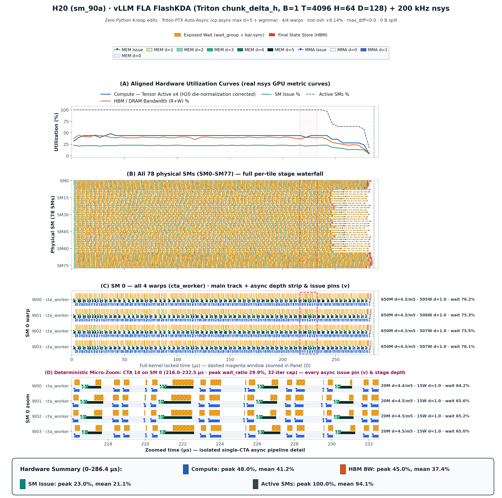

# WeaveProfiler

[简体中文](README.md) | English

> **See what every SM and warp is doing microsecond by microsecond — an automated intra-kernel GPU profiler built for RSI (Recursive Self-Improvement) and Megakernel development.**

WeaveProfiler combines **automated low-overhead in-kernel instrumentation** with **same-run 200 kHz hardware utilization curves** into one **four-panel PNG view**, packaged natively as **`Skill + MCP + Hook`** for Claude Code, Qwen Code, OpenAI Codex CLI, and Antigravity. Across CUDA C++, HIP C++, CuTeDSL, and Triton, it profiles inside an isolated temporary copy without touching production source files or function signatures.

---

## 1. Why RSI Needs WeaveProfiler

In **RSI (Recursive Self-Improvement)** workflows, AI agents iteratively write kernels, diagnose bottlenecks, rewrite microarchitecture, and re-verify to evolve high-performance **Megakernels** (MegaMoE, FlashAttention, persistent GEMM). End-to-end latency alone forces agents to guess blindly—effective RSI requires a profiler that exposes both code semantics and microsecond timing automatically.

Previous options force a trade-off:

- **Automatic vendor profilers (`nsys`, `rocprof-sys`)**: automated, but only show chip-wide aggregate hardware curves—when utilization dips, you cannot tell which SM, warp role, async copy, or barrier stalled. (`ncu` relies on multi-pass replay without a time axis and breaks on persistent or multi-GPU kernels.)
- **Manual in-kernel instrumentation**: captures code-level stages, but is tedious, error-prone, easily triggers register spills or scheduler distortion, struggles to pair async pipelines (`cp.async`, TMA, `wgmma`, `tcgen05`), and cannot run inside an automated optimization loop.

**WeaveProfiler brings both together:**

1. **Automated in-kernel instrumentation aligned with same-run hardware curves**: injects atomic-free, signature-preserving probes in an isolated copy (plus a PTX-level automatic async pass for NVIDIA Triton that extracts compiler-hidden `cp.async`/`wgmma` in-flight depth and exposed waits with zero Python K-loop edits), rigidly aligned with same-run 200 kHz hardware utilization curves in one **four-panel PNG**.
2. **Four deterministic blocking checks**: disassembly/zero-spill, bitwise output equality, event completeness, and `<= 10%` steady-state overhead—auto-coarsening hot probes on failure so distorted timings never mislead optimization.
3. **`Skill + MCP + Hook` native to RSI frameworks**: uses your active AI coding agent directly to read source, plan probes, and read the four-panel view; local MCP handles isolated verification and cross-round comparison; hooks enforce profile-before-edit, clean production source, and PNG-only delivery.

---

## 2. How to Read the Four-Panel Aligned View

WeaveProfiler defaults to PNG-only delivery (`overview.png`) instead of heavy `.perfetto.json.gz` dumps. Panels (A)–(C) share one locked microsecond (`µs`) axis, and Panel (D) automatically appends when full-kernel event spacing is denser than `28 px`:

- **(A) Hardware Utilization Curves**: Same-run chip-wide metrics (0–100%, 200 kHz `nsys` on NVIDIA, `rocprof-sys` on AMD): Compute (Tensor / MFMA), summed HBM Read+Write bandwidth, separate full-duplex interconnect (`NVLink TX` and `NVLink RX` are never summed or merged; `xGMI` on AMD), optional inter-node RDMA, and active SM/CU %. **Fails closed if real same-run hardware curves are missing.**
- **(B) All-SM / All-CU Waterfall**: Every physical core on the vertical axis, exposing wave steps, tail stragglers, and load skew.
- **(C) Single-SM / Single-CU Per-Warp / Per-Wave Timeline**: Each warp separates cleanly into stacked rows—an **upper main execution row (`Softmax` / scalar ALU / amber hatched `Exposed Wait` / `Store`, or synchronous MMA) + 0/1/2 on-demand async engine depth rows below (`MEM` green depth strip + dark-green issue pins `▼`; async `GEMM/WGMMA/tcgen05` blue depth strip + dark-blue issue pins `▼`)**—so async GEMM in-flight depth (`1/2/3/4/5+` 5-shade band) and its overlap with following `Softmax` / epilogue stages appear on separate aligned rows.
- **(D) Deterministic Single-CTA Micro-Zoom**: Auto-triggered on dense timelines; isolates the complete CTA with highest `Exposed Wait` ratio (or steady-state p50 CTA when wait-free; caps >48 iterations to a 32-iteration window around the worst bubble; supports `--zoom-cta` / `--zoom-window`), highlighting the exact window in dashed magenta across Panels (A)–(C).


> Captured on **NVIDIA H20 (`sm_90a`) `4096×4096×2048` Triton `num_stages=5` GEMM** (zero Python K-loop edits; automatic PTX extraction of both `cp.async` and `wgmma` async tracks; **`+5.46%`** steady-state overhead, `122.42 TFLOPS` = `93.7%` cuBLAS, `max_diff=0.0`, same-run 200 kHz `nsys`): Panels (A)–(B) lock 13 HBM wave pulses and the 10-SM tail drop to exact wave boundaries; Panels (C)–(D) expose both `MEM` (`max d=8` with `8→6→4→2→0` drain) and `WGMMA` (`max d=2`) pipelines alongside per-iteration `Exposed Wait`.

---

## 3. Architecture & Core Design

```text
Protected source (read-only) ──► AI Coding Agent (reads source via Skill, plans probes / isolated edits)
                                        │
                                        ▼  (calls local MCP verifier tools)
                             Local Verifier (isolated copy -> compile base & inst -> GPU run -> 4 checks)
                               ├── Any check fails ──► return diagnostics & hotspots -> hoist/coarsen
                               └── All 4 pass ───────► align HW curves -> render 4-panel PNG -> sign seal
```

- **Uses your AI coding agent directly**: Under the default `Skill + MCP + Hook` workflow, WeaveProfiler uses your active coding agent directly to read source, decide probe placement, and interpret the four-panel PNG—no separate LLM API key needed. (Optional headless batch mode `wp.identify` / `weaveprof_profile` accepts an OpenAI-compatible endpoint or an offline local `probe.json`.)
- **Low-perturbation in-kernel recorders**:
  - Pre-partitioned per-`(CTA, physical warp/wave)` slices with `lane 0` sequential 16-byte streaming stores (`st.global.cs.v4.u32` on NVIDIA; `global_store_dwordx4 ... nt` on AMD)—**zero atomics on the hot path**.
  - CUDA C++ defaults to a single 32-bit register context (`0 B` SMEM, up to `32,767` records/lane) with automatic fallback to static SMEM or `__noinline__` on register pressure; HIP C++ caches each wave's cursor in a per-wave slot so `__device__` helpers append seamlessly without signature edits.
  - Supports both global wall clocks (`%globaltimer` / `s_memrealtime`) and dual-anchor cycle counters (`%clock64` / `s_memtime`), plus adjacent boundary fusion.
- **Zero-signature integration**: CUDA/HIP bind via translation-unit device symbols (`cudaMemcpyToSymbol` / `hipMemcpyToSymbol`); Triton/CuTeDSL use transparent launcher proxies (stripping `@triton.autotune` on the instrumented copy to pin the baseline winning config); NVIDIA Triton includes the PTX-level automatic async pass (`triton_ptx_async.py`).
- **Four blocking checks**: ① **Assembly & resources** (core instruction fidelity, `delta_spill_bytes <= 0`, `extra_smem_bytes <= 0`); ② **Output equality** (bitwise identical to unmodified baseline); ③ **Event completeness & coverage** (zero unpaired events/overflows, full physical warp coverage by default, no coarse wrapper collapse); ④ **Steady-state overhead** (`|t_inst / t_base - 1| <= 10%` after warmup; both slowdowns and scheduling-perturbation speedups beyond `±10%` fail).
- **Out-of-workspace safeguards**: Clean backups, HMAC seals, and keys live outside the workspace under `~/.cache/weaveprof/sessions/`; lifecycle hooks (`PreToolUse` / `PostToolUse` / `Stop`) enforce profile-before-edit, clean production source, and PNG-only delivery.

---

## 4. Silicon Case Studies (NVIDIA H20, 200 kHz `nsys`)

### 4.1 8×H20 Production DeepGEMM MegaMoE (`1.47×` Speedup)

On an 8×H20 NVLink node running **Qwen3.5-397B DeepGEMM MegaMoE** (`EP=8, S=1024, E=512`), the aligned timeline pinpointed two root bottlenecks: ① split `GEMM1`/`GEMM2` launches + static expert assignment creating a ~`65 µs` inter-kernel idle gap; ② synchronous `Scatter` stalling compute warpgroups during `GEMM2` while `Disp` warps sat idle. Fusing into a persistent dynamic-queue megakernel and offloading async `Scatter` to `Disp` achieved a `1.47×` speedup (full walkthrough in [h20_megamoe_optimization.md](docs/case_studies/h20_megamoe_optimization.md)):


| Variant | Latency | FP8 Tensor Core (Avg / Peak) | HBM BW (Avg / Peak) |
| --- | ---: | ---: | ---: |
| Original split-kernel (a) | `613.2 µs` | `27.9%` / `37.1%` | `36.4%` / `47.6%` |
| Fused persistent + async Scatter (b) | **`416.4 µs` (`1.47×`)** | `41.8%` / `62.6%` | `55.7%` / `81.5%` |

### 4.2 Deep-Stage Async Pipeline Four-Panel View (RTX 3050 `sm_86` CUDA C++ 6-Stage `cp.async`)

Captured with same-run 200 kHz `nsys` GPU metrics on a `2048×2048×1280` 6-stage circular-buffer `cp.async` + WMMA GEMM on NVIDIA Ampere (`sm_86`): 32 HBM bandwidth pulses (peaking at `93.0%`) in Panel (A) align exactly with the 32 CTA wave boundaries across all 16 physical SMs in Panel (B), while Panel (D) isolates one CTA to reveal the full `0→1→2→3→4→5` prefetch ramp-up and `5→4→3→2→1→0` drain staircase across 5 depth shades (fine-grained 5-probe/iter showcase):


> **Desktop GPU Forensic Case Study (Windows RTX 3050 WDDM, `8192³` Triton GEMM, full write-up in [sm86_wddm_preemption.md](docs/case_studies/sm86_wddm_preemption.md))**:
> - **Cold-start local DRAM (GDDR6) ramp (`0–30 ms`)**: The orange `HBM/DRAM BW %` curve in Panel (A) climbs from `~25–30%` to `~100%` while `Tensor Active %` holds steady near `48%`, exposing **insufficient pre-capture warmup** (laptop DVFS clock stabilization + cold TLB / `2 MB` L2 across a `384 MB` working set).
> - **4 WDDM preemption cliffs ↔ `~1 ms` stretched blue/red blocks**: Panel (A)'s vertical `Active SMs → 0%` drops (`5.5 / 30.2 / 55.0 / 72.0 ms`) align to the microsecond with `~1 ms` stretched blue (`K0 MMA`) and red (`FP16 Store`) spans in Panel (B), pinning the glitches directly to OS display preemption.


### 4.3 Zero-Signature Four-Panel Profiling of Open-Source Kernels (NVIDIA H20, 200.3 kHz `nsys`)

Closed-loop profiling on unmodified open-source libraries at production long-sequence shapes with zero signature edits, `max_diff=0.0`, zero buffer overflows, and 100% physical warp coverage:

| Open-Source Kernel | Frontend & Shape (H20 `sm_90a`) | Warp Coverage | Steady-State Overhead & Highlights |
| --- | --- | :---: | --- |
| **FlashInfer 0.6.8 Hopper FA3** (3 headers) | CUDA C++, `B=5, H=16, S=4096, D=128` | 12 / 12 | **`+0.15%`** (`2,618 → 2,622 µs`), SW–HW delta `0.08%`; Panel (D) splits every math warp into two aligned rows—`Online Softmax / Wait` on top and async `WGMMA QK+PV` in-flight depth (`d=1/2`) overlapping Softmax below |
| **FlashInfer 0.6.8 Hopper FlashMLA** (`mla_hopper.cuh`) | CUDA C++, `B=64, H=128, KV=2048` | 8 / 8 | **`+9.96%`** (`356 → 392 µs`), **`0 B` spill**, SW–HW delta `0.49%`; auto-selects full 2-wave `SM 2`, showing `WG0`'s green `cp.async` in-flight count (`d=1/2`) + `kOScaleReady` wait + blue `PV1` WGMMA alongside `WG1`'s 2-row `Softmax / WGMMA` split |
| **vLLM FLA FlashKDA** (`chunk_delta_h.py`) | Triton 3.6 PTX Auto-Async, `B=1, T=4096, H=64, D=128` | 4 / 4 | **`+8.14%`** (`306 → 331 µs`, zero Python K-loop edits), **`0 B` spill**, SW–HW delta `0.39%`; Panel (D) exposes both 5-shade green `cp.async` ramps, blue `WGMMA` sub-track, and `~65%` per-chunk `Exposed Wait` |




---

## 5. Quick Start & Support Matrix

| Dimension | Support |
| --- | --- |
| GPUs | NVIDIA H20 (`sm_90`/`sm_90a`), B300 (`sm_100a`/`sm_103a`), Ampere (`sm_86`), AMD MI308X (`gfx942`) |
| Languages | CUDA C++, HIP C++, CuTeDSL (NVIDIA), Triton (NVIDIA PTX & AMD CDNA3) |
| Coding Agents | Native Claude Code, Qwen Code (`qwen`), OpenAI Codex CLI, Antigravity (`agy`) |
| Prerequisites | Python 3.10+, `nvcc`/`nsys` or `hipcc`/`rocprof-sys`, `matplotlib`; uses your active coding agent directly (no extra API key) |

Wire into your kernel repo in two commands (`--protect` locks files until the first passing baseline seal unlocks optimization):

```bash
git clone https://github.com/ziyuhuang123/WeaveProfiler.git
python3 -B WeaveProfiler/run.py install-agent \
  --workspace /path/to/your_kernel_repo \
  --protect kernel.cu \
  --card h20   # h20 | b300 | mi308x | sm86
```

Headless CLI wrapper (optional Linux `bubblewrap` read-only mounts) and offline verification:

```bash
python3 -B WeaveProfiler/run.py guard-exec --workspace /path/to/your_kernel_repo \
  -- codex exec "Profile this kernel and diagnose cross-SM load imbalance"

# Offline checks (no GPU required)
python3 -B WeaveProfiler/tests/package_structure.py
python3 -B -m unittest WeaveProfiler/tests/test_wp_megakernel.py WeaveProfiler/tests/test_mcp_hook_installer.py
```

**Key MCP Tools & Known Bounds**: Primary MCP tools are `weaveprof_megakernel_audit` (isolated run + 4 checks + 4-panel PNG + seal), `weaveprof_status`, `weaveprof_analyze`, `weaveprof_compare_rounds`, and `weaveprof_verify_seal`. Known bounds: CUDA single-register mode caps lanes at `32,767` records; AMD `rocprof-sys` PM counters are per-dispatch aggregates. See [SKILL.md](SKILL.md) for full CLI, recorder switches, and platform specs.
