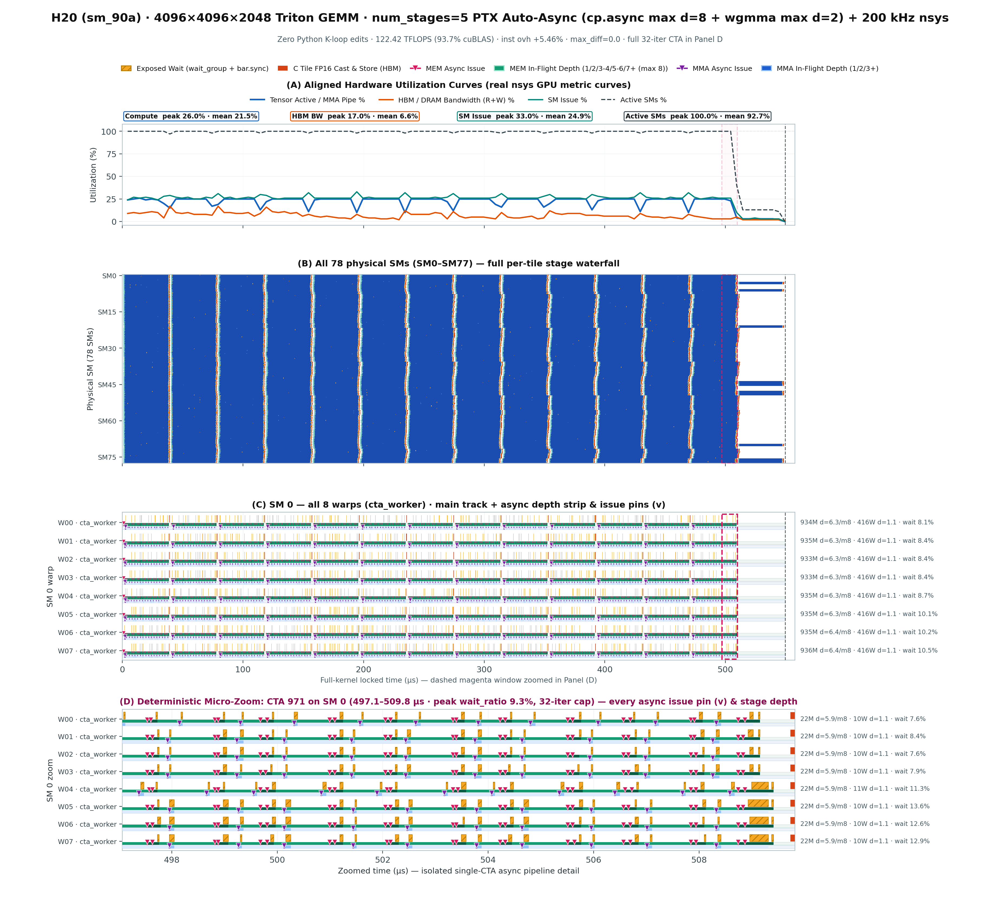
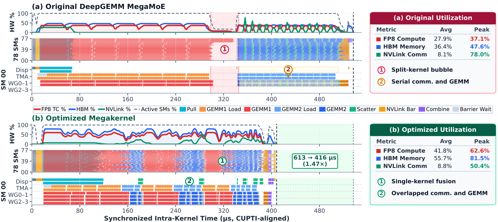
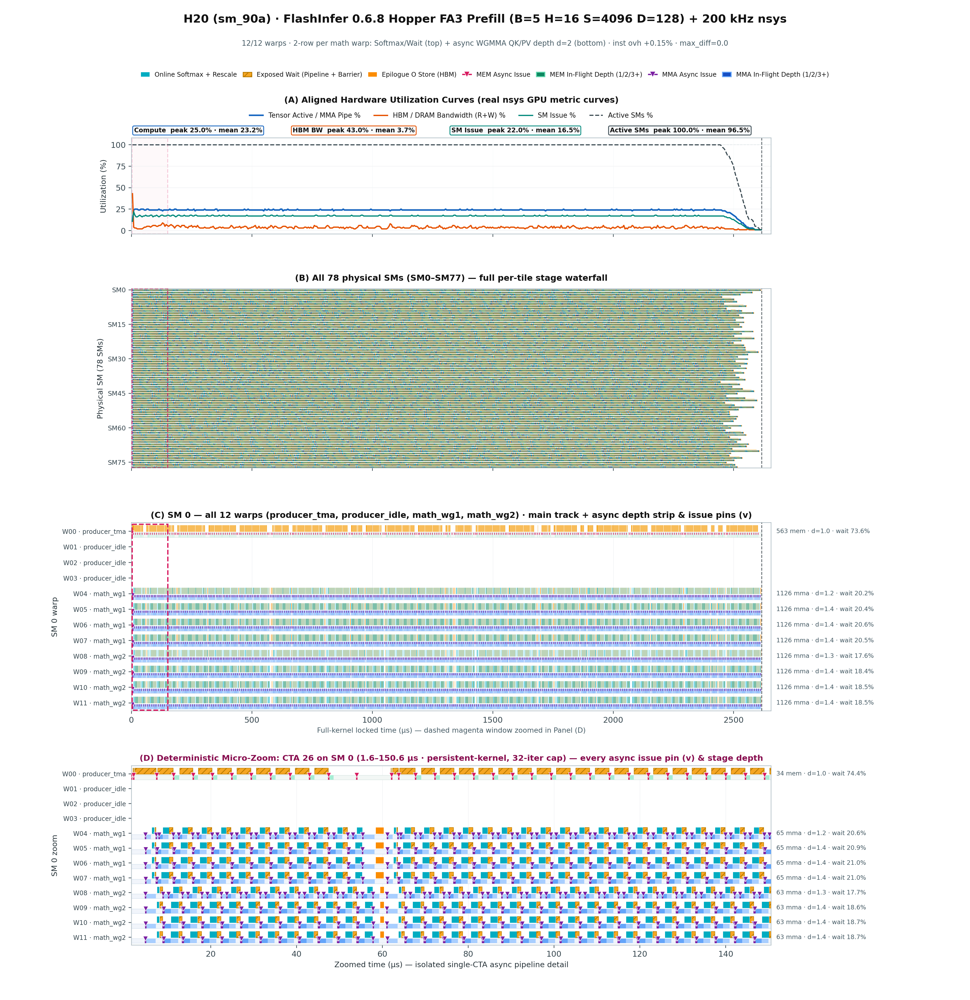

# WeaveProfiler

[简体中文](README.md) | English

## 🚀 Why WeaveProfiler

> **Plot microsecond-level timelines for every Warp/Wave inside a GPU kernel directly alongside same-run hardware utilization curves in a single figure — a low-overhead profiler built for GPU kernel engineers and AI coding agents.**

WeaveProfiler is a low-overhead intra-kernel timeline profiler and reproducible verification tool built for engineers tuning high-performance GPU kernels (such as MoE Megakernels, FlashAttention, FlashMLA, and Persistent GEMM) and AI coding agents iterating on kernel optimizations.

Vendor tools like NVIDIA `nsys` and AMD `rocprof-sys` primarily report chip-wide utilization: when utilization drops suddenly, you still cannot see which SM/CU or which warp is sitting idle waiting. Meanwhile, adding timing instrumentation directly into kernel source easily triggers register spills or alters the compiler's instruction scheduling. WeaveProfiler copies your code into an isolated temporary shadow copy to instrument it, plots every warp's stage timeline aligned with the same run's hardware utilization curves in a single `overview.png`, and enforces four strict checks—refusing to issue a passing result if any check fails, so every round of numbers stays grounded and trustworthy.



> Figure: Measured four-panel view of a `4096×4096×2048` Triton `num_stages=5` GEMM on NVIDIA H20 (`sm_90a`). Without touching your Triton K-loop Python code, the tool automatically tracks two async pipelines from the generated PTX—data movement (`cp.async`, max in-flight depth `8`) and matrix math (`wgmma`, max in-flight depth `2`)—achieving `122.42 TFLOPS` (`93.7%` cuBLAS), `+5.46%` steady-state overhead, `max_diff=0.0`, and `200 kHz nsys` alignment, clearly showing the first `13` complete waves followed by a tail wave where only ~`10` SMs remain active and utilization drops noticeably.

---

## ✨ Highlights

- 🧵 **SM/CU & Warp/Wave-Level Intra-Kernel Timelines**: Each warp/wave writes sequentially to its own pre-allocated memory region via `lane 0` (16-byte records, without `atomicAdd`), avoiding kernel slowdowns and thread contention as much as possible.
- 📈 **Intra-Kernel Timelines & Hardware Curves in One View**: Plots intra-kernel software timelines directly alongside same-run hardware utilization curves (`200 kHz nsys` on NVIDIA; per-dispatch `rocprof-sys` collection on AMD) in one `overview.png` ready to open and inspect, without writing bulky trace files by default (exportable to `.perfetto.json.gz` on demand).
- 🌊 **Async Pipeline Depth & Wait Pinpointing**: Simultaneously tracks in-flight request depth for both `TMA`/`cp.async` data movement and `WGMMA` compute, marking every issue site and highlighting wait time not hidden by compute (`Exposed Wait`).
- 🛡️ **Isolated Shadow Builds Without Touching Production Source**: All instrumentation, compilation, and runs happen inside temporary shadow copies without changing kernel signatures or editing your production source code.
- ✅ **Four Strict Checks + Compact Report + Verifiable Seal**: Refuses to return a passing verdict if any of the four checks fails (compiler spills, output equivalence, event completeness, `±10%` overhead); passing runs emit a full diagnostic `feedback.json`, a `< 2 KB` compact summary for AI agents, and an HMAC-SHA256-verified `seal.json`.
- 🤖 **Multi-Platform, Multi-Language & AI Coding Agent Integration**: Supports `CUDA C++`, `HIP C++`, `Triton`, and `CuTeDSL` across H20, B300, `sm_86`, and MI308X, and integrates with Claude Code, Codex CLI, Qwen Code, and Antigravity via `Skill + MCP + Hook`.

---

## 🔍 Questions It Answers

- **Which warp or wave is waiting, and where?** Splits physical warps/waves handling data movement, compute, and scheduling inside the same SM/CU into separate lanes, marking unhidden wait time (`Exposed Wait`) and its percentage with bright amber hatching to pinpoint the exact blocker.
- **Are the `TMA`/`cp.async` and `WGMMA` pipelines saturated?** Uses shaded blocks to show how many async requests are in flight at once and `▼` markers for every issue site, making it easy to see how pipelines ramp up, what depth they sustain, and how they drain at the end.
- **Is the trailing utilization drop caused by a few straggler SMs or load imbalance across SMs?** Stacking every SM/CU vertically makes it immediately clear whether a few straggler SMs are still finishing or work is unevenly distributed across cores.
- **Which code section is running when Tensor Core or memory bandwidth drops?** Hardware curves and intra-kernel stages share the same microsecond axis, distinguishing inter-kernel idle gaps, cold-start DRAM bandwidth ramps, and desktop WDDM preemption interrupts directly.
- **How much headroom is left, and have we hit hardware limits?** `causal.py` estimates remaining optimization headroom for each stage against measured compute and bandwidth ceilings on that GPU, keeping you from wasting effort where hardware limits are already reached.

---

## 🖼️ How to Read the Four-Panel View

The plotting module `viz.py` (`render_swhw_overview_png`) draws up to 4 aligned panels along a shared microsecond timeline. **If real hardware curves captured from the same run are missing, it refuses to emit an image by default**:

- **(A) Hardware Utilization Curves**: Shows chip-wide metrics from the same capture (`0–100%` vertical axis; `200 kHz nsys` on NVIDIA, `rocprof-sys` on AMD), including compute units, `Active SMs`, `SM Issue`, **total `HBM/DRAM` read+write bandwidth**, and full-duplex `NVLink TX` and `NVLink RX` plotted separately (never summed across directions; missing multi-node RDMA counters are labeled `unavailable` rather than filling with `0`).
- **(B) Full-Chip Physical SM / CU Overview**: Stacks all physical SMs/CUs on the chip vertically (rendered at `2400 px` width), overlaying primary execution stages with background async `MEM` activity to reveal wave boundaries, straggler cores in the final wave, and unusually slow outlier cores.
- **(C) Per-Warp / Per-Wave Timeline for a Representative SM / CU**: Automatically picks the SM/CU with the richest CTAs, roles, and events (overridable via `--sm`). Each lane draws main execution stages and amber-hatched `Exposed Wait` on top, expands green `MEM` (data movement) and blue `MMA` (compute) in-flight depth blocks with `▼` issue markers below on demand, and summarizes event count, mean concurrency `d`, and wait share on the right.
- **(D) Automatic Single-CTA Micro-Zoom**: Expands automatically when adjacent events pack too closely (`< 28 px` apart), prioritizing the CTA with the highest wait share (or the median steady-state CTA when almost no wait exists); if the loop exceeds `48` iterations, it slices `32` iterations around the heaviest stall and marks the zoomed range across Panels (A)–(C) with a dashed magenta outline.

> 💡 **H20 Chart Reading Tip**: On H20, `nsys` normalizes `Tensor Active` against the full GH100 die while each H20 SM has `1/4` of that compute power, so a saturated Panel (A) reads around `25%`; multiply by `4` for true utilization relative to H20 peak (analysis in `causal.py` automatically multiplies by `4`).

---

## 📊 Measured Case Studies

### 8×H20 Production DeepGEMM MegaMoE Optimization (`1.47×` Speedup)

Profiling Qwen3.5-397B DeepGEMM MegaMoE on an 8×H20 NVLink node (`EP=8, S=1024, E=512`, `200 kHz nsys`; details in [h20_megamoe_optimization.md](docs/case_studies/h20_megamoe_optimization.md)): the aligned timeline pinpointed ① an ~`65 µs` inter-kernel idle gap (`t ≈ 280–345 µs`) from splitting `GEMM1`/`GEMM2`, and ② synchronous `Scatter` inside `GEMM2` stalling compute warpgroups while `Disp` warps sat idle. Fusing into a single persistent dynamic-queue kernel and offloading `Scatter` asynchronously to `Disp` achieved a **`1.47×`** speedup (`32.1%` latency reduction), with post-optimization active SMs averaging `94.0%`:

| Variant | End-to-End Latency | FP8 Tensor Core (Mean / Peak) | HBM Bandwidth (Mean / Peak) | NVLink Comm (Mean / Peak) |
| --- | ---: | ---: | ---: | ---: |
| Original split kernels (Fig. a) | `613.2 µs` | `27.9% / 37.1%` | `36.4% / 47.6%` | `8.1% / 78.0%` |
| Persistent fused + async Scatter (Fig. b) | **`416.4 µs` (`1.47×`)** | **`41.8% / 62.6%`** | **`55.7% / 81.5%`** | `8.8% / 50.4%` |



> Figure: Before-and-after comparison on 8×H20 (`78` SMs, `200 kHz nsys`) DeepGEMM MegaMoE, visually showing the speedup gained by eliminating the ~`65 µs` inter-kernel idle gap and making `Scatter` asynchronous.

### Profiling a Production Kernel on H20 (Without Changing Kernel Signatures): FlashInfer 0.6.8 Hopper FA3

Measured profiling of the production CUDA C++ kernel **FlashInfer 0.6.8 Hopper FA3 Prefill** (`B=5, H=16, S=4096, D=128`) on H20 (`sm_90a`, `200 kHz nsys`) without changing kernel signatures:

- **Full Coverage & Very Low Overhead**: Covers all **`12/12`** physical warps at only **`+0.15%`** steady-state relative overhead with exact output match (**`max_diff=0.0`**).
- **Role Split & Compute Overlap**: Panel (C) clearly distinguishes data-moving `W00 producer_tma`, idle `W01–W03 producer_idle`, and two compute warpgroups `W04–W11 math_wg1/2`; Panel (D) (`CTA 26`, `1.6–150.6 µs`) splits each math warp into main work and async matrix math rows, directly showing `Softmax/Wait` overlapping async `WGMMA QK/PV` (depth `d=1/2`) alongside inter-tile `O Store` writebacks.



> Figure: Measured four-panel view of H20 (`sm_90a`) FlashInfer 0.6.8 Hopper FA3 Prefill (`B=5, H=16, S=4096, D=128`), capturing all `12/12` physical warp roles and async compute overlap at `+0.15%` overhead and `max_diff=0.0`.

### More Verified Cases (Links)

- **FlashInfer 0.6.8 Hopper FlashMLA (H20 `sm_90a`)** — [case_h20_flashmla.png](docs/images/case_h20_flashmla.png): `DeepSeek-V3` scale (`B=64, H=128, KV=2048`), covering `8/8` warps with **`+9.96%`** steady-state overhead, `0 B` register spills, `max_diff=0.0`, and `200 kHz nsys`; Panel (D) automatically zooms into full two-wave `SM 2` (`CTA 22`, `140.9–248.8 µs`), simultaneously displaying `WG0`'s async `cp.async` transfers (depth `d=1/2`), wait, and `PV1` compute alongside `WG1`'s `Softmax / WGMMA` stages.
- **vLLM FLA FlashKDA (H20 `sm_90a`)** — [case_h20_flashkda.png](docs/images/case_h20_flashkda.png): `Triton chunk_delta_h` (`B=1, T=4096, H=64, D=128`), tracking both `cp.async` (max depth `5`) and `wgmma` async pipelines automatically from PTX without touching your Triton K-loop Python code, covering `4/4` warps at **`+8.14%`** overhead, `0 B` spills, and `max_diff=0.0`; Panel (D) `CTA 14` (`216.0–232.5 µs`) directly exposes ~**`65%`** (`64.2–65.6%`) unhidden wait time.
- **RTX 3050 `sm_86` WDDM Preemption & Cold-Start Forensics** — [sm86_wddm_preemption.md](docs/case_studies/sm86_wddm_preemption.md) / [case_sm86_wddm_preemption.png](docs/images/case_sm86_wddm_preemption.png): `8192³` FP16 Triton GEMM (full-kernel runtime `86–101 ms`) collects `25.46M` raw records across `16,384` lanes with `0` overflows (`1.07%` SW–HW window span delta), clearly revealing the `0–25 ms` GDDR6 cold-start bandwidth ramp (`55.9%` mean, `98.0%` peak) and the sudden drop to zero from desktop WDDM display preemption at `t ≈ 30–33 ms`.
- **AMD MI308X `gfx942` Sampling Check & Bandwidth Calibration** — [amd_mi308x.md](docs/amd_mi308x.md) / [README_card-mi308x.md](examples/triton/card-mi308x/README_card-mi308x.md): Measured HBM streaming read peak `3684 GB/s`; on `2048³` FP16 Triton GEMM, fast sampling mode (`FI_LEVEL=2 FI_SAMPLE=1`) logs `14` records/wave at a `0.975×` runtime ratio (passing the 10% check, marked for quick debugging only and not valid as formal full-audit evidence), whereas the un-sampled full-K run (`FI_LEVEL=2 FI_SAMPLE=0`) logs `390` records/wave at a **`1.703×`** runtime ratio and is blocked directly by the 10% overhead check.

---

## 🧩 Support Matrix

| Card (`card`) | Architecture (`arch`) | Granularity | Supported Languages | Hardware Sampling & Verification Status |
| --- | --- | --- | --- | --- |
| **`h20`** (NVIDIA H20) | `sm_90` / `sm_90a` | `78` SMs, warp32 | `cuda_cpp`, `triton`, `cutedsl` | `200 kHz nsys` (`--capture-range=cudaProfilerApi`); hardware-tested profiles for CUDA C++ / Triton / CuTeDSL (note: CuTeDSL's `cute.gemm` `wgmma` path is not yet tested on hardware); causal analysis automatically applies a `×4` correction to `Tensor Active` |
| **`b300`** (NVIDIA B300) | `sm_100a` / `sm_103a` | e.g. `sm_103a` `148` SMs, warp32 | `cuda_cpp`, `triton`, `cutedsl` | `200 kHz nsys`; `sm_103a` CUDA C++ / Triton are hardware-tested, `sm_100a` is build-verified only, and CuTeDSL is experimental (see [L20D Peak Calibration Notes](docs/l20d_achievable_peak_rebase.md)) |
| **`sm86`** (Ampere) | `sm_86` | e.g. tested RTX 3050 `16` SMs, warp32 | `cuda_cpp`, `triton`, `cutedsl` | `200 kHz nsys` (falls back to software-only timeline mode on WSL2 when hardware counters are missing); base card profile is hardware-tested on RTX 3050 (no standalone operator presets yet); `triton`/`cutedsl` default to `WP_TIMER=1` (`%clock64` ~`27 ns` step) |
| **`mi308x`** (AMD MI308X) | `gfx942` | `80` CUs (`4` XCC), wave64 | `hip_cpp`, `triton` (no CuTeDSL) | Primary `rocprof-sys` (`rocprofv3` fallback), aggregated per dispatch with no `200 kHz` periodic sampling; GEMM workflow is hardware-tested; PMC capture is forbidden on persistent kernels with `grid >= 80 CU` |

- **AI Coding Agent Integration** (`install-agent --agent`): Built-in support for **Claude Code** (`claude`), **OpenAI Codex CLI** (`codex`), **Qwen Code** (`qwen`), and **Antigravity** (`agy` / `antigravity`).

---

## 📦 Installation

`pyproject.toml` currently declares only `requires-python = ">=3.10"` and **does not list runtime packages under `dependencies`**, so install the components needed for your workflow:

- **Python Version**: `>= 3.10` (source files use `X | Y` union type syntax).
- **Python Packages**:
  - **Required for plotting**: `numpy`, `matplotlib` (required to generate `overview.png`; core decoding, check, and causal analysis modules use the standard library only);
  - **Optional as needed**: `msgspec` (faster JSON I/O), `perfetto` (only needed for native Perfetto protobuf export and `TraceProcessor` checks), `torch` / `triton` / `cutlass` (needed for the corresponding kernel frontends).
- **System Toolchains**:
  - NVIDIA: CUDA Toolkit (`nvcc`, `cuobjdump`) + Nsight Systems (`nsys`);
  - AMD: ROCm (`hipcc`) + `rocprof-sys` (and fallback `rocprofv3`);
  - Optional acceptance/sandbox tools: `trace_processor_shell` (required only for full Perfetto export acceptance in `run.py deliver`), Linux `bwrap` (optional read-only mount for `guard-exec`).

```bash
pip install -e . --no-build-isolation   # Or run directly without installing via python3 -B run.py / python3 -B -m weaveprof
pip install numpy matplotlib            # Required to render overview.png
python3 -B -m weaveprof doctor          # Check Python, GPU lock directory, GPU, and profiler readiness
```

> ⚠️ **GPU Counter Permission Note**: When NVIDIA hits `ERR_NVGPUCTRPERM` (`Insufficient Privilege`), WeaveProfiler aborts immediately instead of silently dropping hardware curves—configure `NVreg_RestrictProfilingToAdminUsers=0` / `CAP_SYS_ADMIN` on Linux (or authorize `nsys` with `sudo`), or allow all users to access GPU performance counters in the Windows NVIDIA Control Panel. When hardware curves are missing, `viz.py` refuses to generate a software-only `overview.png` by default.

---

## ⚡ Quick Start

### Option A: Connect to an AI Coding Agent (`Skill + MCP + Hook`)

```bash
python3 -B run.py install-agent \
  --workspace <your_repo> \
  --protect <kernel_file> \
  --agent claude            # Options: all | both | claude | codex | qwen | agy | antigravity
```

Once installed, protected files are locked and backed up to a separate directory outside your workspace; the AI agent calls the MCP tool **`weaveprof_megakernel_audit`** to compile, benchmark, run the four checks, and render `overview.png` inside temporary shadow copies, unlocking further optimization edits only after a passing `seal.json` is generated.

### Option B: Run Megakernel Profiling via the Python API

> Note: `run.py` itself **does not provide** a `megakernel-audit` subcommand; to invoke it from the CLI, run `python3 -B weaveprof/aka_adapter.py megakernel-audit` (reading JSON from stdin).

```python
from weaveprof.megakernel import run_megakernel_audit

report = run_megakernel_audit(
    workspace="./my_kernel_repo",
    entry_source="kernel.cu",                 # relative to workspace
    inst_files={"kernel.cu": open("kernel_inst.cu").read()},  # or pass inst_dir=...
    build_cmd="make -j8",
    bench_cmd="python3 bench_mk.py",
    capture_nsys=True,
    card="h20",
    out_dir="../wp_audit_out",  # must be outside workspace
)
```

**Three inputs to prepare before running**:

1. **Instrumented copy** (`inst_files` source map or `inst_dir` directory): overlays only the instrumented version inside the temporary shadow copy (`L_inst`), while the original copy is compiled automatically with `WP_LEVEL=0` (probes off) as the baseline—production source stays untouched;
2. **`names.json`**: maps event IDs, semantic categories (must come from `configs/semantic_ids.json`), and thread role IDs to readable names;
3. **Benchmark script `bench_cmd`**:
   - Run **ABBA alternating timing** (alternating baseline and instrumented launches in a `Base-Inst-Inst-Base` order to cancel linear drift from GPU heating or clock throttling);
   - Write the two output comparison files, binary record dump (`capture.wp02.bin` or `capture.fi02.bin`), and `runtime.json` into `$WEAVEPROF_OUT_DIR`;
   - After all four checks pass, when `capture_nsys=True`, WeaveProfiler runs `bench_cmd` once more with **`WEAVEPROF_NSYS_CAPTURE=1`**; in this mode, the script should skip the multi-round ABBA loop, run a single kernel launch bracketed by `cudaProfilerStart()` / `cudaProfilerStop()`, and write the binary record dump from that same run into `$WEAVEPROF_OUT_DIR`.

Minimal `names.json` and `runtime.json` examples (per the `megakernel.py` contract):

```json
{
  "events": {"1": "kv_topk_load", "3": "sparse_mla_mma", "5": "epilogue"},
  "semantics": {"1": "load", "3": "mma", "5": "epilogue"},
  "roles": {"0": "persistent_cta"}
}
```

```json
{
  "kernel_name": "sparse_mla_decode",
  "warmup": 3,
  "timing_protocol": "ABBA",
  "baseline_ns": [374000.0, 374400.0, 373900.0],
  "instrumented_ns": [381106.0, 381513.6, 381004.1],
  "output_files": [["baseline.bin", "instrumented.bin"]],
  "l0_stats": {"regs": 72, "spill_stores": 16, "spill_loads": 16, "stack_bytes": 16, "stl": 2, "ldl": 2},
  "inst_stats": {"regs": 72, "spill_stores": 16, "spill_loads": 16, "stack_bytes": 16, "stl": 3, "ldl": 3}
}
```

**Output artifacts (written to `out_dir`)**:

- `overview.png`: Four-panel SW+HW aligned figure (generated by default; refuses to emit when hardware curves are missing).
- `feedback.json`: Full check details and causal diagnosis report (summary returned to AI agents via the API is compacted to `< 2 KB`).
- `verify.json` / `seal.json`: Verdict summary across the four checks and HMAC-SHA256 seal record.
- `nsys_hw.json` / `trace.perfetto.json.gz`: Hardware summary produced when `capture_nsys` is enabled; bulky `.perfetto.json.gz` files are omitted by default (requires explicit `write_perfetto_gz=True`).

---

## 🛡️ Four Verification Checks

| Check | What It Checks | Input Source |
| --- | --- | --- |
| **`assembly`** | Compares local memory traffic and spill deltas, requiring `delta_spill_stores <= 0 B`, `delta_spill_loads <= 0 B`, `delta_stack_bytes <= 0 B`, `delta_stl <= 4`, and `delta_ldl <= 4` (**catches hidden spills even when the compiler's reported register count stays flat**) | `l0_stats` / `inst_stats` in `runtime.json` written by `bench_cmd` |
| **`output`** | Verifies that baseline and instrumented outputs point to two distinct non-empty files that are **byte-for-byte SHA-256 identical** | Two disk files referenced by `output_files` (falls back to hash fields or `output_match` in `runtime.json` unless strict disk-file comparison is required) |
| **`events`** | Checks `overflow == 0`, start/end pairing errors `== 0`, and `spans > 0`; **blocks empty placeholder probes and coarse probes that only wrap the entire outer loop**, and requires full physical warp coverage by default | Decoded `capture.*.bin` + `names.json`, supplemented by optional fields in `runtime.json` (`sass_body_insns`, `expected_warps_per_cta`) |
| **`overhead`** | Requires `warmup >= 1`, `>= 3` positive paired samples, and median relative change **`\|Δt\| <= 10%`** (**runs that mysteriously speed up by more than `10%` also fail, catching cases where probing alters compiler optimization**) | `baseline_ns` / `instrumented_ns` / `warmup`, etc. in `runtime.json` written by `bench_cmd` |

> ℹ️ **Data Scope in the Megakernel Path**: In `run_megakernel_audit`, `assembly`, `overhead` (and the `output` fallback unless strict disk-file comparison is required) rely on `runtime.json` produced by `bench_cmd`; `megakernel.py` itself does not invoke `cuobjdump` directly for instruction-level comparison. If you need independent disassembly verification and mandatory disk-file output checks, use `wp.profile` / `wp.verify` or the staged `validate` command instead.

---

## 🔧 Device-Side Recorder Quick Reference

The switches and macros below match `recorders/cuda_cpp/wp_lite.cuh` strictly (defining both `WP_*` and a non-equal legacy `FI_*` triggers a compile-time `#error`):

| Compile Switch | Allowed Values (CUDA Default) | Behavior |
| --- | --- | --- |
| **`WP_LEVEL`** | `0 \| 1 \| 2` (`0`) | `0` disables probing (compiles to a no-op for baseline timing); `1` records only `OPEN`/`CLOSE`, scopes, and role switches; `2` records all events and stage boundary transitions |
| **`WP_TIMER`** | `0 \| 1` (`0`) | `0` reads the global clock `%globaltimer`; `1` uses `%clock64` in the body and writes dual-clock anchors using `2` slots each at `OPEN` and `CLOSE` (`2` extra slots total) |
| **`WP_GRAN`** | `0 \| 1` (`0`) | `0` for Warp/Wave granularity (only `lane 0` writes); `1` for CTA/SM granularity (only `thread 0` writes) |
| **`WP_CTX_REG`** | Macro flag (off by default) | Single 32-bit register context (`0 B` SMEM), capped at **`65,535` slots** / **`32,767` records/lane**; supports `WP_CTX_REG_NOINLINE` to mark write helpers `__noinline__` so inlining does not bloat the main loop |
| **`WP_CTX_SMEM`** | Macro flag (off by default) | **Uses static shared memory instead of hot-loop registers**, occupying **`16 B` per slot** (`512 B/CTA` by default for 32 warps, or `16 B/CTA` with `WP_GRAN=1`) |

**When to switch context modes**: Start with `-DWP_CTX_REG` by default; switch modes or move probes immediately on any of these signals:

- **Register headroom <= 2 `regs`/thread or any spill / stack frame / STL increase** (even if the reported `regs` count did not change!): switch to **`-DWP_CTX_SMEM`** when free SMEM `>= 16 B` (if SMEM cannot fit 32 slots, combine with `-DWP_GRAN=1` to drop to `16 B/CTA`).
- **Both registers and shared memory exhausted (free SMEM `< 16 B`)**: fall back to **`-DWP_CTX_REG_NOINLINE`** (1 register, `0 B` SMEM, isolating write helpers as `__noinline__`).
- **Compiler loop unrolling or instruction scheduling is broken**: stop probing inside hot inner loops and **hoist probes out to outer stage boundaries**.

**6 core macros at a glance**:

| Macro | Purpose (1-Sentence Summary) |
| --- | --- |
| **`WP_OPEN(role)`** | Initializes the slot context via `lane 0`/`thread 0` at kernel entry and writes an `OPEN` start record tagged with the physical SM ID (plus the opening anchor when `WP_TIMER=1`). |
| **`WP_CLOSE()`** | Writes the `CLOSE` end record (and closing anchor) on kernel exit paths, setting the overflow flag if the buffer fills up. |
| **`WP_B(id, aux)`** | Writes a 16-byte Begin record for event `id` in the default event group (group 0) with a custom `aux` context payload. |
| **`WP_E(id, aux)`** | Writes a 16-byte End record for event `id` in the default event group (group 0), pairing with its matching `WP_B`. |
| **`WP_TRANS_PRED(pred, g_end, end_id, g_beg, beg_id, aux)`** | Reads the timer once and writes back-to-back End and Begin records for adjacent stages with the same timestamp. |
| **`WP_KERNEL_SCOPE(role)`** | Expands to an RAII scope guard in normal modes, **but under `-DWP_CTX_SMEM` expands directly to a non-RAII opener (internally `FI_OPEN(role)`), so `WP_CLOSE()` must still be called explicitly before exit**. |

---

## 🧭 Other Entry Points

- **Staged CLI Pipeline**: `python3 -B run.py scan → instrument → capture → validate → deliver` (plus `check`, which runs validation without issuing an acceptance receipt) splits source semantic scanning, hash-verified probe generation and application, hardware capture, full rule validation, and `trace_processor_shell`-based final trace acceptance (`deliver`) into separate stages.
- **Built-in H20 GEMM Probe (`gemm-probe`)**: `python3 -B run.py gemm-probe --card h20 --arch sm_90` compiles and runs the built-in H20 `sm_90` GEMM SW+HW probe in a single command (supports `--profile full|quick`; results are always marked diagnostic-only and not valid as formal acceptance evidence).
- **Fast Build & Verification (`fast`)**: `python3 -B run.py fast --job <fast_job.json>` caches by hash, builds both probe-off and full-probe variants in parallel, and runs quick verification (also marked as not valid as formal acceptance evidence and does not replace full validation).
- **Python Closed-Loop API & Module CLI (`wp.profile` / `wp.verify` / `-m weaveprof`)**: `wp.profile` locates probe sites automatically (`identify`), independently compares disassembly instructions, and iteratively hoists probes when overhead or scheduling is affected (paired with `wp.locate_or_remap_0token` to remap positions across edits without calling an LLM); `wp.verify` runs a single reproducible verification round for an existing `probe.json` configuration; `python3 -B -m weaveprof` additionally exposes 9 subcommands: `identify`, `locate`, `verify`, `validate`, `profile`, `seal-check`, `doctor`, `causal`, and `render`.
- **Coding Agent Guardrail Toolchain (`install-agent` / `guard_hook.py` / `mcp-server` / `guard-exec`)**: `install-agent` installs agent-specific MCP and lifecycle hooks so `guard_hook.py` blocks unverified/unsealed edits, leftover probe code in source files, and disallowed `.gz` files across tool calls and exit checks, paired with `guard-exec` to continuously protect files while the agent runs (with optional Linux `bwrap` read-only mounts):

```bash
python3 -B run.py guard-exec --workspace <your_repo> -- codex exec "Diagnose intra-kernel wait bubbles and tail SM dips"
```

---

## 📌 Usage Notes & Known Limitations

- **Megakernel path requires pre-supplied inputs**: `run_megakernel_audit` does not rewrite large multi-file kernel sources automatically; callers must provide the instrumented code inside the temporary shadow copy (`inst_files` / `inst_dir`), `names.json`, and a `bench_cmd` that runs ABBA timing, writes output comparison files, `runtime.json`, and `capture.*.bin`, and handles `WEAVEPROF_NSYS_CAPTURE=1`.
- **Data-source boundary in the megakernel path**: In this path, `assembly`, `overhead`, and optional `output` fallbacks read directly from `runtime.json`; when you need tool-driven `cuobjdump` full instruction-sequence comparison, use `wp.profile` / `wp.verify` or the staged `validate` command.
- **Differences in SW/HW alignment strategies**: Under the `megakernel` path, the software timeline and `nsys` hardware curves are overlaid with each kernel's start as zero, and the `±5%` span and `≥ 90%` sample-density checks emit warnings only; when strict cross-clock offset calculation and tail-margin blocking are required, use `weaveprof/pipeline/validate/tools/fi_align_nsys.py`.
- **H20 Panel (A) vs. causal calibration difference**: Currently, Panel (A) of `overview.png` plots raw `nsys` readings (~`25%` saturated on H20), whereas analysis results from `causal.py` are automatically multiplied by `4`.
- **Local permission boundary of HMAC `seal.json`**: `seal.json` verifies whether artifacts have been modified after generation, but the signing key `.supervisor.key` lives under the current user's local directory (`0o600`), so it does not prevent the same OS user from acting outside the agent session to modify local files directly.
- **GPU counter permissions & architecture limits**: On NVIDIA, hitting `ERR_NVGPUCTRPERM` requires enabling counter access first, and WeaveProfiler refuses software-only PNG output by default when hardware curves are missing; on AMD MI308X, `rocprof-sys` provides per-dispatch aggregated counters only (no `200 kHz` periodic sampling), and persistent kernels with `grid >= 80 CU` forbid ROCm PMC capture.
- **Python runtime dependencies must be installed as needed**: `pyproject.toml` does not yet declare `dependencies`, so install runtime packages such as `numpy` and `matplotlib` manually as needed.
- **Offline test scope & conditional skips**: The offline suite entry point is [tests/run_all.sh](tests/run_all.sh) (containing `40` unit tests and a `__pycache__` check, requiring Python `>= 3.10` and GNU `find`/`date`; when `numpy`/`torch`/`triton`/`hipcc` are missing, corresponding items skip conditionally or run static checks only); real-GPU tests must be executed separately on matching hardware.

---

## 🗂️ Repository Layout / 📚 Documentation Index

```text
WeaveProfiler/
├── run.py                  # Unified CLI (18 subcommands: scan/instrument/capture/validate/deliver/install-agent, etc.)
├── SKILL.md                # AI coding agent usage rules and full parameter reference
├── plugin.json             # Agent plugin manifest and 6 plugin tool definitions
├── pyproject.toml          # Package metadata and `weaveprof` entry-point definition
├── weaveprof/              # Core engine (megakernel.py, harness.py, causal.py, viz.py, api.py, backend.py, mcp_server.py, guard_hook.py, pipeline/)
├── recorders/              # Cross-language device-side recorders (wp_lite.cuh, wp_lite_hip.h, wp_triton*.py, wp_cute.py)
├── configs/                # Card specs (cards/), language patterns (languages/), metric normalization (metrics/), semantics & recipes (recipes/)
├── examples/               # Two-role demos, MI308X Triton example, multi-language reference kernels, and host scaffolding
├── docs/                   # Design docs, hardware calibration notes, case studies, and four-panel example PNGs (images/)
└── tests/                  # Offline test suite (run_all.sh) and hardware regression cases
```

- **Architecture & Guides**
  - [System Design & Prototype Notes (`docs/design.md`)](docs/design.md) — Recorder architecture, SM90 prototype data, and alignment specs
  - [Agent Skill Manual (`SKILL.md`)](SKILL.md) — Complete workflow rules, parameter configs, and troubleshooting manual
  - [Offline Test Entry (`tests/run_all.sh`)](tests/run_all.sh) — `40` offline unit tests and no-`__pycache__` check script
- **Hardware Calibration & Sampling**
  - [AMD MI308X `gfx942` Field Guide (`docs/amd_mi308x.md`)](docs/amd_mi308x.md) — CDNA3 clocks, `rocprof-sys` aggregated metrics, and persistent-kernel constraints
  - [`nsys --capture-range` Sampling Window Guide (`docs/nsys_pm_sampling.md`)](docs/nsys_pm_sampling.md) — Solving `200 kHz` buffer-flush window dropouts
  - [L20D `sm_103` Achievable Peak Rebase (`docs/l20d_achievable_peak_rebase.md`)](docs/l20d_achievable_peak_rebase.md) — Measured bandwidth and compute baselines for the B300-derivative SKU
  - [Slow-Path & Edge-Case Diagnostics (`docs/slow-path.md`)](docs/slow-path.md) — Slow-path diagnosis and corner-case records
- **Case Studies & Examples**
  - [8×H20 DeepGEMM MegaMoE Optimization (`docs/case_studies/h20_megamoe_optimization.md`)](docs/case_studies/h20_megamoe_optimization.md) — `1.47×` speedup diagnosis and refactoring details
  - [RTX 3050 `sm_86` WDDM Preemption Analysis (`docs/case_studies/sm86_wddm_preemption.md`)](docs/case_studies/sm86_wddm_preemption.md) — Cold-start bandwidth ramp and desktop preemption forensics
  - [MI308X Triton Example Notes (`examples/triton/card-mi308x/README_card-mi308x.md`)](examples/triton/card-mi308x/README_card-mi308x.md) — MI308X `2048³` FP16 GEMM sampling comparison walkthrough
