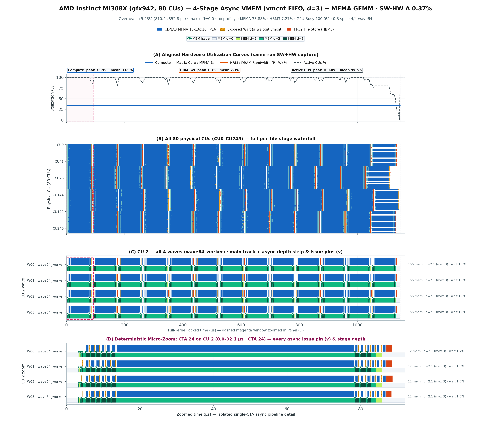
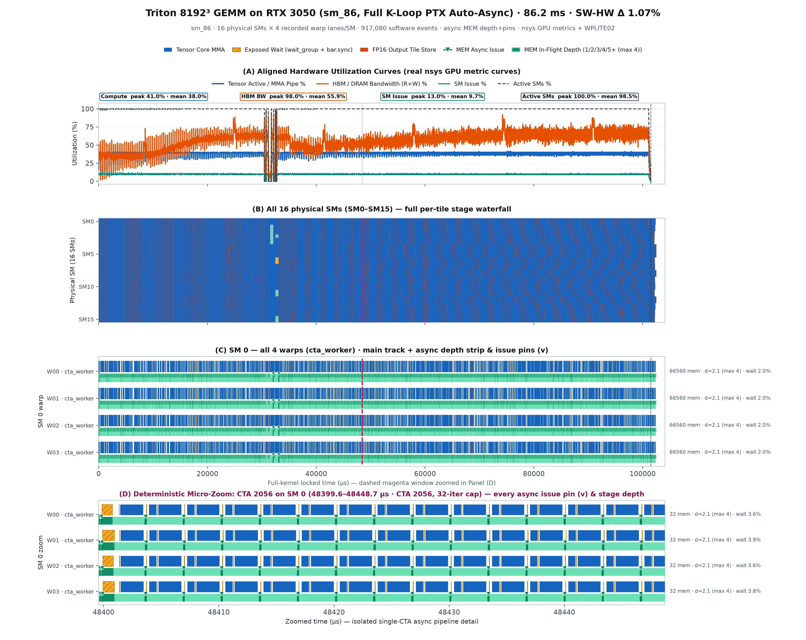
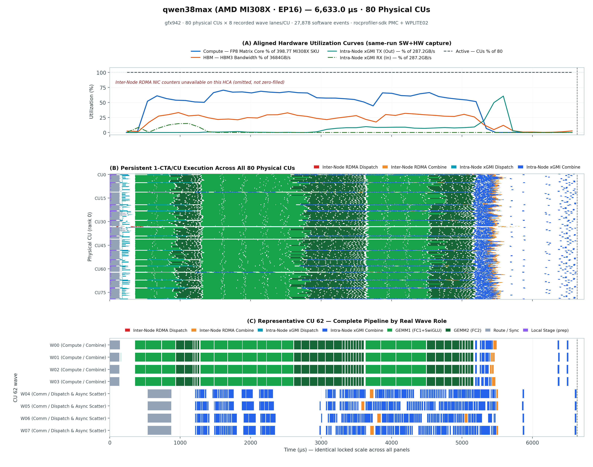

# WeaveProfiler

[简体中文](README.md) | English

> **See what every SM/CU and warp/wave is doing microsecond by microsecond — an automated intra-kernel GPU profiling framework built for modern asynchronous pipelines and agent-driven Recursive Self-Improvement (RSI).**

**WeaveProfiler** aligns **closed-loop automated intra-kernel software instrumentation** with **same-run hardware utilization counters** in a single static four-panel timeline image (`overview.png`). It supports two native entry modes: (1) **`Skill + MCP + Hook`** integration directly inside AI coding agents (`Claude Code`, `Qwen Code`, `OpenAI Codex CLI`, `Antigravity` — no extra API key needed); and (2) **Direct API Key** execution via CLI or Python SDK with automatic endpoint routing for **Alibaba Cloud Bailian (`DashScope` / `Coding Plan` / `MaaS`)** and any OpenAI-compatible provider. Across **CUDA C++, HIP C++, Triton (NVIDIA PTX & AMD AMDGCN), and CuTeDSL**, all probe injection and verification run in isolated scratch copies with zero edits to production code or function signatures.

---

## 1. Background & Three Challenges: Why Modern GPU Kernels and RSI Need WeaveProfiler

Modern LLM training and inference kernels increasingly rely on **persistent fused megakernels** (MegaMoE, FlashAttention-3, FlashMLA, Gated Delta Networks), where warps within each CTA take on specialized **roles** (data loading, matrix compute, inter-GPU communication) connected by multi-stage **asynchronous hardware pipelines** (NVIDIA `cp.async` / TMA / `wgmma` / `tcgen05`, AMD CDNA3 `buffer_load` + `s_waitcnt vmcnt` + `MFMA`). Performance hinges on role overlap: **in-flight pipeline depth ($d$)** determines whether memory/communication latency is hidden, while **Exposed Wait** pinpoints stalls on the critical path. As kernel engineering shifts toward **agent-driven Recursive Self-Improvement (RSI)** with no human in the loop, intra-kernel profiling must become both fine-grained and fully automated.

Existing profilers and naive LLM code edits fall short due to three fundamental challenges:

1. **Free-form LLM code edits silently corrupt traces without trace-level verification**: Vendor hardware profilers (`nsys`, `rocprofv3`) treat launches as black boxes without warp/stage attribution. Asking an LLM agent to directly edit source code for instrumentation—even with compile and output checks—frequently produces unpaired spans across branches, missing warp roles, buffer truncation, or severe hot-loop slowdowns; if verification scripts live inside a writable workspace, unconstrained agents may even tamper with `#pragma unroll` / `__launch_bounds__` or relax check thresholds to pass.
2. **Asynchronous hardware & compiler pipelines are mismeasured as synchronous stubs**: Source-level or high-level IR probes close immediately after non-blocking issue, missing compiler-generated commit/wait boundaries (such as Triton's lowered `commit_group` / `wait_group` or AMDGCN's `s_waitcnt vmcnt(N)`). This underestimates true in-flight residency by `30×–120×`, reports $d=0$ concurrency, and dumps real wait stalls into downstream compute stages.
3. **Heavy recorder state triggers register spills or shared-memory occupancy cliffs**: Production fused kernels run close to register-file and shared-memory ceilings. Multi-register contexts (4–10 live registers) push tight kernels into local-memory `STL/LDL` spills, while kilobyte-scale shared-memory ring buffers (`0.5–4 KB/CTA`) trigger occupancy cliffs (e.g., `2 → 1 CTA/SM`) or silently overwrite events upon wrap-around.

---

## 2. Key Observation & Three Core Mechanisms

> **Key Observation**: Only **stage identification** requires semantic understanding from an LLM, whereas probe injection, asynchronous issue-to-wait pairing, and trace validation can all be executed by **deterministic rules**—and because asynchronous engines retire operations in FIFO issue order, runtime probe state fits in a **single 32-bit register** (`0 B` shared memory).

```text
Protected Source (Read-Only) ──► Read-Only Stage Identification (Coding Agent or Bailian/OpenAI API) ──► probe.json
                                                                                                            │
                                                                                                            ▼
                 Out-of-Workspace Deterministic Harness (C++/CuTe Injection · NVIDIA PTX / AMD AMDGCN Auto-Async Pass)
                                                                                                            │
                                                                                                            ▼
                           Same-Run HW Sampling (200 kHz nsys / rocprof-sys) + Four Fail-Closed Checks
                             ├── Any check fails ──► return offending probes & trace in feedback.json -> auto-coarsen
                             └── All checks pass ──► render aligned 4-panel overview.png + sign HMAC-SHA256 seal
```

WeaveProfiler realizes this observation through three mechanisms backed by system-level guardrails:

### 2.1 Closed-Loop Automated Instrumentation & System Guardrails
- **Read-only stage identification + deterministic injection**: The LLM analyzes kernel source strictly read-only to emit role predicates and stage line boundaries (`probe.json`). Deterministic harness code injects probes into an isolated copy—at the source level for CUDA/HIP/CuTeDSL, via an automatic **PTX dual-async pass** (`triton_ptx_async.py`) for NVIDIA Triton, and via an automatic **AMDGCN async pass** (`triton_amdgcn_async.py`, preserving live scalar `SCC` flags and streaming via `vscnt` without perturbing `vmcnt`) for AMD ROCm Triton, requiring zero Python K-loop edits.
- **Four fail-closed validation checks**: (1) **Assembly & resource check** (core instruction order and loop unrolling preserved, $\Delta_{\text{spill}} \le 0\text{ B}$, $\Delta_{\text{smem}} \le 0\text{ B}$); (2) **Output check** (bitwise-identical or strict numerical equivalence to unmodified baseline); (3) **Event completeness & coverage check** (every `begin` paired with `end`, zero overflow/drops, 100% physical warp/wave64 coverage); (4) **Bidirectional steady-state overhead check** ($|t_{\text{inst}}/t_{\text{base}} - 1| \le 10\%$, rejecting both >+10% slowdowns and <-10% schedule-perturbing speedups).
- **Three system-level guardrails**: Out-of-workspace MCP service signing `HMAC-SHA256` seals with a secret hidden from the agent (`~/.cache/weaveprof/sessions/`), `PreToolUse` / `PostToolUse` / `Stop` lifecycle hooks, and optional Linux `bubblewrap` read-only mounts.

### 2.2 Within- & Cross-Warp Asynchronous Pipeline Tracing
- **Cross-warp producer–consumer pairing (1-to-$N$ earliest-arrival deduplication)**: For warp-specialized `mbarrier` rings (e.g., Hopper FA3 and FlashMLA), producer issues and consumer wait exits are paired by `(CTA, event, slot)` on a chip-wide nanosecond clock. Taking the earliest consumer arrival ($\min_w t_{\text{exit}}(w)$) per generation avoids 1-to-$N$ fan-out double-counting and slow-consumer inflation, yielding exact CTA-wide in-flight TMA depth via sweep-line analysis.
- **Within-warp multi-engine FIFO depth**: Explicit `Exposed Wait` spans bracket `wait_group` / `mbarrier` / `s_waitcnt vmcnt(N)` on each warp's main row, while dual sequence counters (`seq_in++` at commit, retiring `seq_out < seq_in - N` at wait) reconstruct exact per-cycle in-flight depth $dd = seq_in - seq_out across NVIDIA (`cp.async`, `wgmma`, `tcgen05`) and AMD CDNA3 (`WP_VMEM_COMMIT` / `WP_VMEM_WAIT`, `v_mfma`).

### 2.3 Minimal-State Low-Overhead Recording & Zero-Signature Binding
- **Lock-free per-warp slices + 1-register context (`WP_CTX_REG`)**: Lane 0 of each `(CTA, physical warp/wave)` appends 16-byte cache-streaming records (`st.global.cs.v4.u32` on NVIDIA; `buffer_store_dwordx4` / `global_store_dwordx4 ... nt` on AMD) with **zero atomics and zero cross-warp sync**. `WP_CTX_REG` packs mutable state (disabled/overflow bit + 16-bit slot + 15-bit cursor) into **one 32-bit register and `0 B` SMEM** (hoisted before `setmaxnreg`), with an optional `16 B` static SMEM fallback (`WP_CTX_SMEM`) for zero-headroom single-module kernels.
- **Dual-anchor cycle timing, boundary fusion & out-of-band binding**: Low-latency `%clock64` / `s_memtime` reads inside hot loops are calibrated via per-warp `%globaltimer` / `s_memrealtime` open/close anchors; adjacent stage `end`/`begin` pairs fuse into a single clock read; device descriptors (`cudaMemcpyToSymbol` / `hipMemcpyToSymbol`) and per-warp progress slots carry cursors across multi-header `__device__` helpers without changing any C++ signature.

---

## 3. Reading the Four-Panel Aligned View (`overview.png`)

WeaveProfiler outputs one static high-resolution PNG readable directly by both engineers and multimodal LLMs. Panels (A)–(C) share a locked microsecond (`µs`) axis, and Panel (D) opens automatically when full-kernel stages are dense:

- **(A) Same-Run Hardware Utilization Curves (Fail-Closed)**: Chip-wide Compute (Tensor / Matrix Core MFMA), summed HBM R+W bandwidth, separate full-duplex interconnect (`NVLink TX` and `NVLink RX` plotted independently; `xGMI` on AMD), and active SM/CU %. Refuses to render if real same-run hardware curves are absent.
- **(B) All-SM / All-CU Stage Waterfall**: Every physical SM/CU on the vertical axis, exposing wave boundaries, load skew, and tail stragglers.
- **(C) Single-SM / Single-CU Per-Warp / Per-Wave Timeline**: Each physical warp splits into an **upper main track** (stages + amber-hatched `Exposed Wait` + `Store`) and **lower async engine depth strips** (`MEM` green & `MMA/WGMMA/tcgen05` blue 5-shade heat bands + issue pins `▼`).
- **(D) Deterministic Single-CTA Micro-Zoom**: Zooms into the complete CTA with highest `Exposed Wait` ratio (marked in dashed magenta across Panels A–C), revealing individual issue pins, ramp-up, overlap, and drain steps.


> **NVIDIA H20 (`sm_90a`) `4096×4096×2048` Triton `num_stages=5` GEMM**: Zero Python K-loop edits; automatic PTX extraction of `cp.async` (**peak `d = 8`**, showing `1→8` ramp and `8→6→4→2→0` drain) and `wgmma` (**`d = 2`**) alongside `Exposed Wait` at **`+5.46%`** overhead, `max_diff = 0.0`, locked to 200 kHz `nsys`.

---

## 4. Cross-Platform Gallery & Optimization Case Studies Guided by `(In-Flight Depth d + Exposed Wait)`

### 4.1 Direct Silicon Speedups Guided by `(In-Flight Depth d + Exposed Wait)`

Jointly observing `(d, Exposed Wait %)` distinguishes **under-pipelined memory stalls** (increase depth), **split compute synchronization bottlenecks** (fuse `wgmma` waits instead of crossing SMEM cliffs), and **over-pipelined register/SMEM pressure** (trade redundant depth for larger tiles/higher occupancy):

| Platform | Workload & Shape | Before `(d, Exposed Wait)` | Diagnosis & Guided Optimization | After `(d, Exposed Wait)` | Verified Speedup (`max_diff=0`) |
| --- | --- | :---: | --- | :---: | :---: |
| **8×NVIDIA H20** (`sm_90a`) | DeepGEMM MegaMoE (Qwen3.5-397B, `EP=8, S=1024`) | `65 µs` launch gap + sync `Scatter` stall | Persistent dynamic-queue fusion + async `Scatter` offload to idle `Disp` warps | Comm overlapped with FP8 Tensor Core (`27.9% → 41.8%`) | `613.2 → 416.4 µs` (**`1.47×`**) |
| **NVIDIA H20** (`sm_90a`) | Upstream `vLLM fused_moe` (DeepSeek-V3 `M=128, E=256, H=7168, I=2048`) | `s=3` default: `steady d=2.3 (max 4)`, **`Wait = 33.6%`** | HBM latency exposed with spare SMEM headroom → deepen pipeline to `num_stages=5` | `steady d=6.3 (max 8)`, **`Wait = 5.0%`** (`6.8×` drop) | `10,242.5 → 8,724.5 µs` (**`1.17×`** vs default / **`1.29×`** vs `s=1`) |
| **NVIDIA H20** (`sm_90a`) | Upstream `vLLM FLA FlashKDA` (`chunk_fwd_h`, `T=4096`) | `s=2` default: `max d=5`, **`Wait = 27.5%`** (4 split `wgmma` waits) | Naive `s=3` (`d=10`, `133 KB` SMEM) hits `2→1 CTA/SM` cliff (`0.59×`); fuse `K=128` `RS-WGMMA` (`wgmma_waits: 4→2`) | Keeps `2 CTAs/SM` (`73.7 KB` SMEM), halves sync barriers | `286.2 → 265.3 µs` (**`1.08×`**) |
| **NVIDIA B300** (`sm_103a`) | Blackwell Gather-GEMM (`4096×4096×2048` & `8192×8192×4096`) | `s=2`: `steady d=1.9 (max 2)`, **`Wait = 37.4% / 53.4%`** | Advance to `s=3` (`s=4` `131 KB` SMEM drops occupancy to `0.72×`) | `steady d=2.5 (max 4)`, **`Wait = 4.6% / 16.6%`** (`8.1×` drop) | `102.7 → 80.9 µs` (**`1.27×`**, **`1.63×`** vs `s=1`; **`1,071.7 TFLOPS`** @ 8K) |
| **AMD MI308X** (`gfx942`) | CDNA3 Async VMEM + MFMA GEMM (`4096×4096×2688`) | `s=1` sync: `d=0` (blocking `vmcnt(0)`) | 4-stage `global_load_dwordx4` + `s_waitcnt vmcnt(8)` register–LDS pipeline | `steady d=2.1 (max 3)`, **`Wait = 1.7%`** | `1,572.9 → 810.0 µs` (**`1.94×`**, `111.3 TFLOPS`) |
| **2×8 AMD MI308X** (`gfx942`) | 2-Node EP16 MegaMoE (Qwen3.8-Max, `S=16384, E=512, K=10`) | Split opening dispatch + serial `GEMM1→GEMM2` + exposed combine | Fused opening dispatch + cross-node Top-K dedup/pre-reduce + 3-group `GEMM1↔GEMM2` interleave + `1-CTA/CU (80×512)` partial-wave `4+4` split | Full-duplex `xGMI RX/TX` overlapped with `MFMA` (**`70.4%`** chip / **`83.4%`** compute pool of `398.7T`) | `17,204.0 → 6,981.1 µs` (**`2.46×`** vs RCCL+AITER) |
| **RTX 3050** (`sm_86`) | Ampere CUDA C++ `cp.async` + WMMA GEMM (`2048×2048×1280`) | `6-stage (64×128)`: `steady d=4.0 (max 5)`, **`Wait = 19.8%`** | Redundant depth on small tile → retarget SMEM to `3-stage (128×128)` for 2× data reuse | `steady d=1.1 (max 2)`, **`Wait = 16.6%`**, MMA share `79.7%` | `1,170.2 → 1,005.6 µs` (**`1.16×`**, `88.2%` cuBLAS) |

### 4.2 8×H20 Production DeepGEMM MegaMoE (`1.47×` Speedup)

Aligned timelines on an 8×H20 NVLink node running **Qwen3.5-397B DeepGEMM MegaMoE** (`EP=8, S=1024, E=512`) exposed a `~65 µs` inter-kernel gap and synchronous `Scatter` stalls while `Disp` warps idled; fusing into a persistent dynamic-queue megakernel with async `Scatter` offload yielded **`1.47×`** speedup (see [h20_megamoe_optimization.md](docs/case_studies/h20_megamoe_optimization.md)):


### 4.3 AMD Instinct MI308X (`gfx942`, 80 CUs) 4-Stage Async VMEM (`vmcnt` FIFO, `d=3`) + MFMA Four-Panel View

On AMD CDNA3 GPUs, vector memory loads (`global_load_dwordx4` / `buffer_load_dwordx4`) execute asynchronously and retire in FIFO order via `s_waitcnt vmcnt(N)`, overlapping directly with `v_mfma_*` Matrix Core pipelines. WeaveProfiler supports both **HIP C++ async macros** (`WP_VMEM_COMMIT` / `WP_VMEM_WAIT`) and **ROCm Triton AMDGCN auto-async instrumentation** (`triton_amdgcn_async.py`). Below is a live 80-CU MI308X capture at **`+5.23%`** overhead (`810.4 → 852.8 µs`), **`max_diff = 0.0`**, `0 B` spill, and **`0.37%`** `rocprof-sys` SW–HW delta, showing all 4 `wave64` tracks' `vmcnt` issue pins `▼`, in-flight depth (`steady d = 2.1, max 3`), `Exposed Wait (1.8%)`, and `3→2→1→0` tail drain:



### 4.4 Zero-Signature Four-Panel Captures on Open-Source H20 Kernels

Measured on unmodified open-source repositories at long-sequence production shapes (`max_diff = 0.0`, `0` overflow, 100% physical warp coverage):

- **FlashInfer 0.6.8 Hopper FA3** (3 headers, CUDA C++, `B=5, H=16, S=4096, D=128`, 12/12 warps): **`+0.15%`** overhead (`2,618 → 2,622 µs`), `0.08%` SW–HW delta, deduplicated 1-to-8 cross-warp TMA depth `max_d_tma = 4` (2 K + 2 V) and dual-row `Softmax` / async `WGMMA (d=1/2)` overlap.
- **FlashInfer 0.6.8 Hopper FlashMLA** (`mla_hopper.cuh`, `B=64, H=128, KV=2048`, 8/8 warps): **`+9.96%`** overhead, `0 B` spill, `0.49%` SW–HW delta.
- **vLLM FLA FlashKDA** (`chunk_delta_h.py`, Triton 3.6 PTX Auto-Async, `B=1, T=4096, H=64, D=128`, 4/4 warps): **`+8.14%`** overhead, `0 B` spill, `0.39%` SW–HW delta, zero Python K-loop edits.


### 4.5 Desktop Ampere (RTX 3050 `sm_86`) 6-Stage `cp.async` & Windows WDDM Preemption Forensics

For local Ampere desktop/laptop development:
- **6-Stage `cp.async` + WMMA GEMM (`2048×2048×1280`)**: **`+0.70%`** steady-state overhead (`1,178.6 → 1,186.8 µs`, `0 B` spill, `max_diff = 0.0`) under Scheme A head/tail retention + interior coarsening, preserving the full `0→1→2→3→4→5` ramp and `5→4→3→2→1→0` drain in Panel (D).
- **Windows WDDM Preemption Forensics (`8192³` Triton PTX Auto-Async GEMM, see [sm86_wddm_preemption.md](docs/case_studies/sm86_wddm_preemption.md))**: Captures both the `0–25 ms` cold-start GDDR6 ramp and `t ≈ 30–33 ms` OS graphics preemption cliffs.




### 4.6 2-Node 16×AMD Instinct MI308X (EP16) Multi-Fabric RDMA + Full-Duplex xGMI MegaMoE (`2.46×` Speedup)

Captured on a 2-node 16×MI308X cluster (`2×8 GPUs`, `287.2 GB/s` per-direction xGMI + inter-node RDMA) running a persistent single-megakernel **MegaMoE (Qwen3.8-Max, `EP=16, S=16384, E=512, K=10`)**:
- **Panel (A) Export-Regulated MI308X `398.7T` SKU Calibration & Split Full-Duplex xGMI**: MI308X enforces its `398.7 TFLOPS` FP8 cap via both shader clock throttling (`~1.38 GHz` → `451.5T` raw pipe clock ceiling) and power/duty capping (`451.5 / 398.7 = 1.1325×`). Normalizing interval MFMA work directly to the `398.7 TFLOPS` SKU ceiling (`100 × ΔSQ_VALU_MFMA_BUSY_CYCLES × 1024 / (Δt × 398.7T)`) reads **`94.5%`** on a `376.7 TFLOPS` dense FP8 GEMM and **`70.4%` chip-wide (`280.6 TFLOPS`)** here—corresponding to **`83.4%` of `398.7T` SKU peak (`88.3%` of achievable dense GEMM ceiling)** across the `540/640` (`84.4%`) Compute wave pool (see [amd_mi308x.md](docs/amd_mi308x.md)). Full-duplex `Intra-Node xGMI RX (In)` and `Intra-Node xGMI TX (Out)` are plotted as independent curves alongside an explicit HCA-counter unavailability note (never zero-filled).
- **Panels (B)–(D) Persistent `1-CTA/CU (80×512)` Multi-Fabric Waterfall & 3-Group `GEMM1 ↔ GEMM2` Overlap**: Strictly adhering to **`1 CTA/CU` (`80 CTAs × 512 threads = 80 physical CUs × 8 waves`)** over a unified `64 KB` LDS arena with software partial-wave 4-wave synchronization (`W00–W03` Compute / Combine + `W04–W07` Comm / Dispatch & Async Scatter), fused single-stage opening dispatch, cross-node Top-K deduplication & node-level pre-reduction (**`+15.1%`** standalone gain), and 3-group `GEMM1 ↔ GEMM2` interleaving launch `xGMI TX (Out)` and streaming RDMA/xGMI Combine at `t ≈ 3,550 µs` underneath **`70.4%`** chip-wide (**`83.4%`** Compute-pool) Matrix Core execution (reaching **`88.3%`** Inter-Node RDMA bound roofline utilization), cutting latency from `17,204.0 µs` (`RCCL + AITER`) to **`6,981.1 µs` (`2.46×` speedup, 16-rank FP64 verified)**:



---

## 5. Dual-Mode Quick Start & Support Matrix

| Dimension | Coverage |
| --- | --- |
| **GPUs** | NVIDIA Hopper H20 (`sm_90`/`sm_90a`), Blackwell B300 (`sm_100a`/`sm_103a`), Ampere (`sm_86`), AMD Instinct MI308X (`gfx942`) |
| **Frontends** | CUDA C++, HIP C++, Triton (NVIDIA PTX Dual-Async & AMD AMDGCN Async), CuTeDSL |
| **Dual Entry Modes** | **Mode 1**: AI Coding Agents (`Claude Code`, `Qwen Code`, `OpenAI Codex CLI`, `Antigravity` via `Skill + MCP + Hook`, no extra key required); **Mode 2**: Direct **Alibaba Cloud Bailian (`DashScope` / `Coding Plan` / `MaaS`)** or any OpenAI-compatible API Key via CLI / Python SDK |
| **Prerequisites** | Python 3.10+, `nvcc` + `nsys` (NVIDIA) or `hipcc` + `rocprof-sys` (AMD), `matplotlib` |

### Mode 1: AI Coding Agents (`Skill + MCP + Hook`, No Extra API Key Needed)

Install into any kernel repository in two commands (`--protect` locks production files until the initial baseline seal passes):

```bash
git clone https://github.com/ziyuhuang123/WeaveProfiler.git
python3 -B WeaveProfiler/run.py install-agent \
  --workspace /path/to/your_kernel_repo \
  --protect kernel.cu \
  --card h20   # h20 | b300 | mi308x | sm86
```

### Mode 2: Direct API Key (Alibaba Cloud Bailian / DashScope or OpenAI-Compatible)

Automatically routes Bailian standard keys (`DASHSCOPE_API_KEY` / `BAILIAN_API_KEY`, `sk-...` → `dashscope.aliyuncs.com`), Bailian Coding Plan keys (`sk-sp-...` → `coding.dashscope.aliyuncs.com`), Bailian MaaS workspace keys (`sk-ws-...`), or custom `OPENAI_BASE_URL` + `OPENAI_API_KEY`:

```bash
export DASHSCOPE_API_KEY="sk-..."   # or BAILIAN_API_KEY, or pass --api-key directly

python3 -B WeaveProfiler/run.py identify kernel.cu -o probe.json   --card h20 --model qwen-max
python3 -B WeaveProfiler/run.py profile  kernel.cu -o overview.png --card h20 -- python3 bench.py
python3 -B WeaveProfiler/run.py doctor
```

```python
import weaveprof as wp

spec = wp.identify("kernel.cu", out="probe.json", card="h20", api_key="sk-...", model="qwen-max")
with wp.profile("kernel.cu", out="overview.png", card="h20", api_key="sk-..."):
    run_kernel()
```

### Guarded Batch Execution & Offline Tests

```bash
python3 -B WeaveProfiler/run.py guard-exec --workspace /path/to/your_kernel_repo \
  -- codex exec "Profile exposed waits and cross-SM load skew in this kernel"

# Offline structural & unit tests (no GPU required)
python3 -B WeaveProfiler/tests/package_structure.py
python3 -B -m unittest \
  WeaveProfiler/tests/test_wp_megakernel.py \
  WeaveProfiler/tests/test_mcp_hook_installer.py \
  WeaveProfiler/tests/test_triton_amdgcn_async.py
```

**Core MCP Tools & Known Bounds**: Primary MCP tools are `weaveprof_megakernel_audit` (isolated injection + 4 checks + 4-panel PNG + HMAC seal), `weaveprof_status`, `weaveprof_analyze`, `weaveprof_compare_rounds`, and `weaveprof_verify_seal`. Known bounds: CUDA `WP_CTX_REG` caps per-lane capacity at `32,767` records; AMD `rocprof-sys` PM counters are per-dispatch aggregates. See [SKILL.md](SKILL.md) for full recorder macros, compiler flags, and platform details.
