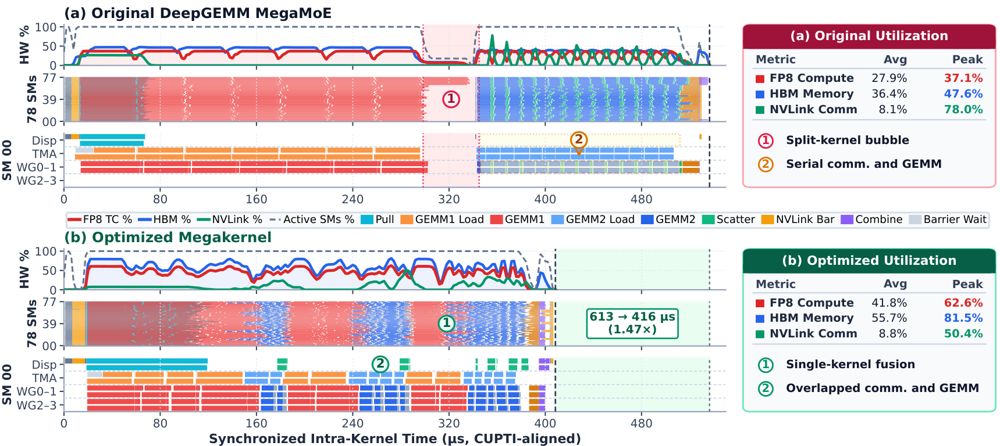
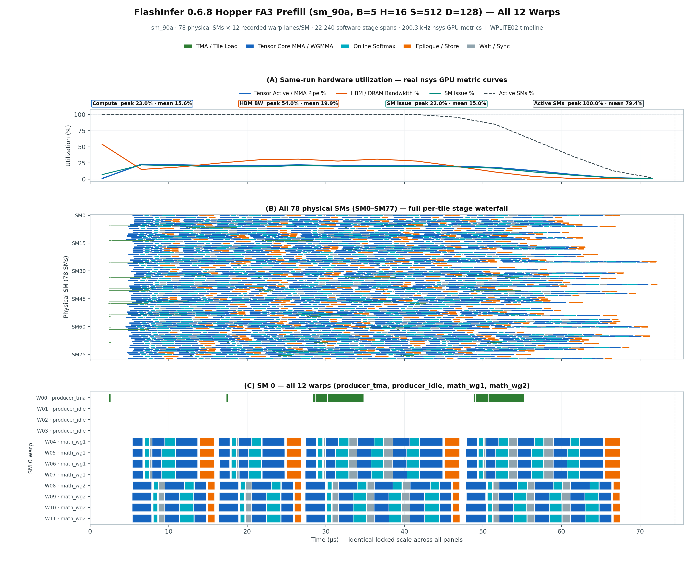
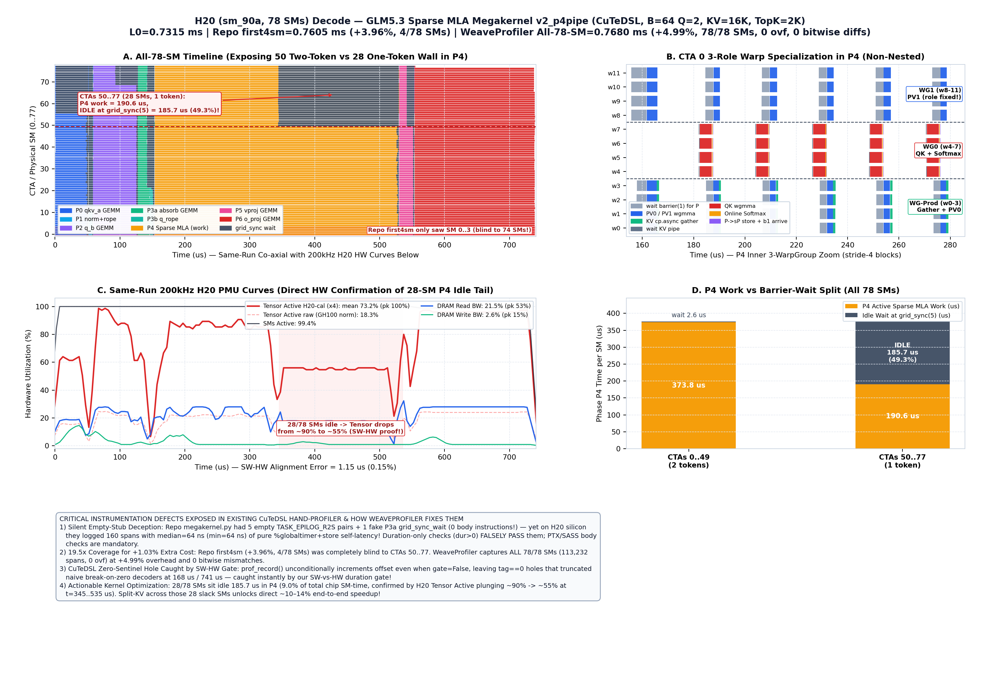
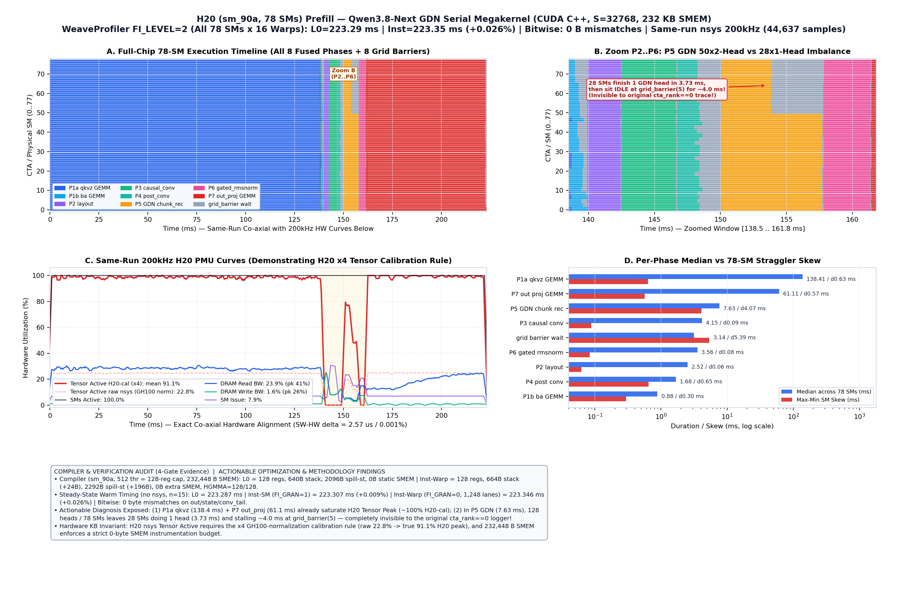

# 真实案例：8×H20 生产级 DeepGEMM MegaMoE 端到端优化（1.47× 加速）

本案例对应论文第 V 节，完整演示 **WeaveProfiler** 如何在 8 卡 NVIDIA H20（`sm_90a`，78 个物理 SM，NVLink 全互联）上对生产级 **Qwen3.5-397B DeepGEMM MegaMoE**（`EP=8`，`S=1024`，`E=512`）执行零调用栈修改的核内细粒度插桩、同次 `nsys` 软硬时间线对齐、瓶颈根因定位以及重构后的闭环验证。

---

## 一、原始算子软硬同轴诊断（图 a：`613.2 µs`）

将 WeaveProfiler 部署到原始分核 DeepGEMM MegaMoE 后，同次软硬对齐的三联时间线在整卡硬件利用率、全 78 SM 瀑布与单 SM 线程束角色（`Disp`、`TMA`、`WG0–1`、`WG2–3`）三个视角上直接暴露出两类决定端到端耗时的核心瓶颈：

1. **瓶颈 ①：分核启动与静态分配导致的跨核大空泡（Split-kernel bubble）**
   - 原始实现将 `GEMM1` 与 `GEMM2` 拆成两次独立核函数发射，并采用静态专家分配。
   - 中联 78-SM 瀑布与上联 `Active SMs %` 曲线清晰显示：在 `t ≈ 280–345 µs` 区间，绝大多数 SM 早已算完 `GEMM1`，却被迫停在核间屏障前空等少数慢 SM 收尾，整卡 `FP8 Tensor Core %` 与 `HBM %` 双双跌至接近 0%。
2. **瓶颈 ②：GEMM2 阶段通信与计算强串行（Serial comm. and GEMM）**
   - 从下联 `SM 00` 的 WarpGroup 时间线可以看到：`GEMM2` 期间，计算组（`WG0–1`）每算完一个小分块就必须暂停并同步执行 `Scatter` 跨卡发送，而专门的通信角色（`Disp`）此时几乎处于完全闲置状态。
   - 这种“算一块、等一次通信”的锯齿交替使整卡平均 `FP8 Tensor Core` 利用率仅 **27.9%**（峰值 **37.1%**），`HBM` 带宽利用率均值 **36.4%**（峰值 **47.6%**），`NVLink` 平均利用率仅 **8.1%**。

---

## 二、时间线指导下的两步重构与复测验证（图 b：`416.4 µs`，`1.47×`）

依据上述可定位到具体 Warp 角色与微秒窗口的诊断结论，对核函数实施两步针对性重构，并复用 WeaveProfiler 进行同口径复测验证：

1. **优化 ①：单核持久化融合 + 原子动态领任务（Single-kernel fusion）**
   - 将 `GEMM1` 与 `GEMM2` 合并为单个持久化 Megakernel，并通过原子动态队列按需领取专家任务。
   - 复测时间线（图 b 中联 ①）显示：跨核空闲大空泡彻底消失，全卡平均活跃 SM 占比保持在 **94.0%**。
2. **优化 ②：异步 `Scatter` 卸载至空闲 `Disp` 线程束（Overlapped comm. and GEMM）**
   - 将 `GEMM2` 的跨卡 `Scatter` 发送从计算 WarpGroup 中解耦，异步卸载给原本闲置的 `Disp` 线程束，与底层的 `GEMM1 / GEMM2` 矩阵计算并行重叠。
   - 复测时间线（图 b 下联 ②）显示：`Disp` 线程束在计算进行的同时持续穿插发起异步 `Scatter`，计算组不再被通信阻塞。

---

## 三、优化前后定量对比（8×H20 实测）

| 指标 | 原始分核 DeepGEMM（图 a） | 优化后融合持久化 Megakernel（图 b） | 变化 / 收益 |
| --- | ---: | ---: | ---: |
| **端到端耗时** | `613.2 µs` | **`416.4 µs`** | **`1.47×` 加速（`-32.1%`）** |
| **FP8 Tensor Core 利用率（均值 / 峰值）** | `27.9%` / `37.1%` | **`41.8%` / `62.6%`** | 均值 `+13.9 pp` / 峰值 `+25.5 pp` |
| **HBM 显存带宽利用率（均值 / 峰值）** | `36.4%` / `47.6%` | **`55.7%` / `81.5%`** | 均值 `+19.3 pp` / 峰值 `+33.9 pp` |
| **NVLink 互联利用率（均值）** | `8.1%` | **`8.8%`** | 消除锯齿串行阻塞 |
| **平均活跃 SM 占比** | 存在约 65 µs 跨核空泡 | **`94.0%`** | 跨核屏障空泡消除 |

---

## 四、更多 H20 真卡实测案例

### 1. 主流开源算子库零签名修改三联图直出（FlashInfer Hopper FA3）

不改动 FlashInfer 0.6.8 的任何 Python 封装、TVM-FFI 接口与模板签名，通过跨三头文件（`prefill_sm90.cuh` + `mainloop.cuh` + `mainloop_mma.cuh`）进度槽接力，覆盖全部 12 个物理 Warp（`W00` TMA 预取、`W01..W03` 早退空闲、`W04..W11` 双计算 WarpGroup 交替执行 `Wait -> WGMMA -> Online Softmax -> Epilogue`）：

### 2. H20 生产级大模型融合核跨 SM 负载倾斜定位

- **GLM-5.3 SparseMLA Decode（CuTeDSL，78 SM × 12 Warp，开销 `+4.99%`）**：清除既有手写插桩中 6 处 64 ns 空桩并扩展至全 78 SM 后，直接定位到 `CTA 50..77`（28 个 SM）在 `P4` 完成后被迫在全局栅栏空等 **185.7 µs**（占该阶段 49.3%），与上联 200 kHz `nsys` 硬件 `Tensor Active` 从 ~90% 跌至 ~55% 精确吻合：

- **Qwen3.8-Next GDN Prefill SerialMK（CUDA C++，78 SM × 16 Warp，开销 `+0.026%`）**：在 232 KB SMEM、128 寄存器封顶压力下，全 78 SM Warp 级插桩仅带来 **+0.026%** 端到端开销，精确定位 `P5 GDN` 阶段 `128 heads / 78 SMs` 导致 28 个 SM 提前完工并在栅栏空等约 **4.0 ms**：

