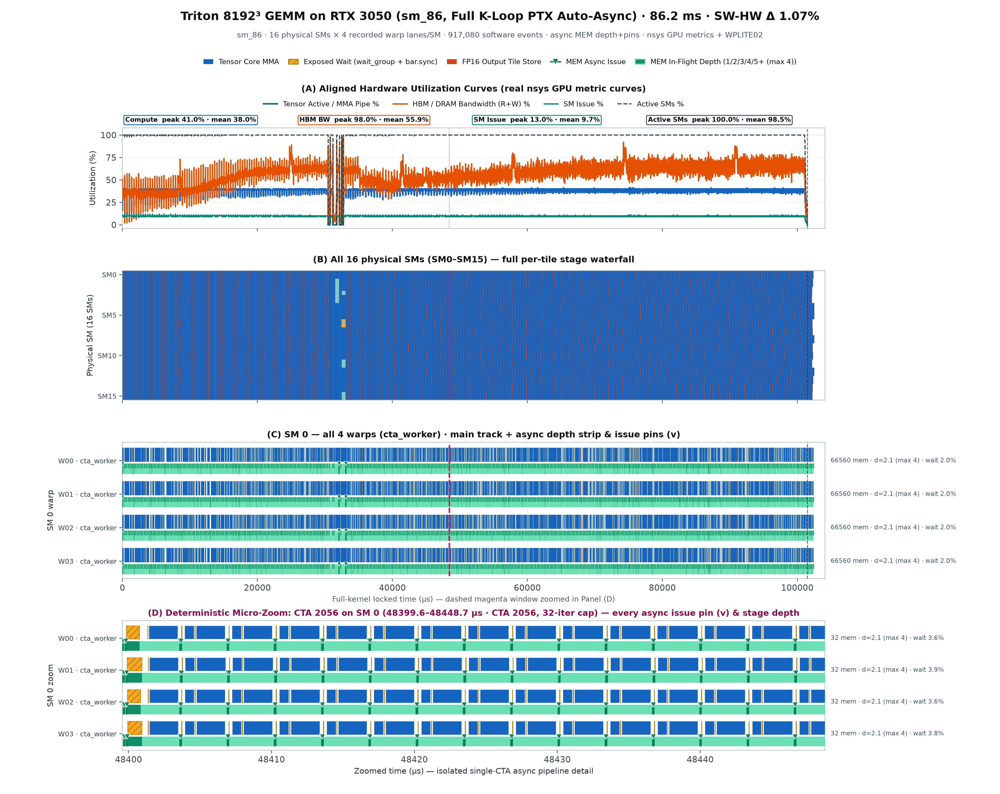

# Case Study: Cold-Start DRAM Ramp, Windows WDDM Display Preemption & Full K-Loop PTX Auto-Async Micro-Zoom on an 8192³ Triton GEMM (RTX 3050 `sm_86`)

> **Takeaway**: When an `86–101 ms` `8192³` FP16 Triton GEMM runs on a Windows desktop/laptop GPU (WDDM driver, RTX 3050 `sm_86`, 16 SMs), WeaveProfiler's locked microsecond SW+HW alignment simultaneously exposes (1) cold-start GDDR6 DRAM bandwidth ramp (`0–25 ms`), (2) Windows Desktop Window Manager (DWM) context preemption cliffs (`Active SMs → 0%`) aligned to the exact microsecond with stretched per-SM software spans, and (3) full K-loop `cp.async` pipelining (`d=2.1`, max `4`, exposed wait `3.6–3.9%`) in Panel (D) via `triton_ptx_async_hook`—with `0` overflow across `25.46M` raw records (`16,384 / 16,384` warp lanes) and `SW-HW Δ = 1.07%`.

## What the Aligned Four-Panel View Reveals

1. **Panel (A) — Cold-Start Local DRAM Bandwidth Ramp (`0–25 ms`) & WDDM Preemption Cliffs (`t ≈ 30–33 ms`)**:
   - **Cold-start DRAM ramp (`0 → ~25 ms`)**: `HBM / DRAM BW %` (local **GDDR6** on consumer RTX 3050) starts near `~25–30%` and climbs steadily toward `~70%` (peaking at `98.0%`) over the first `~25 ms`, while `Tensor Active %` holds steady at `~38–41%`. This is a classic **insufficient-warmup / cold-start signature** on a desktop/laptop GPU exiting low-power P-states (DVFS MCLK/SM boost stabilization + cold TLB / `2 MB` L2 across the `384 MB` working set).
   - **WDDM display preemption cliffs (`t ≈ 30–33 ms`)**: Two sharp vertical cliffs drop **all four hardware curves (`Active SMs %`, `Tensor Active %`, `HBM/DRAM BW %`, `SM Issue %`) simultaneously to `0%` for `~1 ms`** as the OS display compositor temporarily preempts the GPU.

2. **Panel (B) — Exact Microsecond Correspondence Across All 16 SMs (`SM0–SM15`)**:
   - Looking straight down from Panel (A)'s `t ≈ 30–33 ms` `0%` cliffs into Panel (B)'s 16-SM waterfall, SMs caught inside `cp.async` / `wait_group` at the moment of preemption (`SM1–SM3`, `SM6`, `SM11`, `SM15`) exhibit stretched green (`cp.async`) and amber (`wait`) blocks aligned to the exact microsecond of the WDDM context switch.

3. **Panels (C) & (D) — Continuous Full K-Loop `cp.async` Pipeline & Deterministic Single-CTA Micro-Zoom (`CTA 2056 on SM 0`)**:
   - Unlike naive `k=0` loop peeling (which leaves 99% of the K-loop blank), enabling `triton_ptx_async_hook` instruments every `cp.async` commit/wait and MMA cluster directly in PTX with zero Python K-loop edits (`66,560` async MEM issues on `SM 0`).
   - Panel (D) zooms deterministically into steady-state `CTA 2056` (`48399.6–48448.7 µs`, `32-iter` cap), clearly resolving all 4 warps' prologue 4-deep `cp.async` fill (`max 4`), initial `~1 µs` hatched amber prologue wait, and steady-state `d=2.1` pipelined `cp.async` depth strip interleaved with blue `Tensor Core MMA` clusters and razor-thin `3.6–3.9%` `Exposed Wait` bars.

4. **Practical Lessons Encoded Back into WeaveProfiler**:
   - **Never peel `k=0` outside a Triton K-loop**: Always use `triton_ptx_async_hook` on NVIDIA Triton for full K-loop async pipeline visibility without breaking Triton's software pipeliner.
   - **Panel (D) minimum-event gate**: `weaveprof/viz.py` requires `>= 6` per-warp events inside a CTA before zooming into a single CTA, falling back to a multi-CTA wave window (`>= 12` events) on outer-only traces.
   - **Desktop GPU warmup & scoped capture**: Always warm up GPU clocks/L2 before `cudaProfilerStart`, scope `nsys profile` with `--capture-range=cudaProfilerApi`, and account for WDDM/WSL2 `~1%` QPC vs `%globaltimer` drift on consumer Windows GPUs.
